# About this manual

This manual goes with a two-day, hands-on tutorial on **ROOT**, the data-analysis
framework developed at CERN. It is written for complete beginners: you do not need to
know ROOT, and you only need a little programming experience.

Everything that we do in the tutorial is written here, step by step. Every example
has been run, and every plot you see in this manual was made by the example code next
to it. You can therefore use the manual in three ways:

1. **Before the tutorial** — install ROOT (Chapter 1) and read Chapter 2.
2. **During the tutorial** — follow along, run the examples, and do the exercises.
3. **After the tutorial** — as a reference when you start your own analysis.

## Before you come

Please do these three things **before Day 1**. Installing software takes time, and
we want to spend the tutorial on ROOT, not on installation problems.

1. Install ROOT on your laptop, following **Chapter 1**.
2. Download the tutorial files and run the two check scripts in
   `macros/ch01_install` (Section 1.9). If both print
   `Everything is fine. You are ready for the tutorial.`, you are ready.
3. Read **Chapter 2** (First steps). It is short.

If something does not work, write to the organisers before the tutorial
and include the error message you see.

## The two days at a glance

| Time          | Day 1: ROOT basics                    | Day 2: Working with data                   |
|---------------|----------------------------------------|---------------------------------------------|
| 09:30 – 10:00 | Welcome, what is ROOT                  | **Ch. 6** ROOT files                         |
| 10:00 – 11:00 | **Ch. 2** The prompt and macros        | **Ch. 7** Trees (TTree)                      |
| 11:00 – 11:15 | *Break*                                | *Break*                                     |
| 11:15 – 12:45 | **Ch. 3** Histograms                   | **Ch. 7** Trees (cont.), **Ch. 8** PyROOT    |
| 12:45 – 13:45 | *Lunch*                                | *Lunch*                                     |
| 13:45 – 15:00 | **Ch. 4** Graphs and functions         | **Ch. 9** RDataFrame                         |
| 15:00 – 15:15 | *Break*                                | *Break*                                     |
| 15:15 – 16:45 | **Ch. 5** Fitting                      | **Ch. 10** Mini-project                      |
| 16:45 – 17:15 | Recap and questions                    | Results, wrap-up, feedback                   |

Each session starts with a short demonstration (about 20 minutes). The rest of the
time you work on the examples and exercises yourself, with helpers around you.

## How to read this manual

**Code you type into a file** is shown in a box with colours, with the file name in
the first comment line:

```cpp
// hello.C -- your first ROOT macro
void hello()
{
   std::cout << "Hello!" << std::endl;
}
```

**Commands you type in a terminal** (a Linux/macOS terminal, or the Ubuntu window
on Windows) look like this:

```bash
root -l hello.C
```

**What the computer prints back** is shown in a grey box:

```text
Processing hello.C...
Hello!
```

**Lines typed at the ROOT prompt** start with `root [0]`, `root [1]`, ... You type only
the part after the prompt:

```text
root [0] sqrt(2)
(double) 1.4142136
```

> **Tip:** Boxes like this one contain tips, warnings and short explanations. They are
> worth reading — most of them describe a mistake that beginners make very often.

## The tutorial files

All examples and exercise solutions are in the folder `root-tutorial`, which you get
from the organisers. It looks like this:

```text
root-tutorial/
├── ROOT_Tutorial_Manual.pdf     this manual
├── macros/                      all examples, one folder per chapter
│   ├── ch01_install/            installation check
│   ├── ch02_first_steps/
│   ├── ch03_histograms/
│   ├── ch04_graphs_functions/
│   ├── ch05_fitting/
│   ├── ch06_files/
│   ├── ch07_trees/
│   ├── ch08_pyroot/
│   ├── ch09_rdataframe/
│   └── ch10_project/
└── solutions/                   solutions to the exercises
```

Always run an example **from inside its own folder**. Some examples read a file that
is in the same folder, and they will not find it if you start them from somewhere else:

```bash
cd root-tutorial/macros/ch03_histograms
root -l hist_basic.C
```

> **Tip:** Some examples use files made by earlier examples. Chapter 7 writes
> `toy_tree.root`, and Chapters 8 and 9 read it. If an example says that a file
> does not exist, run the example that makes it first. Each example says at the
> top which file it needs.

# 1 Installing ROOT

## 1.1 What is ROOT?

ROOT is a free, open-source software framework for data analysis. It was created at
CERN and is used by almost every experiment in particle and nuclear physics,
including all the LHC experiments (ALICE, ATLAS, CMS and LHCb). With ROOT you can:

- make **histograms** and **graphs**, and draw publication-quality plots;
- **fit** functions to data and get the parameters with their errors;
- **store** very large amounts of data (billions of collision events) in ROOT files;
- **analyse** those data quickly, on one laptop or on many computers at once.

You can use ROOT in two languages:

- **C++** — ROOT includes a C++ *interpreter* called Cling, so you can type C++
  commands and run C++ files (called *macros*) without compiling them first.
- **Python** — the same ROOT classes are available in Python through **PyROOT**.

On Day 1 we use C++ macros; on Day 2 we also use Python. You do not need to be an
expert in either language — Section 2.6 explains the little C++ you need.

This manual was written for **ROOT 6.40**. The latest stable release when it was
written is **ROOT 6.40.04** (27 August 2026). Any ROOT 6.36 or newer will work for
almost everything here.

## 1.2 Which installation method should I use?

There are many ways to install ROOT. For this tutorial we recommend the following:

| Your computer        | Recommended method                                  | Section |
|----------------------|-----------------------------------------------------|---------|
| Linux (any)          | **conda** (Miniforge)                               | 1.3     |
| macOS                | **conda** (Miniforge), or **Homebrew**              | 1.3, 1.5 |
| Windows 10 / 11      | **WSL** (Linux inside Windows), then conda          | 1.6     |
| No admin rights, or nothing works | Docker, or a CERN computer (lxplus/SWAN) | 1.7, 1.8 |

Why conda? It works the same way on Linux and macOS, it does not need administrator
rights, it installs ROOT together with a matching Python and Jupyter, and it does not
interfere with anything else on your computer. If all participants use the same
method, helpers can also fix problems faster.

> **Disk space and time:** a conda installation of ROOT needs about 2–3 GB of disk
> space and 10–20 minutes on a good internet connection. Please do it at home, not at
> the venue.

## 1.3 Linux and macOS: conda (recommended)

**Step 1 — Install Miniforge.** Miniforge is a small installer for conda that uses the
community package collection *conda-forge*, where ROOT lives. Open a terminal and type:

```bash
curl -L -O "https://github.com/conda-forge/miniforge/releases/latest/download/Miniforge3-$(uname)-$(uname -m).sh"
bash Miniforge3-$(uname)-$(uname -m).sh
```

The installer asks a few questions. Press Enter to read the licence, type `yes` to
accept it, press Enter to accept the default install location, and type `yes` when it
asks whether to initialise conda. Then **close the terminal and open a new one**.

> **Already have Anaconda or Miniconda?** You can use it instead of Miniforge.
> Skip Step 1 and go to Step 2.

**Step 2 — Create an environment with ROOT.** An *environment* is a separate folder
with its own set of programs. We make one called `root-tutorial` with ROOT, Jupyter
and NumPy in it:

```bash
conda config --set channel_priority strict
conda create -c conda-forge --name root-tutorial root jupyterlab numpy
```

conda shows a list of packages and asks `Proceed ([y]/n)?`. Type `y`. The download
takes a while.

> **Note:** The first command (`channel_priority strict`) is recommended by the ROOT
> team; without it you can get conflicts between packages on some systems.

**Step 3 — Activate the environment.**

```bash
conda activate root-tutorial
```

Your prompt now starts with `(root-tutorial)`. **You must do this in every new
terminal** before you use ROOT. To check that ROOT is there:

```bash
root-config --version
```

```text
6.40.04
```

Now go to Section 1.9 to test your installation.

## 1.4 Linux: other methods

You only need these if you do not want to use conda.

**Package managers.** Several Linux distributions have ROOT packages. They are made by
the community, not by the ROOT team, and are sometimes an older version:

```bash
# Fedora (the second line adds Python and Jupyter support)
sudo dnf install root
sudo dnf install root python3-root root-notebook

# Arch Linux
sudo pacman -S root

# Gentoo
sudo emerge sci-physics/root
```

**Ubuntu snap.** On Ubuntu (and other distributions with *snap*):

```bash
sudo snap install root-framework
snap run root-framework
```

The snap has its own Python. To use ROOT from Python, start Python with the command
`pyroot` instead of `python`.

> **Ubuntu and Debian** do not have an official ROOT package (`apt install root`
> does not work). The ROOT team says one is being prepared. Until then, use conda,
> the snap, or the pre-compiled binary below.

**Pre-compiled binary.** The ROOT team provides ready-made packages for several Linux
versions. For Ubuntu 24.04:

```bash
# 1. Install the system libraries that ROOT needs
sudo apt install binutils cmake dpkg-dev g++ gcc libssl-dev git libx11-dev \
    libxext-dev libxft-dev libxpm-dev python3 libtbb-dev libvdt-dev libgif-dev

# 2. Download and unpack ROOT (about 400 MB)
wget https://root.cern/download/root_v6.40.04.Linux-ubuntu24.04-x86_64-gcc13.3.tar.gz
tar -xzf root_v6.40.04.Linux-ubuntu24.04-x86_64-gcc13.3.tar.gz

# 3. Set up the environment (this creates the "root" command)
source root/bin/thisroot.sh
```

For Ubuntu 22.04 the file is `root_v6.40.04.Linux-ubuntu22.04-x86_64-gcc11.4.tar.gz`.
Files for other distributions (AlmaLinux, Debian, Fedora, Ubuntu 26.04) are listed on
the release page: <https://root.cern/releases/release-64004/>.

Step 3 must be repeated in every new terminal. To do it automatically, add it to the
end of your `~/.bashrc` file, with the full path:

```bash
echo 'source $HOME/root/bin/thisroot.sh' >> ~/.bashrc
```

## 1.5 macOS: Homebrew

If you already use Homebrew (<https://brew.sh>), this is the quickest way:

```bash
xcode-select --install     # Apple command-line tools, if not yet installed
brew install root
```

Check it:

```bash
root-config --version
```

> **Python with Homebrew ROOT.** Homebrew's ROOT works only with *one* Python
> version: the one it was built with. Ask ROOT which one:
>
> ```bash
> root-config --python-version
> ```
>
> If it prints `3.14.7`, use Python 3.14. Homebrew installs it, but it may not be the
> `python3` you get by default. Run it with its full path:
>
> ```bash
> $(brew --prefix python@3.14)/bin/python3.14 check_pyroot.py
> ```
>
> If you use a different Python, `import ROOT` fails with
> `ROOT was built for Python 3.14.7, but you are running Python 3.9.6`.
> For Jupyter notebooks with Homebrew ROOT, conda (Section 1.3) is simpler.

## 1.6 Windows: WSL (recommended)

ROOT is mainly developed for Linux and macOS. On Windows, the easiest way is
**WSL** (*Windows Subsystem for Linux*). It runs a real Ubuntu Linux inside Windows,
and ROOT windows open on your Windows desktop like normal windows.

**Step 1 — Install WSL and Ubuntu.** Open **PowerShell as Administrator** (right-click
the Start button → *Terminal (Admin)* or *Windows PowerShell (Admin)*) and type:

```text
wsl --install
```

Restart the computer when asked. After the restart an **Ubuntu** window opens and
asks you to choose a Linux user name and password. Remember the password — Linux asks
for it when you install things with `sudo`.

**Step 2 — Install ROOT inside Ubuntu.** In the Ubuntu window, follow the conda
instructions of Section 1.3 exactly. They are the same as for Linux.

**Step 3 — Install a small package for graphics** (in the Ubuntu window):

```bash
sudo apt update
sudo apt install libgl1 libglu1-mesa
```

From now on, open the **Ubuntu** app from the Start menu whenever you want to use
ROOT, and type `conda activate root-tutorial`.

> **Where are my Windows files?** Inside Ubuntu, your Windows `C:` drive is at
> `/mnt/c`. For example, your Windows Downloads folder is
> `/mnt/c/Users/<your Windows name>/Downloads`. ROOT runs faster on files inside the
> Linux home folder, so copy the tutorial files there:
>
> ```bash
> cp -r /mnt/c/Users/<your Windows name>/Downloads/root-tutorial ~/
> cd ~/root-tutorial
> ```

> **No windows appear?** Windows 11 shows Linux windows out of the box. On Windows 10,
> first update WSL with `wsl --update` (in PowerShell). If plots still do not appear,
> you can still do the whole tutorial: every example also saves its plot as a PNG
> file, which you can open from Windows.

### Native Windows installer (alternative)

ROOT also has a native Windows version. On the install page it is still marked as a
*beta*, and it needs a matching Visual Studio, so we recommend WSL. If you still want it:

1. Install **Visual Studio** (the free *Community* edition is fine). In the Visual
   Studio Installer, select the workload **"Desktop development with C++"**.
   You need the same Visual Studio version that ROOT was built with: the `vc18` in the
   file name below. The release page says which version this is.
2. If you want PyROOT, install **Python 3.14** (64-bit) from <https://www.python.org>.
   The `python314` in the file name means that ROOT needs exactly this Python version.
3. Download and run the installer
   `root_v6.40.04.win64.python314.vc18.exe` from
   <https://root.cern/releases/release-64004/>. It sets up everything for you.
4. Start ROOT by double-clicking its icon, or from the
   **x64 Native Tools Command Prompt for VS** (in the Start menu):

```text
cd %USERPROFILE%
root
```

> **Avoid spaces in folder names on Windows.** Do not unpack or install ROOT in a
> folder whose name contains a space (like `C:\Program Files`), and keep your own
> macros in folders without spaces too.

## 1.7 Docker

If you know Docker, the ROOT team provides ready-made images:

```bash
docker run -it rootproject/root:latest
```

To work on files in your current folder, mount it into the container:

```bash
docker run -it -v "$PWD":/work -w /work rootproject/root:latest
```

Graphics windows do not open from Docker without extra setup, but the examples in this
manual all save their plots as PNG files, so you can follow the tutorial this way.

## 1.8 If you have a CERN account

- **lxplus**: log in with `ssh -X <username>@lxplus.cern.ch` and type `root`. The
  latest stable ROOT is installed there.
- **SWAN** (<https://swan.cern.ch>): Jupyter notebooks with ROOT, in your web browser.
  Nothing to install.

## 1.9 Test your installation

Download the tutorial files and go to the installation-check folder. (On conda,
activate the environment first.)

```bash
conda activate root-tutorial          # only if you use conda
cd root-tutorial/macros/ch01_install
```

**Test 1 — ROOT with C++.** The file `check_root.C`:

```cpp
// check_root.C -- check that ROOT works on your computer
// Run with:   root -l check_root.C
// If it works you will see a plot, and check_root.png appears in this folder.

void check_root()
{
   std::cout << "ROOT version: " << gROOT->GetVersion() << std::endl;

   auto h = new TH1D("h", "ROOT works!;x;Entries", 40, -4, 4);
   h->FillRandom("gaus", 5000);

   auto c = new TCanvas("c", "Installation check", 800, 600);
   h->SetFillColor(kGreen - 9);
   h->Draw();
   c->SaveAs("check_root.png");

   std::cout << "Everything is fine. You are ready for the tutorial." << std::endl;
}
```

Run it:

```bash
root -l check_root.C
```

A window with a histogram opens, and the terminal prints:

```text
Processing check_root.C...
ROOT version: 6.40.04
Everything is fine. You are ready for the tutorial.
```


The ROOT prompt `root [1]` is now waiting for you. Type `.q` and press Enter to quit.

**Test 2 — ROOT with Python (PyROOT).** The file `check_pyroot.py`:

```python
# check_pyroot.py -- check that ROOT works from Python (PyROOT)
# Run with:   python check_pyroot.py
import sys
print("Python version:", sys.version.split()[0])

import ROOT
print("ROOT version  :", ROOT.gROOT.GetVersion())

try:
    import numpy
    print("NumPy version :", numpy.__version__)
except ImportError:
    print("NumPy is missing (needed only for Chapter 8 and 9 extras)")

h = ROOT.TH1D("h", "PyROOT works!;x;Entries", 40, -4, 4)
h.FillRandom("gaus", 5000)
print("Histogram mean:", round(h.GetMean(), 3))
print("Everything is fine. You are ready for the tutorial.")
```

Run it:

```bash
python check_pyroot.py
```

You should see something like:

```text
Python version: 3.14.7
ROOT version  : 6.40.04
NumPy version : 2.5.2
Histogram mean: 0.008
Everything is fine. You are ready for the tutorial.
```

If both tests print `Everything is fine`, you are ready. Well done!

## 1.10 A text editor

You write macros in a text editor (not in Word!). Any of these is fine:

- **Visual Studio Code** (<https://code.visualstudio.com>), free, for all systems.
  Install the *C/C++* and *Python* extensions. With WSL, install the *WSL* extension
  too, then type `code .` in the Ubuntu window to open the current folder.
- Any editor you already like: gedit, Kate, nano, vim, emacs, Sublime Text, ...

## 1.11 Installation problems

| What you see | What it means and what to do |
|---|---|
| `root: command not found` | ROOT is not set up in this terminal. With conda: `conda activate root-tutorial`. With a binary: `source root/bin/thisroot.sh`. |
| `conda: command not found` | Close the terminal and open a new one after installing Miniforge. If it still fails, run the installer again and answer `yes` to "initialise conda". |
| `ModuleNotFoundError: No module named 'ROOT'` | You run a Python that does not know about ROOT. With conda: activate the environment. With Homebrew: use the Python of Section 1.5. |
| `ROOT was built for Python 3.14.7, but you are running Python 3.9.6` | Same as above: use the Python version that ROOT was built with. |
| The ROOT window never appears | On WSL see Section 1.6; over `ssh` use `ssh -X`. The PNG files are still made, so you can continue. |
| conda takes forever to "solve" | Make sure you ran `conda config --set channel_priority strict` and use Miniforge. |

If you are stuck, write to the organisers **before** the tutorial with: your operating
system, the method you used, the exact command you typed, and the full error message.

# 2 First steps: the ROOT prompt and macros

In this chapter you start ROOT, use it as a calculator, write your first *macro* (a
small program), and make your first plot. You will also learn the small amount of C++
that you need for the rest of the tutorial.

Examples for this chapter are in `macros/ch02_first_steps`.

## 2.1 Starting and quitting ROOT

Open a terminal (remember `conda activate root-tutorial` if you use conda) and type:

```bash
root -l
```

The `-l` option means "do not show the welcome banner". You now see the ROOT prompt:

```text
root [0]
```

ROOT is waiting for a command. The number in brackets counts your commands.
Commands that start with a dot are special ROOT commands. The most important ones:

| Command        | What it does                                   |
|----------------|------------------------------------------------|
| `.q`           | quit ROOT                                      |
| `.x file.C`    | run (execute) the macro `file.C`               |
| `.L file.C`    | load the macro `file.C` without running it     |
| `.ls`          | list the objects in the current folder/file    |
| `.!` *command* | run a shell command, e.g. `.! ls`              |
| `.help`        | list all dot commands                          |

Two keyboard tricks save a lot of typing:

- **Up / Down arrows** bring back your previous commands.
- **Tab** completes names. Type `TMath::Si` and press Tab to see all functions that
  start with `Si`. After an object, `h->Get` + Tab lists all its methods that start
  with `Get`.

## 2.2 ROOT as a calculator

At the prompt you can type any C++ expression and ROOT prints the result, with its
type in brackets:

```text
root [0] 1 + 2
(int) 3
root [1] sqrt(2)
(double) 1.4142136
root [2] TMath::Pi()
(double) 3.1415927
root [3] double r = 2.5
(double) 2.5000000
root [4] TMath::Pi() * r * r
(double) 19.634954
root [5] int a = 7, b = 2
(int) 2
root [6] a / b
(int) 3
```

Look at the last line: 7 / 2 gives **3**, not 3.5! When both numbers are integers
(`int`), C++ does *integer division* and throws away the fraction. Write `7.0 / 2` or
`a / 2.0` to get 3.5. This is one of the most common mistakes in C++.

> **Tip:** If you end a line with a semicolon `;`, ROOT does not print the result.
> This is useful for long calculations: `double x = 3.0;`

`TMath` contains many mathematical functions and constants: `TMath::Pi()`,
`TMath::Exp(x)`, `TMath::Gaus(x, mean, sigma)`, `TMath::Prob(chi2, ndf)`, and the
normal C/C++ functions `sqrt`, `pow`, `exp`, `log`, `sin`, `cos`, `atan2` all work too.

## 2.3 Your first macro

Typing everything at the prompt is fine for quick tests, but for real work you write
your commands in a file, called a **macro**. Create a file `hello.C` in a text editor:

```cpp
// hello.C -- your first ROOT macro
// Run it from a terminal with:   root -l hello.C
// The function name (hello) must be the same as the file name (hello.C).

void hello()
{
   std::cout << "Hello from ROOT " << gROOT->GetVersion() << "!" << std::endl;

   for (int i = 1; i <= 5; i++) {
      std::cout << i << " squared is " << i * i << std::endl;
   }
}
```

There are three ways to run it. From the terminal:

```bash
root -l hello.C
```

From the ROOT prompt:

```text
root [0] .x hello.C
```

Or from the terminal, quitting ROOT automatically at the end (`-q`):

```bash
root -l -q hello.C
```

In all cases you see:

```text
Processing hello.C...
Hello from ROOT 6.40.04!
1 squared is 1
2 squared is 4
3 squared is 9
4 squared is 16
5 squared is 25
```

> **The golden rule of macros:** the file `hello.C` must contain a function called
> `hello()`. ROOT runs the function that has the **same name as the file**. If the names
> do not match, ROOT only prints a warning and does not run anything:
>
> ```text
> warning: Failed to call `hello()` to execute the macro.
> Add this function or rename the macro. Falling back to `.L`.
> ```

The useful command-line options are:

| Option | Meaning |
|--------|---------|
| `-l`   | no welcome banner |
| `-q`   | quit after running the macros |
| `-b`   | *batch mode*: no graphics windows (plots are still saved to files) — useful on remote computers and for long jobs |

You can combine them: `root -l -b -q hello.C`.

## 2.4 Macros with arguments

A macro function can take arguments, with default values:

```cpp
// squares.C -- a macro that takes an argument
// Run with the default value:   root -l squares.C
// Run with your own value:      root -l 'squares.C(3)'

void squares(int n = 10)
{
   for (int i = 1; i <= n; i++) {
      std::cout << i << "^2 = " << i * i << std::endl;
   }
}
```

```bash
root -l -q squares.C          # uses the default n = 10
root -l -q 'squares.C(3)'     # n = 3; note the quotes around the whole thing
```

From the ROOT prompt: `.x squares.C(3)`. With `n = 10` the output is:

```text
Processing squares.C...
1^2 = 1
2^2 = 4
3^2 = 9
4^2 = 16
5^2 = 25
6^2 = 36
7^2 = 49
8^2 = 64
9^2 = 81
10^2 = 100
```

> **Why the quotes?** Without them, the terminal tries to understand the brackets
> itself and gives an error. Strings inside need double quotes, so use single quotes
> outside: `root -l 'myMacro.C("data.root", 5)'`.

## 2.5 Loading macros and unnamed macros

`.L` loads a macro without running it. After that, you can call its functions as often
as you like:

```text
root [0] .L squares.C
root [1] squares(2)
1^2 = 1
2^2 = 4
root [2] squares(4)
1^2 = 1
2^2 = 4
3^2 = 9
4^2 = 16
```

A file can contain several functions; after `.L` all of them are available.

There is also a second kind of macro, the **unnamed macro**: just a block of code
inside `{ }`, with no function name:

```cpp
// unnamed.C -- an "unnamed" macro: just a block of code in { }
// Run with:   root -l unnamed.C
{
   double x = 3.0;
   std::cout << "x       = " << x << std::endl;
   std::cout << "sqrt(x) = " << sqrt(x) << std::endl;
   std::cout << "x^3     = " << pow(x, 3) << std::endl;
}
```

```text
Processing unnamed.C...
x       = 3
sqrt(x) = 1.73205
x^3     = 27
```

Unnamed macros are handy for quick tests, but they cannot take arguments and cannot
be compiled. In this tutorial we use named macros.

## 2.6 The C++ you need for ROOT

You do not need to be a C++ expert to use ROOT. This macro shows almost everything
we use in the tutorial:

```cpp
// cpp_basics.C -- the small amount of C++ you need for ROOT
// Run with:   root -l cpp_basics.C

// A helper function: takes a number, returns a number
double kineticEnergy(double mass, double speed)
{
   return 0.5 * mass * speed * speed;
}

void cpp_basics()
{
   // 1. Variables have a type
   int    nEvents = 1000;        // whole numbers
   double energy  = 13.6;        // real numbers
   bool   isGood  = true;        // true / false
   TString name   = "electron";  // text (ROOT's string class)

   std::cout << name << ": E = " << energy << " eV, N = " << nEvents
             << ", good = " << isGood << std::endl;

   // 2. Careful: integer division throws away the fraction!
   std::cout << "1/2   = " << 1 / 2   << "   (integer division)" << std::endl;
   std::cout << "1./2  = " << 1. / 2  << " (real division)"     << std::endl;

   // 3. if / else
   if (energy > 10) {
      std::cout << "High energy" << std::endl;
   } else {
      std::cout << "Low energy" << std::endl;
   }

   // 4. for loop
   double sum = 0;
   for (int i = 1; i <= 100; i++) {
      sum += i;
   }
   std::cout << "Sum of 1..100 = " << sum << std::endl;

   // 5. Arrays and vectors
   double masses[3] = {0.000511, 0.10566, 1.77686};   // e, mu, tau in GeV
   std::vector<TString> names = {"e", "mu", "tau"};
   for (int i = 0; i < 3; i++) {
      std::cout << names[i] << " mass = " << masses[i] << " GeV" << std::endl;
   }

   // 6. Calling a function
   std::cout << "Kinetic energy = " << kineticEnergy(2.0, 3.0) << " J" << std::endl;

   // 7. Objects and pointers: "new" creates an object that lives on after
   //    the macro ends; "->" calls a function (method) of the object
   auto h = new TH1D("h", "Example", 10, 0, 10);
   h->Fill(3.5);
   std::cout << "Histogram entries: " << h->GetEntries() << std::endl;
}
```

Output:

```text
Processing cpp_basics.C...
electron: E = 13.6 eV, N = 1000, good = 1
1/2   = 0   (integer division)
1./2  = 0.5 (real division)
High energy
Sum of 1..100 = 5050
e mass = 0.000511 GeV
mu mass = 0.10566 GeV
tau mass = 1.77686 GeV
Kinetic energy = 9 J
Histogram entries: 1
```

The important points:

1. **Every variable has a type**: `int` (whole number), `double` (real number),
   `bool` (true/false), `TString` or `std::string` (text). In ROOT you often also see
   `Int_t`, `Double_t`, `Float_t`, ... which are the same types with ROOT names.
2. **Statements end with a semicolon** `;`. Blocks of code are inside `{ }`.
3. **Integer division**: `1/2` is `0`. Use `1./2` or `1.0/2`.
4. **Loops**: `for (int i = 0; i < n; i++) { ... }` runs the block for i = 0, 1, ..., n-1.
5. **Arrays start at index 0**: the first element of `masses` is `masses[0]`.
6. **Objects and pointers.** ROOT is built of *classes* (`TH1D`, `TF1`, `TCanvas`, ...).
   `new TH1D(...)` creates an object and gives you a *pointer* to it. You call the
   object's functions (*methods*) with an arrow: `h->Fill(3.5)`. `auto` lets C++ work
   out the type for you: `auto h = new TH1D(...)` is the same as
   `TH1D *h = new TH1D(...)`.
7. **Comments** start with `//` and go to the end of the line.

> **Why `new`?** An object made with `new` lives until you delete it, so a histogram or
> canvas made with `new` is still there after the macro has finished, and you can keep
> looking at it and working with it. An object made without `new`
> (`TH1D h("h", ...)`) is deleted when the macro ends, and its plot disappears from the
> screen. **For histograms, graphs, functions and canvases, always use `new` in macros.**

## 2.7 Your first plot

```cpp
// first_plot.C -- draw a mathematical function and save it as a picture
// Run with:   root -l first_plot.C

void first_plot()
{
   // A canvas is the window you draw on: name, title, width, height (pixels)
   auto c = new TCanvas("c", "My first plot", 800, 600);

   // A 1D function: name, formula, x-min, x-max
   auto f = new TF1("f", "sin(x)/x", -10, 10);

   // Title and axis titles in one string, separated by ';'
   f->SetTitle("My first ROOT plot;x;sin(x)/x");
   f->SetLineColor(kBlue);
   f->SetLineWidth(3);
   f->Draw();

   c->SaveAs("first_plot.png");   // also try .pdf, .jpg, .svg, .root
}
```

```bash
root -l first_plot.C
```

```text
Processing first_plot.C...
Info in <TCanvas::Print>: png file first_plot.png has been created
```


Three objects work together here, and you will see them again and again:

- a **canvas** (`TCanvas`) — the window, or the page, that you draw on;
- the thing you draw — here a **function** (`TF1`);
- `Draw()`, which puts it on the current canvas.

The title string `"My first ROOT plot;x;sin(x)/x"` sets three things at once, separated
by semicolons: the plot title, the x-axis title, and the y-axis title. This works for
histograms and graphs too.

**The canvas is interactive.** Try this in the window that opened:

- Move the mouse over the curve or the axes: the status bar at the bottom shows what is
  under the mouse. (If you do not see it, use *View → Event Statusbar*.)
- **Zoom**: click on the x axis and drag along it. To zoom out again, right-click
  the axis and choose *UnZoom*.
- **Right-click** on any object (the curve, an axis, the title) to get a menu of
  everything you can do with it: change colour, line width, axis range, and more.
- *View → Editor* opens a side panel to change styles with the mouse.
- *File → Save* saves the canvas as PNG, PDF, and other formats.

## 2.8 Saving plots

`SaveAs` chooses the format from the file extension:

| Command | Result |
|---------|--------|
| `c->SaveAs("plot.png")` | picture (good for slides and web pages) |
| `c->SaveAs("plot.pdf")` | vector graphics: sharp at any size (best for papers and theses) |
| `c->SaveAs("plot.svg")` | vector graphics for web pages and editing |
| `c->SaveAs("plot.root")` | the canvas itself; open it later and keep editing |
| `c->SaveAs("plot.C")` | a macro that redraws the canvas |

## 2.9 Compiled macros

So far ROOT has *interpreted* our macros: it read and ran them line by line. You can
also ask ROOT to **compile** a macro into fast machine code first, by adding a `+`
after the name. This uses ROOT's built-in compiler tool, called **ACLiC**.

Compiled code runs much faster (important for loops over millions of events), and the
compiler finds more mistakes. But a compiled macro must be correct C++: it must
`#include` the header file of every class and function it uses, like any C++ program.

```cpp
// hello_compiled.C -- a macro that can also be COMPILED (ACLiC)
// Run interpreted:   root -l hello_compiled.C
// Run compiled:      root -l hello_compiled.C+      (note the + at the end)
//
// A compiled macro must #include the headers of everything it uses,
// exactly like a normal C++ program.
#include <iostream>
#include <cmath>
#include "TROOT.h"

void hello_compiled()
{
   std::cout << "Hello from ROOT " << gROOT->GetVersion() << "!" << std::endl;

   double sum = 0;
   for (int i = 1; i <= 10000000; i++) {
      sum += 1.0 / (double(i) * i);     // converges to pi^2 / 6
   }
   std::cout << "sqrt(6 * sum) = " << std::sqrt(6 * sum) << std::endl;
}
```

```bash
root -l -q hello_compiled.C+
```

```text
Processing hello_compiled.C+...
Info in <TMacOSXSystem::ACLiC>: creating shared library .../ch02_first_steps/./hello_compiled_C.so
Hello from ROOT 6.40.04!
sqrt(6 * sum) = 3.14159
```

ROOT made a library file `hello_compiled_C.so` (and a few other files) next to the
macro. The next time, it uses that file directly, unless you changed the macro. Use
`++` to force a fresh compilation.

If you try to compile `hello.C`, which has no `#include` lines, the compiler complains:

```text
././hello.C:10:12: error: no member named 'cout' in namespace 'std'
      std::cout << i << " squared is " << i * i << std::endl;
      ~~~~~^
```

The fix is to add `#include <iostream>` (for `std::cout`) and `#include "TROOT.h"`
(for `gROOT`) at the top. The header for a ROOT class is its name plus `.h`:
`TH1D.h`, `TCanvas.h`, `TF1.h`, ...

> **Tip:** In this tutorial you can always run macros the normal (interpreted) way.
> Compiling is something you will want later, for long analysis jobs.

## 2.10 The ROOT object browser

ROOT has a graphical **browser** to look at files, histograms and trees:

```text
root [0] new TBrowser
```

or, from the terminal, to open a particular file:

```bash
rootbrowse my_results.root
```

In recent ROOT versions the browser opens inside a web-browser window. Double-click
a ROOT file to open it, and double-click a histogram to draw it. If you prefer the
older look, start ROOT with `root --web=off`. We will use the browser in Chapter 6.

## 2.11 Getting help

- **Tab completion** at the prompt (Section 2.1) shows the methods of any object.
- **The reference guide** has a page for every class, with all methods and many
  examples: <https://root.cern/doc/master/>. Search for a class name, for example
  `TH1` (<https://root.cern/doc/master/classTH1.html>).
- **The ROOT manual**: <https://root.cern/manual/>.
- **The ROOT forum**: <https://root-forum.cern.ch>. Search it first: most beginner
  questions have already been answered.
- **ROOT's own tutorials**: hundreds of small examples. Find the folder with
  `root-config --tutdir`, or browse them online at
  <https://root.cern/doc/master/group__Tutorials.html>.

## Key points

- Start ROOT with `root -l`, quit with `.q`.
- A macro `name.C` must contain a function `name()`. Run it with `root -l name.C` or
  `.x name.C`.
- `-b` (no graphics) and `-q` (quit at the end) are useful for running macros in a script.
- Use `new` to create histograms, functions, graphs and canvases in macros.
- Watch out for integer division: `1/2 == 0`.
- `c->SaveAs("file.png")` or `"file.pdf"` saves your plot.

## Exercises

**Exercise 2.1 — A table.** Write a macro `table.C` that prints a table with three
columns: x, √x and ln(x), for x = 1, 2, ..., 10.
*Hint:* `printf("%4d %10.4f\n", i, value);` prints an integer in 4 characters and a real
number with 4 decimals in 10 characters. `log(x)` is the natural logarithm.

**Exercise 2.2 — Your own function plot.** Change `first_plot.C` so that it draws the
damped oscillation e^(−x/3) cos(x) for x from 0 to 15, as a red line, with the axis
titles "Time t (s)" and "Amplitude". Save it both as PNG and as PDF, and open the two
files to compare them (zoom in on the PDF!).
*Hint:* in a formula, write e^(−x/3) as `exp(-x/3)`.

Solutions are in Appendix A and in the folder `solutions/ch02`.

# 3 Histograms

The histogram is the most important object in data analysis. In this chapter you learn
to create, fill, draw, style and combine histograms, in one and two dimensions.

Examples for this chapter are in `macros/ch03_histograms`.

## 3.1 What is a histogram?

A histogram counts how many values fall into each of a set of intervals, called
**bins**. For example, if you measure the energy of 10 000 particles, a histogram with
100 bins from 0 to 100 GeV tells you how many particles had 0–1 GeV, how many had
1–2 GeV, and so on. The shape of the histogram shows the *distribution* of the values.

ROOT has histogram classes for 1, 2 and 3 dimensions. The last letter gives the type
used to store the bin contents:

| Class | Dimensions | Bin content stored as |
|-------|------------|-----------------------|
| `TH1D`, `TH1F`, `TH1I` | 1 | double, float, int |
| `TH2D`, `TH2F`         | 2 | double, float |
| `TH3D`, `TH3F`         | 3 | double, float |

Use `TH1D` (and `TH2D`) unless you have a reason not to.

## 3.2 Create, fill, draw

```cpp
// hist_basic.C -- create, fill, draw and save a 1D histogram
// Run with:   root -l hist_basic.C

void hist_basic()
{
   // 1. Create the histogram:
   //    name, "title;x-axis title;y-axis title", number of bins, x-min, x-max
   auto h = new TH1D("h", "Gaussian random numbers;x;Entries", 50, -5, 5);

   // 2. Fill it with 10000 random numbers from a Gaussian (mean 0, sigma 1)
   TRandom3 rng(42);                 // random-number generator, seed = 42
   for (int i = 0; i < 10000; i++) {
      h->Fill(rng.Gaus(0, 1));
   }

   // 3. Make it look nice, draw it and save the picture
   auto c = new TCanvas("c", "Histogram", 800, 600);
   h->SetLineColor(kBlue + 1);
   h->SetLineWidth(2);
   h->SetFillColor(kAzure - 9);
   h->Draw();
   c->SaveAs("hist_basic.png");

   // 4. Ask the histogram about itself
   std::cout << "Entries : " << h->GetEntries() << std::endl;
   std::cout << "Mean    : " << h->GetMean()    << std::endl;
   std::cout << "Std Dev : " << h->GetStdDev()  << std::endl;
   std::cout << "Bin with x = 1.0 is bin number " << h->FindBin(1.0)
             << ", it has " << h->GetBinContent(h->FindBin(1.0))
             << " entries" << std::endl;
}
```

```bash
root -l hist_basic.C
```

```text
Processing hist_basic.C...
Entries : 10000
Mean    : -0.000621535
Std Dev : 1.0171
Bin with x = 1.0 is bin number 30, it has 530 entries
```


Let us go through it.

**Creating.** `new TH1D("h", "Gaussian random numbers;x;Entries", 50, -5, 5)` takes:

1. a **name** (`"h"`) — ROOT uses it to find the object, for example in a file. Every
   histogram should have a different name;
2. the **titles**: plot title, x-axis title and y-axis title, separated by `;`;
3. the **number of bins** (50);
4. the **lower and upper edge** of the x axis (−5 and 5). Each bin is
   (5 − (−5)) / 50 = 0.2 wide.

**Filling.** `h->Fill(x)` adds 1 to the bin that contains `x`. `TRandom3` is ROOT's
random-number generator; `rng.Gaus(0, 1)` returns a random number from a Gaussian
distribution with mean 0 and standard deviation 1. The number in `TRandom3 rng(42)` is
the *seed*: the same seed always gives the same random numbers, so you get exactly the
same plot as in this manual.

**Drawing.** `Draw()` draws the histogram on the current canvas. The box in the top
right corner is the **statistics box**: the number of entries, the mean and the
standard deviation (*Std Dev*, often called RMS in ROOT) of the filled values.

## 3.3 Bins and their contents

The bins are numbered **from 1 to N** (here N = 50). Bin 0 is the *underflow* bin: it
counts values below the lower edge. Bin N+1 is the *overflow* bin: it counts values
above the upper edge. They are not drawn, but they are counted in the entries.

| Method | What it gives |
|--------|---------------|
| `h->GetNbinsX()` | number of bins N |
| `h->FindBin(x)` | number of the bin that contains `x` |
| `h->GetBinContent(i)` | content of bin `i` |
| `h->GetBinError(i)` | error of bin `i` (√content for a normal histogram) |
| `h->GetBinCenter(i)`, `h->GetBinLowEdge(i)`, `h->GetBinWidth(i)` | position of bin `i` |
| `h->SetBinContent(i, value)` | set the content of bin `i` yourself |
| `h->GetEntries()` | how many times `Fill` was called |
| `h->Integral()` | sum of the bin contents (without under/overflow) |
| `h->GetMean()`, `h->GetStdDev()` | mean and standard deviation |
| `h->GetMaximum()`, `h->GetMaximumBin()` | largest bin content, and which bin it is |

## 3.4 Draw options

`Draw` takes an *option* string that controls how the histogram looks:

```cpp
// hist_draw_options.C -- the same histogram drawn with four draw options
// Run with:   root -l hist_draw_options.C

void hist_draw_options()
{
   gStyle->SetOptStat(0);   // no statistics box, to keep the plots clean

   auto h = new TH1D("h", "Draw options;x;Entries", 20, -4, 4);
   TRandom3 rng(1);
   for (int i = 0; i < 2000; i++) h->Fill(rng.Gaus(0, 1));

   auto c = new TCanvas("c", "Draw options", 1000, 800);
   c->Divide(2, 2);        // split the canvas into 2 x 2 pads

   // DrawClone draws a copy, so changing the style later does not
   // change the plots we already made.
   c->cd(1);                                   // go to pad 1
   h->SetTitle("Option \"HIST\" (bars outline)");
   h->DrawClone("HIST");

   c->cd(2);
   h->SetTitle("Option \"E1\" (points with error bars)");
   h->SetMarkerStyle(20);
   h->DrawClone("E1");

   c->cd(3);
   h->SetTitle("Option \"BAR\" (filled bars)");
   h->SetFillColor(kOrange - 3);
   h->SetBarWidth(0.8);
   h->SetBarOffset(0.1);
   h->DrawClone("BAR");

   c->cd(4);
   h->SetTitle("Option \"C\" (smooth curve)");
   h->SetFillStyle(0);            // no fill for this one
   h->SetLineColor(kRed);
   h->SetLineWidth(3);
   h->DrawClone("C");

   c->SaveAs("hist_draw_options.png");
}
```

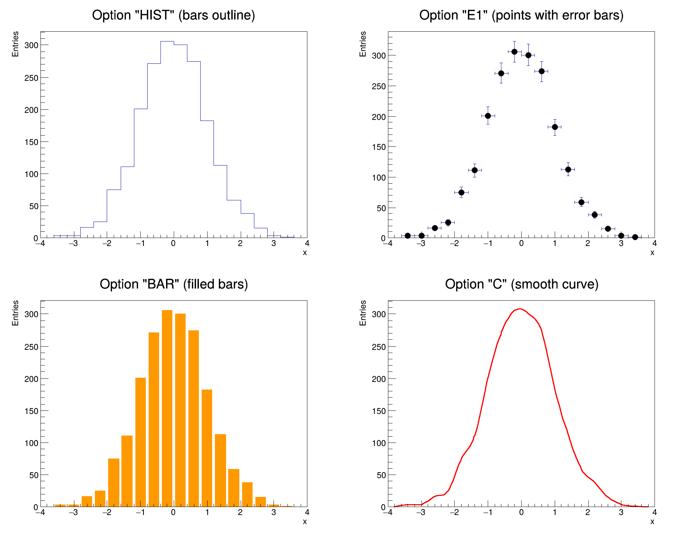

`c->Divide(2, 2)` splits the canvas into 2 × 2 *pads*, and `c->cd(1)` makes pad 1 the
current one, so the next `Draw` goes there. The most useful options:

| Option | Meaning |
|--------|---------|
| (none) or `HIST` | bars outline (with `HIST`, error bars are never drawn) |
| `E`, `E1` | points with error bars (`E1` adds small lines at the ends) |
| `P` | markers only |
| `L`, `C` | a line or a smooth curve through the bin contents |
| `BAR` | bars with gaps |
| `TEXT` | write the bin contents as numbers |
| `SAME` | draw on top of what is already on the pad (do not clear it) |

Options can be combined, for example `"E1 SAME"` or `"HIST TEXT"`. For 2D histograms
there are more options (Section 3.9). The full list is on the `THistPainter` page of the
reference guide: <https://root.cern/doc/master/classTHistPainter.html>.

## 3.5 Making plots look good

**Colours.** ROOT has named colours: `kBlack`, `kRed`, `kBlue`, `kGreen`, `kOrange`,
`kMagenta`, `kCyan`, `kAzure`, `kViolet`, `kPink`, `kGray`, ... Add or subtract a
number for lighter or darker shades: `kBlue + 1` is darker blue, `kAzure - 9` is a very
light blue. `SetFillColorAlpha(kRed, 0.2)` gives a transparent fill.

**Lines, fills and markers.**

| Method | Examples |
|--------|----------|
| `SetLineColor(c)`, `SetLineWidth(w)`, `SetLineStyle(s)` | style 1 = solid, 2 = dashed, 3 = dotted |
| `SetFillColor(c)`, `SetFillStyle(s)` | style 1001 = solid, 3004 = hatched, 0 = none |
| `SetMarkerStyle(m)`, `SetMarkerColor(c)`, `SetMarkerSize(s)` | 20 = filled circle, 21 = filled square, 24 = open circle |

**The statistics box.** `gStyle->SetOptStat(0)` hides it for all plots;
`h->SetStats(0)` hides it for one histogram. `gStyle->SetOptStat("emr")` shows only
entries (e), mean (m) and RMS/std dev (r). `gStyle` holds the global style settings.

**Axis ranges.** `h->SetMinimum(0)` and `h->SetMaximum(500)` fix the y range.
`h->GetXaxis()->SetRangeUser(-2, 2)` zooms the x axis. `gPad->SetLogy()` makes the
y axis logarithmic (useful for spectra that fall over many orders of magnitude).

**Text.** Titles and legends understand a LaTeX-like syntax, with `#` instead of `\`:
`#sigma`, `#mu`, `#pi`, `#sqrt{x}`, `x^{2}`, `p_{T}`, `#pm`, `#rightarrow`,
`#bar{p}`. For example, `"m_{#mu#mu} (GeV/c^{2})"` writes the letter m with the
subscript μμ, followed by (GeV/c²).

## 3.6 Several histograms on one plot

To compare two distributions, draw the second one with the `SAME` option and add a
legend:

```cpp
// hist_compare.C -- two histograms on one canvas, normalised, with a legend
// Run with:   root -l hist_compare.C

void hist_compare()
{
   gStyle->SetOptStat(0);           // hide the statistics box

   auto hNarrow = new TH1D("hNarrow", "Comparing two distributions;x;Probability", 60, -6, 8);
   auto hWide   = new TH1D("hWide",   "Wide", 60, -6, 8);

   TRandom3 rng(7);
   for (int i = 0; i < 10000; i++) hNarrow->Fill(rng.Gaus(0, 1));
   for (int i = 0; i < 5000;  i++) hWide->Fill(rng.Gaus(2, 2));

   // Normalise both to area 1, so we compare shapes (not number of entries)
   hNarrow->Scale(1.0 / hNarrow->Integral());
   hWide->Scale(1.0 / hWide->Integral());

   hNarrow->SetLineColor(kBlue);  hNarrow->SetLineWidth(2);
   hWide->SetLineColor(kRed);     hWide->SetLineWidth(2);
   hWide->SetFillColorAlpha(kRed, 0.2);       // transparent fill

   // The FIRST histogram drawn sets the axis range, so make room for both
   double ymax = std::max(hNarrow->GetMaximum(), hWide->GetMaximum());
   hNarrow->SetMaximum(1.2 * ymax);

   auto c = new TCanvas("c", "Compare", 800, 600);
   hNarrow->Draw("HIST");
   hWide->Draw("HIST SAME");                  // SAME = draw on top

   auto leg = new TLegend(0.62, 0.76, 0.88, 0.88);   // x1,y1,x2,y2 (fractions)
   leg->AddEntry(hNarrow, "#mu = 0, #sigma = 1", "l");
   leg->AddEntry(hWide,   "#mu = 2, #sigma = 2", "lf");
   leg->Draw();

   c->SaveAs("hist_compare.png");
}
```

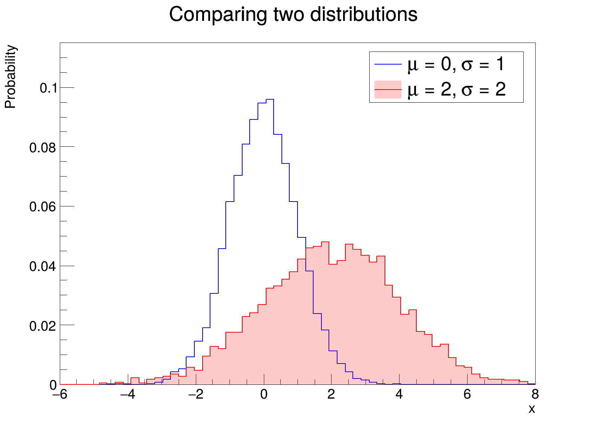

Three things to notice:

1. **Normalising.** The two histograms have 10 000 and 5 000 entries. To compare their
   *shapes*, we divide each one by its integral with `Scale(1.0 / h->Integral())`, so
   both have area 1.
2. **The first histogram drawn sets the y range.** If the second one is taller, its top
   is cut off. That is why we call `SetMaximum` on the first one, with some room to spare.
3. **The legend.** `new TLegend(x1, y1, x2, y2)` takes the corners as *fractions* of the
   pad (0 = left/bottom, 1 = right/top). The last argument of `AddEntry` says what to
   show next to the label: `"l"` line, `"f"` fill, `"p"` marker, `"e"` error bar,
   or combinations like `"lf"` and `"pe"`.

## 3.7 Histogram arithmetic

Histograms can be added, scaled, divided and rebinned. A typical example is an
**efficiency**: the fraction of particles that a detector sees, as a function of energy.

```cpp
// hist_operations.C -- adding, scaling, dividing and rebinning histograms
// Run with:   root -l hist_operations.C

void hist_operations()
{
   gStyle->SetOptStat(0);
   TRandom3 rng(11);

   // "All" particles and "detected" particles. The detector misses many
   // low-energy particles, so the detection probability depends on energy.
   auto hAll = new TH1D("hAll", "All particles;Energy (GeV);Particles", 20, 0, 10);
   auto hDet = new TH1D("hDet", "Detected particles;Energy (GeV);Particles", 20, 0, 10);
   hAll->Sumw2();   // keep track of errors properly (do this before filling)
   hDet->Sumw2();

   for (int i = 0; i < 20000; i++) {
      double E = rng.Uniform(0, 10);
      hAll->Fill(E);
      double probability = 1.0 - exp(-E / 2.0);   // the "true" efficiency
      if (rng.Uniform() < probability) hDet->Fill(E);
   }

   // Bin-by-bin information
   int bin = hAll->FindBin(5.2);
   std::cout << "Energy 5.2 GeV is in bin " << bin
             << " (from " << hAll->GetBinLowEdge(bin)
             << " to " << hAll->GetBinLowEdge(bin) + hAll->GetBinWidth(bin)
             << " GeV, centre " << hAll->GetBinCenter(bin) << ")" << std::endl;
   std::cout << "Bin " << bin << ": all = " << hAll->GetBinContent(bin)
             << ", detected = " << hDet->GetBinContent(bin) << std::endl;

   // Integrals (sums of bin contents)
   std::cout << "Total detected            : " << hDet->Integral() << std::endl;
   std::cout << "Detected with E in [0, 2] : "
             << hDet->Integral(hDet->FindBin(0.01), hDet->FindBin(1.99)) << std::endl;

   // Clone + Divide: efficiency = detected / all  ("B" = binomial errors)
   auto hEff = (TH1D *)hDet->Clone("hEff");
   hEff->Divide(hDet, hAll, 1.0, 1.0, "B");
   hEff->SetTitle("Detection efficiency;Energy (GeV);Efficiency");

   // Add and Scale
   auto hSum = (TH1D *)hAll->Clone("hSum");
   hSum->Add(hDet);              // hSum = hAll + hDet
   hSum->Scale(0.5);             // multiply every bin by 0.5
   std::cout << "Entries in (all + detected) / 2 : " << hSum->Integral() << std::endl;

   // Rebin: merge every 2 neighbouring bins
   auto hCoarse = (TH1D *)hAll->Rebin(2, "hCoarse");
   std::cout << "Bins before rebin: " << hAll->GetNbinsX()
             << ", after: " << hCoarse->GetNbinsX() << std::endl;

   auto c = new TCanvas("c", "Efficiency", 800, 600);
   hEff->SetMarkerStyle(20);
   hEff->SetMarkerColor(kBlue + 1);
   hEff->SetLineColor(kBlue + 1);
   hEff->SetMinimum(0);
   hEff->SetMaximum(1.1);
   hEff->Draw("E1");

   // Draw the true efficiency on top for comparison
   auto fTrue = new TF1("fTrue", "1 - exp(-x/2)", 0, 10);
   fTrue->SetLineColor(kRed);
   fTrue->SetLineStyle(2);       // dashed
   fTrue->Draw("SAME");

   auto leg = new TLegend(0.45, 0.20, 0.88, 0.32);
   leg->AddEntry(hEff, "Measured (detected / all)", "pe");
   leg->AddEntry(fTrue, "True efficiency 1 - e^{-E/2}", "l");
   leg->Draw();

   c->SaveAs("hist_operations.png");
}
```

```text
Processing hist_operations.C...
Energy 5.2 GeV is in bin 11 (from 5 to 5.5 GeV, centre 5.25)
Bin 11: all = 921, detected = 861
Total detected            : 15907
Detected with E in [0, 2] : 1413
Entries in (all + detected) / 2 : 17953.5
Bins before rebin: 20, after: 10
```

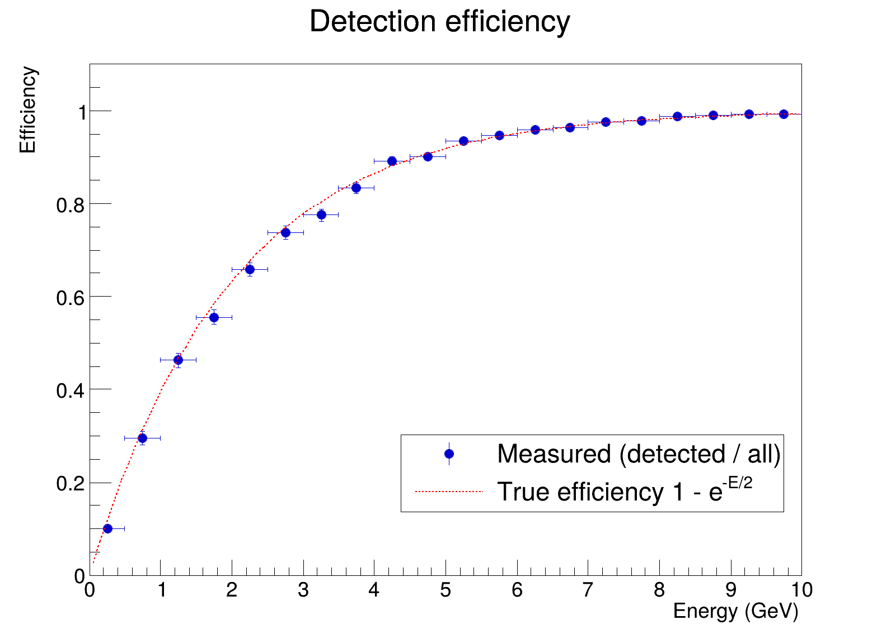

The most useful operations:

| Method | What it does |
|--------|--------------|
| `h->Sumw2()` | store the bin errors properly; call it before filling if you will scale, add or divide |
| `h->Clone("newName")` | make a copy with a new name |
| `h->Add(h2)`, `h->Add(h2, -1)` | add or subtract `h2`, bin by bin |
| `h->Scale(c)` | multiply every bin (and its error) by `c` |
| `h->Divide(h1, h2, 1, 1, "B")` | `h = h1 / h2` bin by bin, with binomial errors |
| `h->Multiply(h2)` | multiply bin by bin |
| `h->Rebin(n, "newName")` | merge every `n` neighbouring bins |
| `h->Integral(b1, b2)` | sum of the bins from `b1` to `b2` |

> **Tip:** For efficiencies, ROOT also has a dedicated class, `TEfficiency`, which
> gives better error bars when the efficiency is close to 0 or 1. Look it up once you
> are comfortable with histograms.

## 3.8 Several pads on one canvas

You have already seen `c->Divide(2, 2)` and `c->cd(n)`. A few more details:

- Pads are numbered from 1, left to right and then top to bottom.
- `gPad` always points to the current pad, so `gPad->SetLogy()` makes the current pad
  logarithmic, and `gPad->SetGrid()` adds a grid.
- `c->Divide(1, 2)` gives two pads one above the other.

## 3.9 Two-dimensional histograms

A 2D histogram counts pairs of values (x, y). It shows whether two quantities are
related (*correlated*).

```cpp
// hist_2d.C -- a 2D histogram drawn two ways
// Run with:   root -l hist_2d.C

void hist_2d()
{
   gStyle->SetOptStat(0);

   // name, title, nbins-x, x-min, x-max, nbins-y, y-min, y-max
   auto h2 = new TH2D("h2", "Correlated variables;x;y",
                      40, -4, 4, 40, -4, 4);

   TRandom3 rng(3);
   for (int i = 0; i < 50000; i++) {
      double x = rng.Gaus(0, 1);
      double y = 0.6 * x + 0.8 * rng.Gaus(0, 1);  // y depends on x
      h2->Fill(x, y);
   }

   auto c = new TCanvas("c", "2D histogram", 1200, 550);
   c->Divide(2, 1);

   c->cd(1);
   gPad->SetRightMargin(0.15);        // room for the colour scale
   h2->Draw("COLZ");                  // colour map + colour scale (Z)

   c->cd(2);
   h2->DrawClone("LEGO2");            // 3D-looking bars

   c->SaveAs("hist_2d.png");

   std::cout << "Correlation factor = " << h2->GetCorrelationFactor() << std::endl;

   // Projections: squash the 2D histogram into 1D
   TH1D *px = h2->ProjectionX("px");
   std::cout << "Projection on x: mean = " << px->GetMean()
             << ", std dev = " << px->GetStdDev() << std::endl;
}
```

```text
Processing hist_2d.C...
Correlation factor = 0.595541
Projection on x: mean = -0.00283017, std dev = 1.00002
```

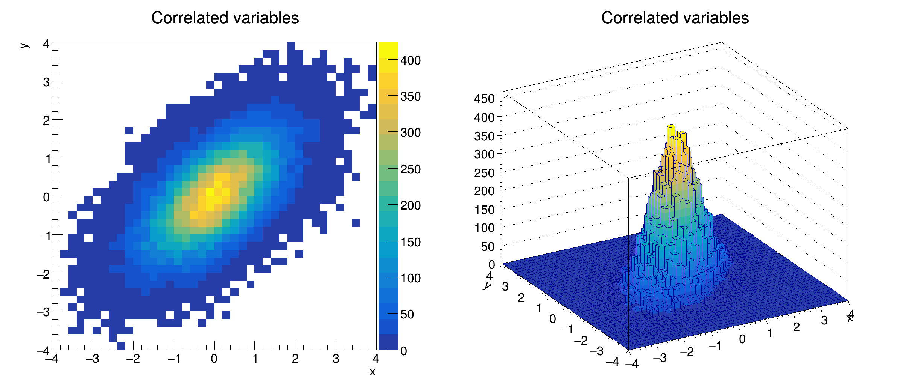

The tilted shape shows that y tends to be large when x is large: the two variables are
correlated, with a correlation factor of 0.6. Useful 2D draw options:

| Option | Meaning |
|--------|---------|
| `COLZ` | colours for the bin contents, with a colour scale (Z) — the most common |
| `BOX` | boxes whose size shows the content |
| `CONT` | contour lines |
| `LEGO`, `LEGO2` | 3D bars |
| `SURF`, `SURF2` | 3D surface |

`ProjectionX()` and `ProjectionY()` add up a 2D histogram along one axis to make a 1D
histogram. `ProfileX()` makes a *profile*: the mean y value in each x bin, with its
error — a quick way to see how y depends on x.

## 3.10 Random numbers

`TRandom3` is the generator to use. Its most useful methods:

| Method | Distribution |
|--------|--------------|
| `Uniform(a, b)` | uniform between a and b (`Uniform()` is between 0 and 1) |
| `Gaus(mean, sigma)` | Gaussian (normal) |
| `Exp(tau)` | exponential with mean tau (like decay times) |
| `Poisson(mean)` | Poisson (counting experiments) |
| `Landau(mpv, sigma)` | Landau (energy loss in thin detectors) |
| `Integer(n)` | a random integer from 0 to n−1 |

`TRandom3 rng(0)` uses a different seed every time you run, so you get different
numbers each time. A histogram can also fill itself from a function:
`h->FillRandom("gaus", 1000)` fills 1000 values distributed like a Gaussian.

## Key points

- `new TH1D(name, "title;x title;y title", nbins, xmin, xmax)` creates a histogram;
  `Fill(x)` fills it; `Draw()` draws it.
- Bins are numbered 1 to N; 0 and N+1 are underflow and overflow.
- `Draw("E")` for error bars, `Draw("SAME")` to draw on top, `Draw("COLZ")` for 2D.
- To compare shapes, normalise with `Scale(1.0 / h->Integral())`.
- Use `Sumw2()` before scaling, adding or dividing, so the errors are right.
- `TLegend`, `SetLineColor`, `SetMarkerStyle`, `gStyle->SetOptStat(0)` make plots readable.

## Exercises

**Exercise 3.1 — The central limit theorem.** Make four histograms, in four pads of one
canvas. Fill the first with 100 000 values of `rng.Uniform(0, 1)`. Fill the second with
100 000 values of the *sum of two* uniform random numbers, the third with sums of three,
and the fourth with sums of twelve. What happens to the shape? Fit the last three with
a Gaussian (`h->Fit("gaus")`, see Chapter 5) to see how close they are.

**Exercise 3.2 — Calculating π with random numbers.** Generate one million random
points (x, y), with x and y uniform between −1 and 1. Count how many fall inside the
circle x² + y² < 1. The fraction inside is π/4 (the area of the circle divided by the
area of the square), so π ≈ 4 × (inside / total). Print your estimate.
Also fill a histogram of x² + y² for all points. Can you explain its shape?
*Bonus:* draw the first 5000 points, inside in blue and outside in red. (Hint: use two
`TGraph` objects, from Chapter 4.)

Solutions are in Appendix A and in `solutions/ch03`.

# 4 Graphs and functions

A histogram counts how often values occur. Very often, though, you have *measured
points*: a voltage for each current, a period for each pendulum length, a temperature
at each hour. For these you use a **graph**. And to describe data with a formula, you
use a **function**. This chapter covers both.

Examples for this chapter are in `macros/ch04_graphs_functions`.

## 4.1 Functions: TF1

`TF1` is a function of one variable, x. You can make one in three ways:

```cpp
// functions.C -- three ways to make a function (TF1), and what you can do with it
// Run with:   root -l functions.C

// Way 3: write the function in C++. x[0] is the variable, p[0], p[1]... are parameters
double fermi(double *x, double *p)
{
   return p[0] / (1.0 + exp((x[0] - p[1]) / p[2]));
}

void functions()
{
   // Way 1: a formula with parameters [0], [1], [2]
   auto f1 = new TF1("f1", "[0]*exp(-x/[1])*cos([2]*x)", 0, 10);
   f1->SetParameters(1.0, 3.0, 4.0);          // amplitude, decay length, frequency
   f1->SetParNames("A", "tau", "omega");

   // Way 2: a built-in function: "gaus", "expo", "pol0".."pol9", "landau"
   auto f2 = new TF1("f2", "gaus", 0, 10);    // [0]*exp(-0.5*((x-[1])/[2])^2)
   f2->SetParameters(0.8, 5.0, 0.7);          // height, mean, sigma

   // Way 3: from the C++ function above: name, function, x-min, x-max, n-parameters
   auto f3 = new TF1("f3", fermi, 0, 10, 3);
   f3->SetParameters(1.0, 7.0, 0.4);

   f1->SetLineColor(kBlue);    f1->SetLineWidth(3);
   f2->SetLineColor(kRed);     f2->SetLineWidth(3);
   f3->SetLineColor(kGreen + 2); f3->SetLineWidth(3); f3->SetLineStyle(2);
   f1->SetNpx(500);            // draw with 500 points: smoother curve
   f2->SetNpx(500);

   auto c = new TCanvas("c", "Functions", 800, 600);
   f1->SetTitle("Three kinds of TF1;x;f(x)");
   f1->SetMinimum(-1.0);
   f1->SetMaximum(1.9);       // leave room for the legend
   f1->Draw();
   f2->Draw("SAME");
   f3->Draw("SAME");

   auto leg = new TLegend(0.45, 0.74, 0.88, 0.88);
   leg->AddEntry(f1, "formula: A e^{-x/#tau} cos(#omega x)", "l");
   leg->AddEntry(f2, "built-in: gaus", "l");
   leg->AddEntry(f3, "C++ function: Fermi step", "l");
   leg->Draw();
   c->SaveAs("functions.png");

   // Things you can calculate with a TF1
   std::cout << "f2(5.5)                 = " << f2->Eval(5.5)          << std::endl;
   std::cout << "Integral of f2 (0..10)  = " << f2->Integral(0, 10)    << std::endl;
   std::cout << "  (expected 0.8*0.7*sqrt(2 pi) = " << 0.8 * 0.7 * sqrt(2 * TMath::Pi()) << ")" << std::endl;
   std::cout << "Derivative of f1 at x=1 = " << f1->Derivative(1.0)  << std::endl;
   std::cout << "Maximum of f2 is at x   = " << f2->GetMaximumX()     << std::endl;
   std::cout << "f3 = 0.5 at x           = " << f3->GetX(0.5)         << std::endl;
}
```

```text
Processing functions.C...
f2(5.5)                 = 0.61987
Integral of f2 (0..10)  = 1.40371
  (expected 0.8*0.7*sqrt(2 pi) = 1.40371)
Derivative of f1 at x=1 = 2.32521
Maximum of f2 is at x   = 5
f3 = 0.5 at x           = 7
```

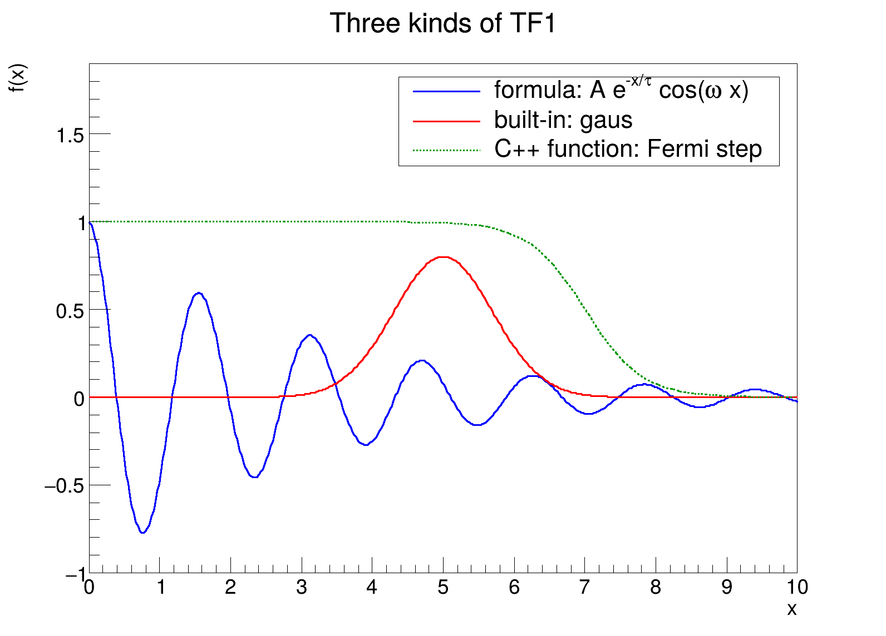

**Way 1: a formula.** The formula is a string, written like C++. The variable is `x`,
and `[0]`, `[1]`, `[2]`, ... are **parameters**: numbers that you can change later, and
that a fit can adjust (Chapter 5). You can use all the normal mathematical functions
(`sin`, `exp`, `sqrt`, `pow(x, 3)`, ...) and `TMath` functions, for example
`"TMath::Gaus(x, [0], [1])"`. You can also give the parameters names, which is useful in
fits: `[A]*exp(-x/[tau])`.

**Way 2: a built-in function.** These names are ready to use:

| Name | Formula |
|------|---------|
| `gaus` | `[0]*exp(-0.5*((x-[1])/[2])^2)` — height, mean, sigma |
| `expo` | `exp([0] + [1]*x)` |
| `pol0`, `pol1`, ..., `pol9` | polynomials: `[0] + [1]*x + [2]*x^2 + ...` |
| `landau` | the Landau distribution — `[0]` height, `[1]` (close to the) peak position, `[2]` width |

You can add them up, with the number in brackets giving the index of their first
parameter: `"gaus(0) + pol1(3)"` is a Gaussian with parameters 0–2 plus a straight line
with parameters 3–4. We use this a lot in Chapter 5.

**Way 3: a C++ function.** When the function is too complicated for one line, write it
as a C++ function with the signature `double f(double *x, double *p)`. `x[0]` is the
variable and `p[0]`, `p[1]`, ... are the parameters. Then pass the function and the
number of parameters to `TF1`.

Things you can do with a `TF1`:

| Method | What it does |
|--------|--------------|
| `SetParameters(a, b, ...)`, `SetParameter(i, v)` | set parameter values |
| `SetParNames("A", "tau", ...)` | give the parameters names |
| `Eval(x)` | the value at x |
| `Integral(a, b)` | the integral from a to b |
| `Derivative(x)` | the derivative at x |
| `GetMaximumX()`, `GetMinimumX()` | where the maximum / minimum is |
| `GetX(y)` | the x where the function equals y |
| `SetNpx(n)` | draw with n points (default 100); increase it for fast-changing functions |
| `SetRange(a, b)` | change the x range |

## 4.2 Graphs: TGraph

A `TGraph` is a list of (x, y) points. The simplest way to make one is from two arrays:

```cpp
// graph_basic.C -- a graph (x,y points) from two arrays
// Run with:   root -l graph_basic.C

void graph_basic()
{
   // Temperature measured every 2 hours during one day
   const int n = 13;
   double hour[n] = {0, 2, 4, 6, 8, 10, 12, 14, 16, 18, 20, 22, 24};
   double temp[n] = {18.7, 16.4, 17.8, 19.0, 23.2, 26.1, 29.1,
                     30.5, 31.3, 28.7, 26.4, 22.0, 19.1};

   auto g = new TGraph(n, hour, temp);
   g->SetTitle("Temperature during one day;Time (hours);Temperature (#circC)");
   g->SetMarkerStyle(21);           // filled square
   g->SetMarkerSize(1.3);
   g->SetMarkerColor(kRed + 1);
   g->SetLineColor(kGray + 2);
   g->SetLineWidth(2);

   auto c = new TCanvas("c", "Graph", 800, 600);
   c->SetGrid();                    // grid lines help reading values
   g->Draw("APL");                  // A = draw axes, P = points, L = line

   c->SaveAs("graph_basic.png");

   std::cout << "Number of points: " << g->GetN() << std::endl;
   std::cout << "Point 6: hour = " << g->GetPointX(6)
             << ", temperature = " << g->GetPointY(6) << std::endl;
   std::cout << "Temperature at 13:00 (linear interpolation) = "
             << g->Eval(13.0) << std::endl;
}
```

```text
Processing graph_basic.C...
Number of points: 13
Point 6: hour = 12, temperature = 29.1
Temperature at 13:00 (linear interpolation) = 29.8
```

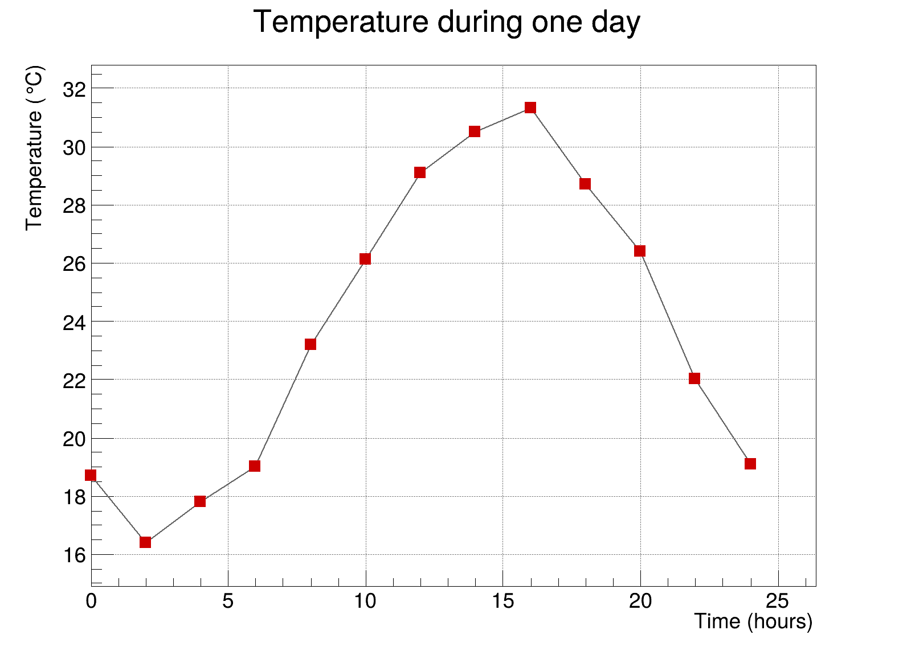

The draw options for graphs are different from those for histograms:

| Option | Meaning |
|--------|---------|
| `A` | draw the **axes** — needed for the first graph on a pad! |
| `P` | draw markers at the points |
| `L` | connect the points with straight lines |
| `C` | connect the points with a smooth curve |
| `*` | a star at each point |

So `"AP"` draws axes and markers, `"APL"` adds lines. To draw a second graph on the
same axes, leave out the `A`: `g2->Draw("P")`.

> **Common mistake:** `g->Draw("P")` on an empty canvas shows nothing, because no
> axes were drawn. The first graph needs `A`.

You can also add points one at a time, which is handy inside a loop:

```cpp
auto g = new TGraph();
for (int i = 0; i < 10; i++) {
   g->AddPoint(i, i * i);       // x, y
}
```

## 4.3 Graphs with error bars

Real measurements have uncertainties. `TGraphErrors` stores an error on x and on y for
every point. A very convenient feature: it can read the data straight from a text file.
The file `pendulum.txt` contains measurements of the period of a pendulum for different
lengths:

```text
# Pendulum experiment: length L (m), period T (s), error on L (m), error on T (s)
0.20  0.888  0.005  0.015
0.30  1.102  0.005  0.015
0.40  1.249  0.005  0.015
0.50  1.426  0.005  0.015
0.60  1.568  0.005  0.015
0.70  1.673  0.005  0.015
0.80  1.799  0.005  0.015
0.90  1.906  0.005  0.015
1.00  2.001  0.005  0.015
```

The four columns are x, y, error on x, error on y. Lines that start with `#` are
skipped, so you can use them for comments.

```cpp
// graph_errors.C -- read measurements with errors from a text file and
//                   compare them with a theory curve
// Run with:   root -l graph_errors.C     (pendulum.txt must be in the same folder)

void graph_errors()
{
   // Reads 4 columns: x  y  error-x  error-y   (lines starting with # are skipped)
   auto g = new TGraphErrors("pendulum.txt");
   g->SetTitle("Simple pendulum;Length L (m);Period T (s)");
   g->SetMarkerStyle(20);
   g->SetMarkerColor(kBlue + 1);
   g->SetLineColor(kBlue + 1);

   // Theory: T = 2 pi sqrt(L / g), with g = 9.81 m/s^2
   auto theory = new TF1("theory", "2*TMath::Pi()*sqrt(x/9.81)", 0.1, 1.1);
   theory->SetLineColor(kRed);
   theory->SetLineStyle(2);

   auto c = new TCanvas("c", "Pendulum", 800, 600);
   c->SetGrid();
   g->Draw("AP");
   theory->Draw("SAME");

   auto leg = new TLegend(0.15, 0.77, 0.45, 0.88);
   leg->AddEntry(g, "Measurement", "pe");
   leg->AddEntry(theory, "T = 2#pi #sqrt{L/g}", "l");
   leg->Draw();

   // Free text on the plot. NDC = coordinates as fractions of the pad (0..1)
   auto text = new TLatex();
   text->SetNDC();
   text->SetTextFont(42);          // normal (not bold) Helvetica
   text->SetTextSize(0.04);
   text->DrawLatex(0.55, 0.20, "g = 9.81 m/s^{2}");

   c->SaveAs("graph_errors.png");
   std::cout << "Read " << g->GetN() << " points from pendulum.txt" << std::endl;
}
```

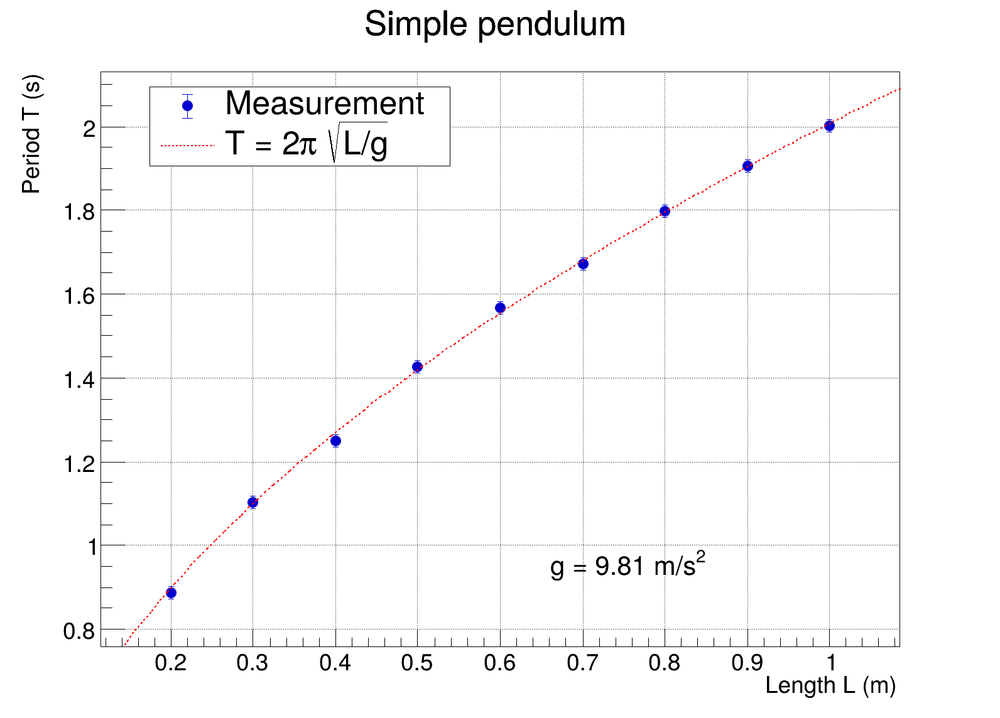

**Text on a plot.** `TLatex` writes text anywhere on the plot. With `SetNDC()` the
position is given in *normalised device coordinates* (fractions of the pad, from 0 to
1), so it does not depend on the axis ranges. Without `SetNDC()` the position is in the
units of the axes. `SetTextFont(42)` is ROOT's normal sans-serif font, and
`SetTextSize` is a fraction of the pad height.

Related classes:

- `TGraphAsymmErrors` — different errors up and down (or left and right);
- `TLine`, `TArrow`, `TBox`, `TEllipse` — draw shapes, for example
  `auto line = new TLine(x1, y1, x2, y2); line->Draw();`.

## 4.4 Several graphs together

`TMultiGraph` collects several graphs and draws them on common axes, choosing the axis
ranges so that all points fit:

```cpp
// multigraph.C -- several graphs on one set of axes with TMultiGraph
// Run with:   root -l multigraph.C

void multigraph()
{
   // A cup of coffee cooling down, with and without a lid
   const int n = 13;
   double t[n]     = {0, 5, 10, 15, 20, 25, 30, 35, 40, 45, 50, 55, 60};
   double noLid[n] = {89.6, 77.6, 68.6, 59.7, 51.6, 47.0, 42.1,
                      38.9, 34.8, 33.4, 31.3, 30.5, 28.4};
   double lid[n]   = {90.3, 82.0, 77.8, 69.6, 66.3, 60.8, 56.4,
                      52.8, 49.6, 47.2, 44.3, 42.9, 38.8};

   auto gNoLid = new TGraph(n, t, noLid);
   gNoLid->SetMarkerStyle(20);
   gNoLid->SetMarkerColor(kRed);
   gNoLid->SetLineColor(kRed);

   auto gLid = new TGraph(n, t, lid);
   gLid->SetMarkerStyle(21);
   gLid->SetMarkerColor(kBlue);
   gLid->SetLineColor(kBlue);

   auto mg = new TMultiGraph();
   mg->SetTitle("Cooling coffee;Time (min);Temperature (#circC)");
   mg->Add(gNoLid, "PL");      // each graph can have its own draw option
   mg->Add(gLid,   "PL");

   auto c = new TCanvas("c", "MultiGraph", 800, 600);
   c->SetGrid();
   mg->Draw("A");              // the multigraph draws the axes for all of them

   auto leg = new TLegend(0.60, 0.76, 0.88, 0.88);
   leg->AddEntry(gNoLid, "Without lid", "lp");
   leg->AddEntry(gLid,   "With lid",    "lp");
   leg->Draw();

   c->SaveAs("multigraph.png");
}
```

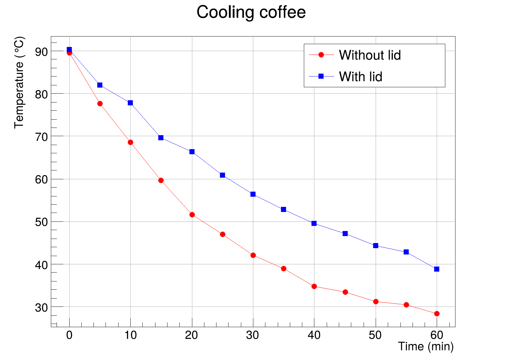

## 4.5 Histogram or graph?

| Use a **histogram** when... | Use a **graph** when... |
|---|---|
| you **count** how often values occur | you have **measured points** (x, y) |
| e.g. the energy of many particles | e.g. voltage against current |
| the errors come from counting (√N) | each point has its own measured error |

Both can be fitted with functions, which is the topic of the next chapter.

## Key points

- `new TF1("f", "formula with x and [0], [1]...", xmin, xmax)` makes a function;
  built-in names are `gaus`, `expo`, `polN`, `landau`.
- `new TGraph(n, x, y)` makes a graph from arrays; `new TGraphErrors("file.txt")` reads
  x, y, ex, ey from a text file.
- The first graph on a pad needs the `A` (axes) option: `Draw("AP")`.
- `TMultiGraph` draws several graphs together; `TLatex` with `SetNDC()` writes text.

## Exercises

**Exercise 4.1 — Trigonometry.** Draw sin(x), cos(x) and sin(x)·cos(x) for x from 0 to
2π on one canvas, in three different colours, with a legend. Then use `Integral` to
calculate the integral of sin²(x) from 0 to π. (The exact answer is π/2.)

**Exercise 4.2 — Ohm's law.** The file `ohm.txt` (in the same folder) contains
measurements of the voltage across a resistor for different currents:

```text
# Ohm's law: current I (mA), voltage V (V), error on I (mA), error on V (V)
1.0   2.25   0.05   0.05
2.0   4.38   0.05   0.05
3.0   6.66   0.05   0.05
4.0   8.79   0.05   0.05
5.0  10.97   0.05   0.05
6.0  13.18   0.05   0.05
7.0  15.47   0.05   0.05
8.0  17.55   0.05   0.05
9.0  19.83   0.05   0.05
10.0 21.96   0.05   0.05
```

Make a `TGraphErrors` from the file and draw it with proper axis titles. (We fit it in
Exercise 5.1.)

Solutions are in Appendix A and in `solutions/ch04`.

# 5 Fitting

Fitting means finding the values of a function's parameters that describe the data
best. It is how you measure things: the mass of a particle from the position of a peak,
a lifetime from an exponential decay, the gravitational acceleration from pendulum data.
ROOT's fitting is fast, reliable, and gives you the errors on the parameters.

Examples for this chapter are in `macros/ch05_fitting`.

## 5.1 What does a fit do?

For each data point (or histogram bin) *i* you have a measured value $y_i$ with error
$\sigma_i$, and the function predicts $f(x_i)$. The **least-squares** or **χ² fit** chooses the
parameters that make

$$\chi^2 = \sum_i \frac{\left(y_i - f(x_i)\right)^2}{\sigma_i^2}$$

as small as possible. ROOT uses the minimisation program **Minuit** for this.

After the fit, two numbers tell you whether the function describes the data well:

- **ndf**, the *number of degrees of freedom* = number of points (bins) − number of
  free parameters;
- **χ²/ndf** should be close to 1. Much larger than 1 means the function does not
  describe the data (or the errors are too small). Much smaller than 1 usually means the
  errors are too big.
- The **probability** (`Prob`) is the chance of getting a χ² this large or larger if
  the function were correct. Very small values (below about 0.01) are a warning sign.

## 5.2 Your first fit

```cpp
// fit_gaus.C -- fit a histogram with a Gaussian and read the results
// Run with:   root -l fit_gaus.C

void fit_gaus()
{
   gStyle->SetOptFit(1111);    // show fit results in the statistics box
   gStyle->SetStatW(0.25);     // statistics box width and height
   gStyle->SetStatH(0.20);     //   (as fractions of the canvas)

   auto h = new TH1D("h", "Measured mass;Mass (GeV);Events", 50, 0, 10);
   TRandom3 rng(5);
   for (int i = 0; i < 1000; i++) h->Fill(rng.Gaus(5.0, 1.5));

   h->SetMaximum(1.6 * h->GetMaximum());   // room for the statistics box

   auto c = new TCanvas("c", "Gaussian fit", 800, 600);

   // Fit with the built-in Gaussian. ROOT prints the result and draws
   // the fitted curve on top of the histogram.
   h->Fit("gaus");
   h->SetMarkerStyle(20);
   h->Draw("E");               // draw again with error bars (the fit is kept)

   c->SaveAs("fit_gaus.png");

   // Get the fitted function and its parameters
   TF1 *fit = h->GetFunction("gaus");
   std::cout << "\n--- Results ---" << std::endl;
   std::cout << "Mean  = " << fit->GetParameter(1) << " +- " << fit->GetParError(1) << std::endl;
   std::cout << "Sigma = " << fit->GetParameter(2) << " +- " << fit->GetParError(2) << std::endl;
   std::cout << "chi2 / ndf = " << fit->GetChisquare() << " / " << fit->GetNDF()
             << " = " << fit->GetChisquare() / fit->GetNDF() << std::endl;
   std::cout << "Fit probability = " << fit->GetProb() << std::endl;
}
```

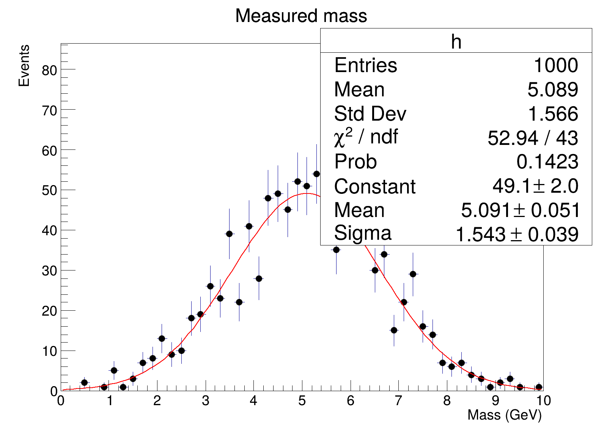

`h->Fit("gaus")` does everything: it creates a Gaussian function, chooses sensible
starting values, fits, prints the result, and draws the fitted curve on the histogram.
The printout is:

```text
Processing fit_gaus.C...
****************************************
Minimizer is Minuit2 / Migrad
Chi2                      =      52.9448
NDf                       =           43
Edm                       =  5.45987e-06
NCalls                    =           53
Constant                  =      49.0973   +/-   1.98969
Mean                      =      5.09064   +/-   0.0511566
Sigma                     =      1.54279   +/-   0.0385196    	 (limited)

--- Results ---
Mean  = 5.09064 +- 0.0511566
Sigma = 1.54279 +- 0.0385196
chi2 / ndf = 52.9448 / 43 = 1.23128
Fit probability = 0.142307
```

How to read the Minuit printout:

| Line | Meaning |
|------|---------|
| `Minimizer is Minuit2 / Migrad` | the fitting program used |
| `Chi2`, `NDf` | χ² and the number of degrees of freedom: 52.9 / 43 = 1.23 — a good fit |
| `Edm` | *estimated distance to minimum*; very small means the fit converged |
| `NCalls` | how many times the function was evaluated |
| `Constant`, `Mean`, `Sigma` | the fitted parameters with their errors |

The word `(limited)` next to `Sigma` means that ROOT did not allow sigma to become
negative during the fit. You can ignore it.

**The result** is mean = 5.09 ± 0.05 and sigma = 1.54 ± 0.04. The data were generated
with mean 5.0 and sigma 1.5, so the fit found the true values within about 1–2 errors,
as it should.

`gStyle->SetOptFit(1111)` adds the fit results (χ²/ndf, probability, parameters) to the
statistics box. Each digit switches on one item: `SetOptFit(111)` leaves out the
probability.

## 5.3 Getting the results in your program

After `h->Fit("gaus")`, the fitted function is stored *inside* the histogram:
`h->GetFunction("gaus")` gives it back. Then:

| Method | What it gives |
|--------|---------------|
| `GetParameter(i)` | value of parameter i |
| `GetParError(i)` | error of parameter i |
| `GetChisquare()` | χ² |
| `GetNDF()` | number of degrees of freedom |
| `GetProb()` | fit probability |

## 5.4 A peak on top of a background

The most common fit in physics: a peak (the *signal*) sitting on top of a smooth
*background*. We describe it with the sum of two functions, `gaus(0) + expo(3)`:

```cpp
// fit_peak_background.C -- fit a peak (signal) on top of a falling background
//                          and count how many signal events there are
// Run with:   root -l fit_peak_background.C

void fit_peak_background()
{
   gStyle->SetOptStat(0);

   // --- 1. Fake data: 20000 background events + 2000 signal events ---
   auto h = new TH1D("h", "Signal on a background;Mass (GeV);Events / 0.1 GeV", 100, 0, 10);
   TRandom3 rng(2);
   for (int i = 0; i < 20000; i++) h->Fill(rng.Exp(3.0));       // background
   for (int i = 0; i < 2000;  i++) h->Fill(rng.Gaus(4.0, 0.3)); // signal

   // --- 2. The model: Gaussian (parameters 0,1,2) + exponential (3,4) ---
   //     gaus(0) = [0]*exp(-0.5*((x-[1])/[2])^2)
   //     expo(3) = exp([3] + [4]*x)
   auto fTotal = new TF1("fTotal", "gaus(0) + expo(3)", 0, 10);
   fTotal->SetParNames("Height", "Mean", "Sigma", "BkgConst", "BkgSlope");

   // Starting values: look at the plot and guess. Good guesses = good fits.
   fTotal->SetParameters(200, 4.2, 0.5, 6.0, -0.3);
   fTotal->SetLineColor(kRed);
   fTotal->SetNpx(500);

   // --- 3. Fit. "S" returns a TFitResultPtr with all the fit details ---
   auto c = new TCanvas("c", "Peak + background", 800, 600);
   TFitResultPtr result = h->Fit(fTotal, "S");

   // --- 4. Draw signal and background parts separately ---
   auto fSig = new TF1("fSig", "gaus", 0, 10);
   fSig->SetParameters(fTotal->GetParameter(0), fTotal->GetParameter(1),
                       fTotal->GetParameter(2));
   fSig->SetLineColor(kBlue);
   fSig->SetLineStyle(2);
   fSig->SetNpx(500);

   auto fBkg = new TF1("fBkg", "expo", 0, 10);
   fBkg->SetParameters(fTotal->GetParameter(3), fTotal->GetParameter(4));
   fBkg->SetLineColor(kGreen + 2);
   fBkg->SetLineStyle(2);

   h->SetMarkerStyle(20);
   h->SetMarkerSize(0.8);
   h->Draw("E");
   fSig->Draw("SAME");
   fBkg->Draw("SAME");

   auto leg = new TLegend(0.58, 0.68, 0.88, 0.88);
   leg->AddEntry(h, "Data", "pe");
   leg->AddEntry(fTotal, "Total fit", "l");
   leg->AddEntry(fSig, "Signal (Gaussian)", "l");
   leg->AddEntry(fBkg, "Background (exponential)", "l");
   leg->Draw();
   c->SaveAs("fit_peak_background.png");

   // --- 5. Number of signal events = area of the Gaussian / bin width ---
   double binWidth = h->GetBinWidth(1);
   double nSignal  = fSig->Integral(0, 10) / binWidth;

   // Error on the area, using the covariance matrix of the 3 signal parameters
   TMatrixDSym covSig = result->GetCovarianceMatrix().GetSub(0, 2, 0, 2);
   double nSignalErr = fSig->IntegralError(0, 10, fSig->GetParameters(),
                                           covSig.GetMatrixArray()) / binWidth;

   std::cout << "\n--- Results ---" << std::endl;
   std::cout << "Peak position  = " << fTotal->GetParameter(1) << " +- "
             << fTotal->GetParError(1) << " GeV" << std::endl;
   std::cout << "Peak width     = " << fTotal->GetParameter(2) << " +- "
             << fTotal->GetParError(2) << " GeV" << std::endl;
   std::cout << "Signal events  = " << nSignal << " +- " << nSignalErr
             << "   (we generated 2000)" << std::endl;
   std::cout << "chi2 / ndf     = " << result->Chi2() << " / " << result->Ndf() << std::endl;
}
```

```text
Processing fit_peak_background.C...
****************************************
Minimizer is Minuit2 / Migrad
Chi2                      =      100.067
NDf                       =           95
Edm                       =  4.27906e-06
NCalls                    =          170
Height                    =      272.608   +/-   11.0213
Mean                      =      4.00308   +/-   0.0117217
Sigma                     =     0.291695   +/-   0.0118554
BkgConst                  =      6.47815   +/-   0.0111633
BkgSlope                  =    -0.326883   +/-   0.00326377

--- Results ---
Peak position  = 4.00308 +- 0.0117217 GeV
Peak width     = 0.291695 +- 0.0118554 GeV
Signal events  = 1993.23 +- 74.6664   (we generated 2000)
chi2 / ndf     = 100.067 / 95
```

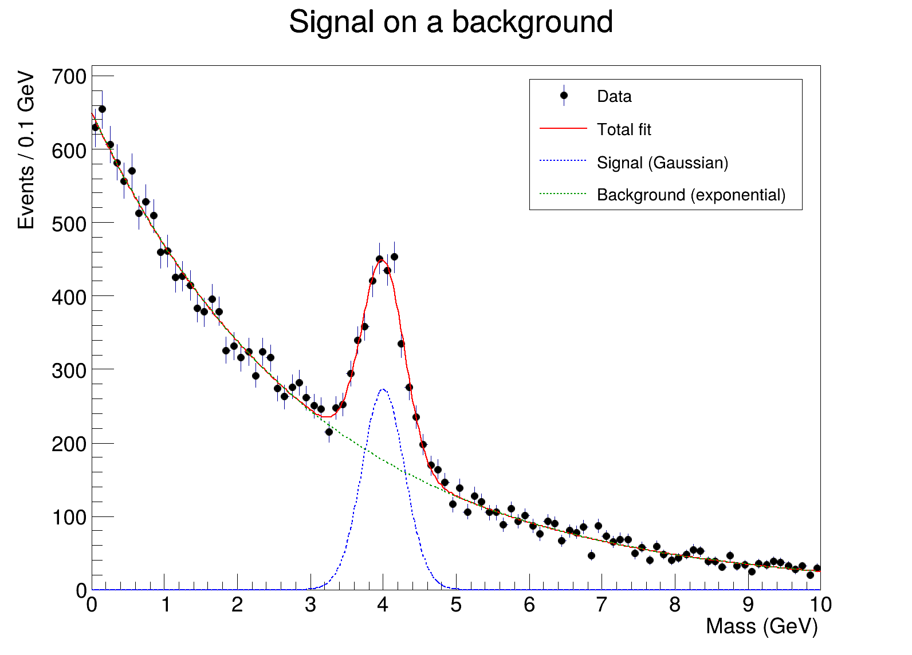

Important ideas in this example:

**Starting values.** With more than one function, ROOT cannot guess the starting values
for you. You must give reasonable ones with `SetParameters`. Look at the plot: the peak
is near 4 GeV, it is about 200 events above the background, and it is about 0.5 GeV
wide. Bad starting values are the most common reason for a fit to fail.

> **Tip:** Before fitting, draw the function with your starting values on top of the
> data: `fTotal->Draw("SAME")`. If it is not roughly in the right place, the fit will
> struggle.

**The fit result.** With the option `"S"`, `Fit` returns a `TFitResultPtr`, which holds
everything about the fit: `result->Chi2()`, `result->Ndf()`, `result->Parameter(i)`,
`result->ParError(i)`, `result->IsValid()`, and the **covariance matrix**
`result->GetCovarianceMatrix()`, which says how the parameter errors are correlated.
`result->Print("V")` prints all of it.

**Counting signal events.** The parameter `[0]` of `gaus` is the *height* of the peak,
not the number of events. The number of events is the area under the Gaussian divided
by the bin width:

$$N_\text{signal} = \frac{\int \text{gaus}\, dx}{\text{bin width}} = \frac{A\,\sigma\sqrt{2\pi}}{\text{bin width}}$$

Here we get 1993 ± 75 signal events — we generated 2000. The error is calculated by
`IntegralError`, using the part of the covariance matrix that belongs to the three
signal parameters.

## 5.5 Fitting a graph

Graphs are fitted in the same way. Here we use the pendulum data from Chapter 4 to
**measure g**. Since T = 2π√(L/g), the square T² = (4π²/g)·L is a straight line in L
with slope 4π²/g:

```cpp
// fit_graph.C -- fit a straight line to a graph and measure g
// Run with:   root -l fit_graph.C     (pendulum.txt must be in the same folder)
//
// Physics: T = 2 pi sqrt(L/g)  =>  T^2 = (4 pi^2 / g) * L
// So T^2 against L is a straight line with slope 4 pi^2 / g.

void fit_graph()
{
   gStyle->SetOptFit(111);
   gStyle->SetStatX(0.88);     // move the statistics box to the empty
   gStyle->SetStatY(0.35);     // lower-right corner

   auto data = new TGraphErrors("pendulum.txt");   // L, T, dL, dT

   // Build a new graph of T^2 against L
   auto g = new TGraphErrors();
   for (int i = 0; i < data->GetN(); i++) {
      double L  = data->GetPointX(i);
      double T  = data->GetPointY(i);
      double dL = data->GetErrorX(i);
      double dT = data->GetErrorY(i);
      g->SetPoint(i, L, T * T);
      g->SetPointError(i, dL, 2 * T * dT);     // error of T^2 is 2 T dT
   }
   g->SetTitle("Pendulum: T^{2} against L;Length L (m);T^{2} (s^{2})");
   g->SetMarkerStyle(20);
   g->SetMarkerColor(kBlue + 1);

   auto c = new TCanvas("c", "Graph fit", 800, 600);
   c->SetGrid();
   g->Fit("pol1");        // straight line: [0] + [1]*x
   g->Draw("AP");

   TF1 *line = g->GetFunction("pol1");
   double slope    = line->GetParameter(1);
   double slopeErr = line->GetParError(1);
   double gValue   = 4 * TMath::Pi() * TMath::Pi() / slope;
   double gError   = gValue * slopeErr / slope;    // error propagation

   auto text = new TLatex();
   text->SetNDC();
   text->SetTextFont(42);
   text->SetTextSize(0.045);
   text->DrawLatex(0.15, 0.80, Form("g = %.2f #pm %.2f m/s^{2}", gValue, gError));
   c->SaveAs("fit_graph.png");

   std::cout << "\nSlope = " << slope << " +- " << slopeErr << " s^2/m" << std::endl;
   std::cout << "g     = " << gValue << " +- " << gError << " m/s^2" << std::endl;
}
```

```text
Processing fit_graph.C...
****************************************
Minimizer is Minuit2 / Migrad
Chi2                      =      2.69021
NDf                       =            7
Edm                       =  5.41509e-06
NCalls                    =           49
p0                        =   -0.0163367   +/-   0.0342054
p1                        =      4.05047   +/-   0.0616625

Slope = 4.05047 +- 0.0616625 s^2/m
g     = 9.74662 +- 0.148378 m/s^2
```

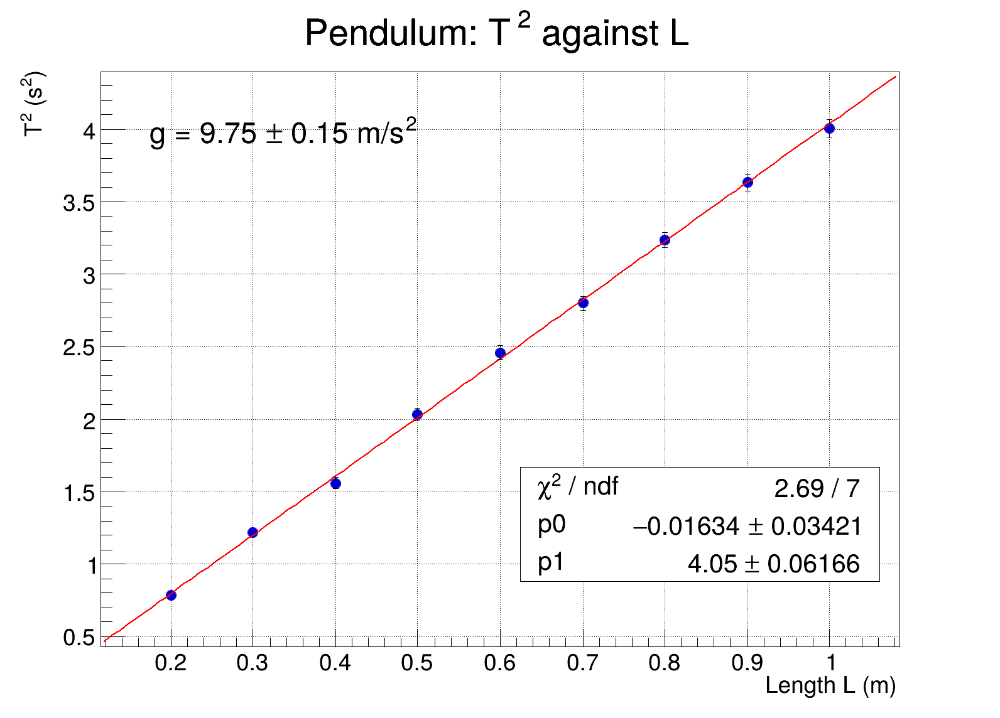

We measure g = 9.75 ± 0.15 m/s², in agreement with the known 9.81 m/s². The intercept
`p0` is compatible with zero, as the physics says it should be. Note also how the error
on T² is calculated from the error on T (*error propagation*): σ(T²) = 2T·σ(T).

For a `TGraphErrors`, the fit uses the y errors and also takes the x errors into account.

## 5.6 Fit options

The second argument of `Fit` is a string of options. You can combine them, e.g. `"LRQ"`.

| Option | Meaning |
|--------|---------|
| `Q` | quiet: do not print the result |
| `S` | return a `TFitResultPtr` with all the results |
| `R` | fit only in the range of the function (as given when making the `TF1`) |
| `L` | use a (log-)likelihood fit instead of χ²; better for histograms with few entries |
| `0` | do not draw the fit result |
| `+` | keep previous fit functions attached to the histogram (otherwise they are replaced) |
| `E` | better error estimate with MINOS (slower) |
| `I` | use the integral of the function over each bin instead of its value at the bin centre |

To fit only part of a histogram you can also give the range directly:

```cpp
h->Fit("gaus", "", "", 3.0, 7.0);    // options, draw options, xmin, xmax
```

## 5.7 Few entries: use a likelihood fit

The χ² fit uses √N as the error of a bin with N entries. When N is small, this is a bad
approximation, and for empty bins (N = 0) it does not work at all — ROOT simply ignores
them. The result is a biased fit. The **likelihood fit** (option `"L"`) uses the correct
Poisson probabilities and works also for empty bins.

```cpp
// fit_likelihood.C -- with few entries per bin, use a likelihood fit ("L")
// Run with:   root -l fit_likelihood.C

void fit_likelihood()
{
   gStyle->SetOptStat(0);

   // Only 60 entries spread over 40 bins: many bins have 0, 1 or 2 entries
   auto h = new TH1D("h", "Few entries: chi2 vs likelihood fit;x;Entries", 40, 0, 10);
   TRandom3 rng(8);
   for (int i = 0; i < 60; i++) h->Fill(rng.Gaus(5.0, 1.5));

   auto fChi2 = new TF1("fChi2", "gaus", 0, 10);
   auto fLike = new TF1("fLike", "gaus", 0, 10);
   fChi2->SetLineColor(kRed);
   fLike->SetLineColor(kBlue);
   fLike->SetLineStyle(2);

   // Options: Q = quiet, 0 = do not draw now, L = likelihood, + = keep the
   // previous fit function attached to the histogram as well
   h->Fit(fChi2, "Q0");
   h->Fit(fLike, "L Q0 +");

   auto c = new TCanvas("c", "Likelihood", 800, 600);
   h->SetMarkerStyle(20);
   h->Draw("E");
   fChi2->Draw("SAME");
   fLike->Draw("SAME");

   auto leg = new TLegend(0.58, 0.74, 0.88, 0.88);
   leg->AddEntry(fChi2, "#chi^{2} fit (default)", "l");
   leg->AddEntry(fLike, "Likelihood fit (\"L\")", "l");
   leg->Draw();
   c->SaveAs("fit_likelihood.png");

   double bw = h->GetBinWidth(1);
   std::cout << "                 chi2 fit    likelihood fit   (true)" << std::endl;
   printf("Mean           %8.2f       %8.2f        5.00\n",
          fChi2->GetParameter(1), fLike->GetParameter(1));
   printf("Sigma          %8.2f       %8.2f        1.50\n",
          fChi2->GetParameter(2), fLike->GetParameter(2));
   printf("Events (area)  %8.1f       %8.1f       60\n",
          fChi2->Integral(0, 10) / bw, fLike->Integral(0, 10) / bw);
}
```

```text
Processing fit_likelihood.C...
                 chi2 fit    likelihood fit   (true)
Mean               4.77           4.90        5.00
Sigma              2.06           1.39        1.50
Events (area)      57.6           60.0       60
```

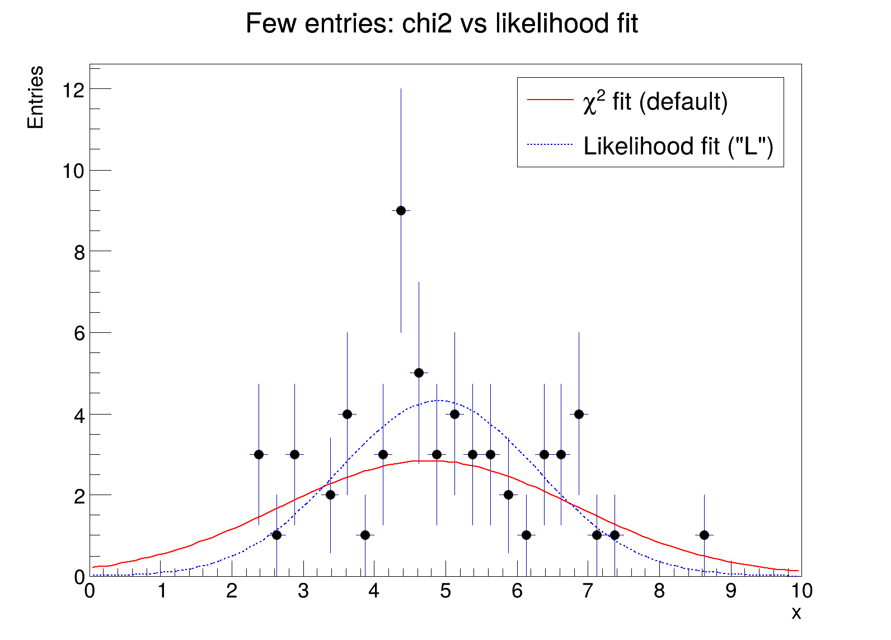

The χ² fit gives a Gaussian that is too wide and too low; the likelihood fit gets close
to the true values, and its area equals the number of entries exactly.

> **Rule of thumb:** if many bins have fewer than about 10 entries, use the `"L"` option.

## 5.8 When a fit fails

If the fitted curve is nowhere near the data, or ROOT prints warnings such as
`FAILED` or `NOT POSDEF`, try these steps:

1. **Better starting values.** Draw the starting function on the data (Section 5.4).
2. **Fit a smaller range** with `"R"` or the xmin/xmax arguments, around the region you
   care about.
3. **Limit parameters** to sensible ranges: `f->SetParLimits(2, 0.01, 1.0);` keeps
   parameter 2 between 0.01 and 1.
4. **Fix parameters** you know: `f->FixParameter(1, 3.0969);`
5. **Fit in steps**: first fit only the background in a range without the peak, then use
   those values as starting values for the full fit.
6. **Check the result** in your code: `if (!result->IsValid()) { ... }`.

> **The Fit Panel.** For experimenting, right-click on a histogram in a canvas and choose
> *FitPanel*. You can choose the function, range and options with the mouse and see the
> result at once.

## Key points

- `h->Fit("gaus")` fits and draws; `h->GetFunction("gaus")` gives the result back.
- Check χ²/ndf ≈ 1 and that the parameter errors look reasonable.
- For combined functions like `gaus(0) + expo(3)`, always give starting values.
- The number of signal events is the integral of the signal function divided by the bin width.
- Use the `"L"` option for histograms with few entries per bin.

## Exercises

**Exercise 5.1 — The resistance.** Fit the Ohm's-law graph from Exercise 4.2 with a
straight line (`pol1`). What is the resistance and its error? (The voltage is in V and
the current in mA, so the slope is in kΩ.)

**Exercise 5.2 — The muon lifetime.** Muons decay with a lifetime of τ = 2.197 μs.
Generate 5000 decay times with `rng.Exp(2.197)` and fill them in a histogram with 40
bins from 0 to 10 μs. Fit with `expo`. The fitted function is exp(p0 + p1·t), so the
lifetime is τ = −1/p1. Calculate τ and its error (error propagation:
σ(τ) = τ·σ(p1)/|p1|). Is your result compatible with 2.197 μs? Draw the histogram with a
logarithmic y axis: what does the exponential look like?

Solutions are in Appendix A and in `solutions/ch05`.

# 6 ROOT files

So far, everything we made disappeared when we quit ROOT. To keep results, or to share
them, you save them in a **ROOT file** (extension `.root`). Experiments store all their
data in ROOT files, so reading them is an essential skill.

Examples for this chapter are in `macros/ch06_files`.

## 6.1 What is in a ROOT file?

A ROOT file can hold any ROOT object: histograms, graphs, functions, canvases, and the
data *trees* of Chapter 7. Inside, it is organised like a disk with folders (called
*directories*). ROOT files are:

- **compressed** — they take less space than plain text;
- **self-describing** — the file knows what kind of objects are inside, so any ROOT
  program (C++ or Python) can read it, years later;
- **fast** to read partially — you can read one histogram, or one column of a huge
  table, without reading the whole file.

## 6.2 Writing a file

```cpp
// file_write.C -- save histograms and a graph into a ROOT file
// Run with:   root -l file_write.C

void file_write()
{
   // Open (create) a file. "RECREATE" = create it, overwrite if it exists.
   TFile *file = TFile::Open("my_results.root", "RECREATE");

   // Histograms created while a file is open belong to that file
   auto hEnergy = new TH1D("hEnergy", "Deposited energy;E (MeV);Events", 100, 0, 100);
   auto hAngle  = new TH1D("hAngle", "Polar angle;#theta (rad);Events", 50, 0, TMath::Pi());
   TRandom3 rng(4);
   for (int i = 0; i < 10000; i++) {
      hEnergy->Fill(rng.Landau(20, 4));        // energy loss in a thin detector
      hAngle->Fill(acos(rng.Uniform(-1, 1)));  // directions uniform on a sphere
   }

   // A folder (directory) inside the file
   TDirectory *calib = file->mkdir("calibration");
   calib->cd();                              // new histograms now go into this folder
   auto hGain = new TH1D("hGain", "Channel gains;Gain;Channels", 40, 0.8, 1.2);
   for (int i = 0; i < 500; i++) hGain->Fill(rng.Gaus(1.0, 0.05));

   // Other objects (graphs, functions, ...) do not belong to the file
   // automatically: write them yourself, giving them a name.
   file->cd();                               // back to the top of the file
   auto g = new TGraph();
   for (int i = 0; i < 10; i++) g->SetPoint(i, i, 2.0 * i + rng.Gaus(0, 1));
   g->SetTitle("Detector response;Input;Output");
   g->Write("gResponse");

   file->Write();     // write all histograms that belong to the file
   file->Close();     // close it -- this also deletes those histograms from memory!

   std::cout << "Wrote my_results.root" << std::endl;
}
```

```text
Processing file_write.C...
Wrote my_results.root
```

**Opening.** `TFile::Open(name, mode)` opens a file. The mode says what you want to do:

| Mode | Meaning |
|------|---------|
| `"READ"` | read only (the default). The file must exist. |
| `"RECREATE"` | create a new file; if it exists, **overwrite** it |
| `"NEW"` or `"CREATE"` | create a new file; fail if it already exists |
| `"UPDATE"` | open an existing file to add or change objects |

**Who owns a histogram?** When a file is open, every histogram you create *belongs to*
the file's current directory. This is why `file->Write()` writes all of them in one go,
and why `file->Close()` **deletes them from memory**: the file cleans up what it owns.
Graphs, functions and canvases do not belong to the file, so we write them ourselves with
`object->Write("name")`.

**Folders.** `file->mkdir("calibration")` creates a folder in the file and returns it;
`calib->cd()` makes it the current directory, so new histograms go there. `file->cd()`
goes back to the top.

## 6.3 Reading a file

```cpp
// file_read.C -- open a ROOT file, list it, read objects back and draw them
// Run with:   root -l file_read.C      (run file_write.C first)

void file_read()
{
   TFile *file = TFile::Open("my_results.root");      // read-only by default
   if (!file || file->IsZombie()) {
      std::cout << "Cannot open my_results.root -- run file_write.C first" << std::endl;
      return;
   }

   file->ls();                                        // what is inside?

   // Get<Type>("name") returns a pointer, or nullptr if the name is wrong
   auto hEnergy = file->Get<TH1D>("hEnergy");
   auto hGain   = file->Get<TH1D>("calibration/hGain");   // folder/name
   auto gResp   = file->Get<TGraph>("gResponse");

   if (!hEnergy || !hGain || !gResp) {
      std::cout << "Something is missing in the file!" << std::endl;
      return;
   }
   std::cout << "hEnergy: " << hEnergy->GetEntries() << " entries, mean "
             << hEnergy->GetMean() << " MeV" << std::endl;

   auto c = new TCanvas("c", "Read back", 1200, 400);
   c->Divide(3, 1);
   c->cd(1);  hEnergy->Draw();
   c->cd(2);  hGain->Draw();
   c->cd(3);  gResp->SetMarkerStyle(20);  gResp->Draw("AP");
   c->SaveAs("file_read.png");

   // We do NOT close the file here: closing it would delete hEnergy and hGain
   // and they would vanish from the canvas. (See the chapter text.)
}
```

```text
Processing file_read.C...
TFile**		my_results.root
 TFile*		my_results.root
  KEY: TDirectoryFile	calibration;1	calibration
  KEY: TGraph	gResponse;1	Detector response
  KEY: TH1D	hEnergy;1	Deposited energy
  KEY: TH1D	hAngle;1	Polar angle
hEnergy: 10000 entries, mean 29.4931 MeV
```


**Listing.** `file->ls()` prints the contents. Each `KEY` line shows the class of the
object, its name, a *cycle number* after the `;`, and its title. The cycle number counts
how many times an object with that name was written; normally you can ignore it, and
ROOT always gives you the highest one.

**Getting objects.** `file->Get<TH1D>("hEnergy")` reads the object called `hEnergy` and
gives you a pointer of type `TH1D*`. Objects in folders are found with a path:
`"calibration/hGain"`.

> **Always check the pointer!** If the name is wrong (or the file is wrong), `Get` returns
> `nullptr`, and using it crashes ROOT with a scary `*** Break *** segmentation violation`
> message. A simple `if (!h) { ... }` check saves you a lot of confusion. The same is
> true for `TFile::Open`: check that the file opened.

## 6.4 Keeping a histogram after closing the file

Histograms you read from a file also belong to that file. If you close the file, they
are deleted. To keep a histogram, take it away from the file first:

```cpp
TFile *f = TFile::Open("my_results.root");
auto h = f->Get<TH1D>("hEnergy");
h->SetDirectory(nullptr);   // h now belongs to you, not to the file
f->Close();                 // h is still there
h->Draw();
```

This is why `file_read.C` does not close the file. When ROOT quits, it closes all files
anyway.

## 6.5 Files at the ROOT prompt

You can open a file directly when starting ROOT. ROOT calls it `_file0` (the next one
`_file1`, ...), and you can use the objects in it just by typing their names:

```bash
root -l my_results.root
```

```text
Attaching file my_results.root as _file0...
(TFile *) 0x125d7bda0
root [1] .ls
TFile**         my_results.root
 TFile*         my_results.root
  KEY: TDirectoryFile   calibration;1   calibration
  KEY: TGraph   gResponse;1     Detector response
  KEY: TH1D     hEnergy;1       Deposited energy
  KEY: TH1D     hAngle;1        Polar angle
root [2] hEnergy->GetMean()
(double) 29.493118
root [3] hEnergy->Draw()
```

This "type the name" trick works only at the prompt, not in macros.

## 6.6 Looking inside files with the browser

The quickest way to see what is in a file is the browser:

```bash
rootbrowse my_results.root
```

Click on the file, open the folders, and double-click a histogram to draw it. This is
very useful for files you get from someone else.

## 6.7 Command-line tools

ROOT comes with a few small programs that you run directly in the terminal.

**`rootls`** lists a file, like `ls` for folders:

```bash
rootls my_results.root
rootls -l my_results.root               # long listing with class names and titles
rootls -l my_results.root:calibration   # look inside a folder
```

```text
calibration  gResponse  hAngle  hEnergy

TDirectoryFile  Nov 04 15:1 2026 calibration;1 "calibration"
TGraph          Nov 04 15:1 2026 gResponse;1   "Detector response"
TH1D            Nov 04 15:1 2026 hAngle;1      "Polar angle"
TH1D            Nov 04 15:1 2026 hEnergy;1     "Deposited energy"

TH1D  Nov 04 15:1 2026 hGain;1 "Channel gains"
```

`rootls -t file.root` also shows the structure of trees (Chapter 7).

**`hadd`** adds up files. Histograms with the same name are added bin by bin, and trees
are joined one after another. This is how you combine the results of many jobs, for
example one file per run:

```bash
hadd merged.root run1.root run2.root        # or: hadd merged.root run*.root
```

```text
Info in <hadd>: target file: merged.root
Info in <hadd>: compression setting for all output: 101
hadd Source file 1: run1.root
hadd Source file 2: run2.root
hadd Target path: merged.root:/
hadd Target path: merged.root:/calibration
```

If both input files have 10 000 entries in `hEnergy`, the merged `hEnergy` has 20 000.
Use `hadd -f` to overwrite an existing output file.

**`rootcp`** copies objects between files, and **`rooteventselector`** copies part of a
tree. Run any of them with `--help` to see their options.

## Key points

- `TFile::Open("f.root", "RECREATE")` creates a file; `TFile::Open("f.root")` reads one.
- Histograms created while a file is open belong to it: `file->Write()` saves them and
  `file->Close()` deletes them from memory.
- `file->Get<TH1D>("name")` reads an object; check that the result is not `nullptr`.
- `h->SetDirectory(nullptr)` keeps a histogram alive after the file is closed.
- `rootls`, `rootbrowse` and `hadd` are handy command-line tools.

## Exercises

**Exercise 6.1 — Save and read back.** Take your solution of Exercise 3.1 (the central
limit theorem). Change it so that the four histograms are written into a folder called
`sums` in a file `clt.root`. Then, in the same macro, close the file, open it again for
reading, list its contents with `ls()`, read back the histogram for the sum of twelve
numbers and draw it. Check: its mean should be 6 and its standard deviation 1.
Finally, look at `clt.root` with `rootls -l clt.root:sums` and with `rootbrowse`.

Solutions are in Appendix A and in `solutions/ch06`.

# 7 Trees: storing and reading event data

A histogram stores a summary of the data. But in an experiment you want to keep **every
event**, with all its measured quantities, so that you can decide later which cuts to
apply and which plots to make. ROOT stores such data in a **tree** (class `TTree`).

Examples for this chapter are in `macros/ch07_trees`. Run `tree_write.C` first: it
creates the file `toy_tree.root` that all the other examples (also in Chapters 8 and 9)
read.

## 7.1 What is a tree?

Think of a tree as a big table:

- each **row** is one *entry* — usually one collision event;
- each **column** is a *branch* — one measured quantity, like the energy.

| eventNumber | energy | nHits | x | y | hitEnergy |
|---|---|---|---|---|---|
| 0 | 17.49 | 2 | 9.88 | −1.56 | {11.06, 6.44} |
| 1 | 0.02 | 1 | −5.28 | 17.10 | {0.02} |
| 2 | 18.94 | 11 | 3.39 | 11.29 | {1.47, 0.94, 0.21, 2.05, ...} |
| ... | ... | ... | ... | ... | ... |

A branch can hold a single number per event, or an **array** whose length changes from
event to event (like `hitEnergy`: one value per detector hit). Trees can have billions of
rows and hundreds of columns. ROOT stores each column separately and compressed, so
when you read only two columns, only those two are read from disk. This makes trees very
fast for analysis.

## 7.2 Writing a tree

Our example is a toy calorimeter: for each event we store the total energy, the impact
position (x, y), the number of hits, and the energy of each hit.

```cpp
// tree_write.C -- create a TTree with one entry per "event" and save it
// Run with:   root -l tree_write.C

void tree_write()
{
   TFile *file = TFile::Open("toy_tree.root", "RECREATE");
   auto tree = new TTree("events", "Toy calorimeter events");

   // 1. Variables that hold the values of ONE event
   int    eventNumber;
   int    nHits;
   double energy;                    // total energy (GeV)
   double x, y;                      // impact position (cm)
   std::vector<double> hitEnergy;    // energy of each hit -- a different
                                     // number of values in every event

   // 2. Connect each variable to a branch: name, address of the variable
   tree->Branch("eventNumber", &eventNumber);
   tree->Branch("nHits", &nHits);
   tree->Branch("energy", &energy);
   tree->Branch("x", &x);
   tree->Branch("y", &y);
   tree->Branch("hitEnergy", &hitEnergy);

   // 3. Event loop: set the variables, then call Fill() to store the event
   TRandom3 rng(1);
   for (int i = 0; i < 50000; i++) {
      eventNumber = i;
      energy = rng.Exp(20.0);                 // falling energy spectrum
      x      = rng.Gaus(0, 10);
      y      = rng.Gaus(0, 10);
      nHits  = 1 + rng.Poisson(energy / 2);   // more energy -> more hits

      // share the energy randomly between the hits
      hitEnergy.clear();
      std::vector<double> w(nHits);
      double sumW = 0;
      for (int k = 0; k < nHits; k++) { w[k] = rng.Exp(1.0); sumW += w[k]; }
      for (int k = 0; k < nHits; k++) hitEnergy.push_back(energy * w[k] / sumW);

      tree->Fill();
   }

   // 4. Write the tree to the file and close it
   tree->Write();
   std::cout << "Wrote " << tree->GetEntries() << " events to toy_tree.root" << std::endl;
   file->Close();
}
```

```text
Processing tree_write.C...
Wrote 50000 events to toy_tree.root
```

The recipe is always the same:

1. **Make variables** that hold the values of one event.
2. **Make one branch per variable** with `tree->Branch("name", &variable)`. The `&`
   gives the *address* of the variable, so that the tree knows where to read the value
   from when you call `Fill`.
3. **In the event loop**, set the variables, then call `tree->Fill()`. `Fill` copies the
   current values of all variables into a new row.
4. **Write** the tree to the file, and close the file.

`std::vector<double>` is C++'s array that can grow; `push_back` adds an element and
`clear()` empties it. Do not forget to `clear()` it at the start of every event!

> **The older way to make branches.** In many existing programs you will see a third
> argument, a *leaf list*, that states the type: `tree->Branch("energy", &energy,
> "energy/D")`. The letter after `/` is the type: `I` int, `F` float, `D` double,
> `L` 64-bit integer, `O` bool. Both ways give the same result for simple numbers.

## 7.3 Looking at a tree

```cpp
// tree_inspect.C -- look inside a TTree: its branches and its first entries
// Run with:   root -l tree_inspect.C      (run tree_write.C first)

void tree_inspect()
{
   TFile *file = TFile::Open("toy_tree.root");
   auto tree = file->Get<TTree>("events");

   std::cout << "Number of events: " << tree->GetEntries() << std::endl;

   tree->Print();   // list of branches, their types and sizes

   // Print a table: which columns, which events (cut), options, how many rows
   tree->Scan("eventNumber:energy:nHits:x:y", "", "", 5);
   // With a cut: look at the first 10 events, show only those with nHits > 10
   tree->Scan("eventNumber:energy:nHits", "nHits > 10", "", 10);
}
```

```text
Processing tree_inspect.C...
Number of events: 50000
******************************************************************************
*Tree    :events    : Toy calorimeter events                                 *
*Entries :    50000 : Total =         6725597 bytes  File  Size =    5887215 *
*        :          : Tree compression factor =   1.14                       *
******************************************************************************
*Br    0 :eventNumber : eventNumber/I                                        *
*Entries :    50000 : Total  Size=     201069 bytes  File Size  =      70490 *
*Baskets :        7 : Basket Size=      32000 bytes  Compression=   2.85     *
*............................................................................*
*Br    1 :nHits     : nHits/I                                                *
*Entries :    50000 : Total  Size=     201003 bytes  File Size  =      56672 *
*Baskets :        7 : Basket Size=      32000 bytes  Compression=   3.54     *
*............................................................................*
*Br    2 :energy    : energy/D                                               *
*Entries :    50000 : Total  Size=     401552 bytes  File Size  =     382514 *
*Baskets :       13 : Basket Size=      32000 bytes  Compression=   1.05     *
*............................................................................*
*Br    3 :x         : x/D                                                    *
*Entries :    50000 : Total  Size=     401467 bytes  File Size  =     367378 *
*Baskets :       13 : Basket Size=      32000 bytes  Compression=   1.09     *
*............................................................................*
*Br    4 :y         : y/D                                                    *
*Entries :    50000 : Total  Size=     401467 bytes  File Size  =     367010 *
*Baskets :       13 : Basket Size=      32000 bytes  Compression=   1.09     *
*............................................................................*
*Br    5 :hitEnergy : vector<double>                                         *
*Entries :    50000 : Total  Size=    5118555 bytes  File Size  =    4640152 *
*Baskets :      167 : Basket Size=      32000 bytes  Compression=   1.10     *
*............................................................................*
************************************************************************
*    Row   * eventNumb *    energy *     nHits *         x *         y *
************************************************************************
*        0 *         0 * 17.492326 *         2 * 9.8836556 * -1.558237 *
*        1 *         1 * 0.0191989 *         1 * -5.278220 * 17.102601 *
*        2 *         2 * 18.939600 *        11 * 3.3949208 * 11.289218 *
*        3 *         3 * 4.4442655 *         3 * -1.738175 * 8.6883360 *
*        4 *         4 * 2.9000473 *         1 * 5.6443765 * 2.9391008 *
************************************************************************
************************************************
*    Row   * eventNumb *    energy *     nHits *
************************************************
*        2 *         2 * 18.939600 *        11 *
*        5 *         5 * 64.855797 *        30 *
************************************************
==> 2 selected entries
```

`tree->Print()` lists every branch with its type (`/I` int, `/D` double, or a class name
like `vector<double>`) and its size. `tree->Scan("columns", "cut", "", n)` prints a table.

> **Watch out:** the last argument of `Scan` is the number of *entries to look at*, not
> the number of rows to print. With the cut `nHits > 10`, ROOT looks at the first 10
> events and prints only the 2 that pass.

## 7.4 Quick plots: `TTree::Draw`

`TTree::Draw` makes a histogram from a tree in one line. It is the fastest way to look
at your data:

```cpp
// tree_draw.C -- quick plots straight from a TTree with TTree::Draw
// Run with:   root -l tree_draw.C      (run tree_write.C first)

void tree_draw()
{
   TFile *file = TFile::Open("toy_tree.root");
   auto tree = file->Get<TTree>("events");

   auto c = new TCanvas("c", "TTree::Draw", 1000, 800);
   c->Divide(2, 2);

   // 1. One variable. ">>hE(50,0,100)" names the histogram and sets the bins
   c->cd(1);
   gPad->SetLogy();                      // logarithmic y axis
   tree->Draw("energy>>hE(50,0,100)");
   auto hE = (TH1F *)gDirectory->Get("hE");
   hE->SetTitle("All events;Energy (GeV);Events");

   // 2. With a cut (selection): only events with more than 20 hits
   c->cd(2);
   tree->Draw("energy>>hECut(50,0,100)", "nHits > 20");
   auto hECut = (TH1F *)gDirectory->Get("hECut");
   hECut->SetTitle("Events with nHits > 20;Energy (GeV);Events");
   hECut->SetLineColor(kRed);

   // 3. Two variables "y:x" (y first!) -> 2D plot
   c->cd(3);
   tree->Draw("nHits:energy>>h2(50,0,100,50,0,60)", "", "COLZ");
   auto h2 = (TH2F *)gDirectory->Get("h2");
   h2->SetTitle("Hits vs energy;Energy (GeV);Number of hits");
   h2->SetStats(0);                      // no statistics box on this one
   gPad->SetRightMargin(0.15);

   // 4. Any formula of the branches; vectors are drawn element by element
   c->cd(4);
   tree->Draw("sqrt(x*x + y*y)>>hR(50,0,40)");
   auto hR = (TH1F *)gDirectory->Get("hR");
   hR->SetTitle("Distance from the centre;r = #sqrt{x^{2}+y^{2}} (cm);Events");

   c->SaveAs("tree_draw.png");

   std::cout << "Events with nHits > 20: " << hECut->GetEntries() << std::endl;
   std::cout << "Mean distance r: " << hR->GetMean() << " cm" << std::endl;

   // Counting without drawing: GetEntries with a cut
   std::cout << "Events with energy > 50 GeV: "
             << tree->GetEntries("energy > 50") << std::endl;
}
```

```text
Processing tree_draw.C...
Events with nHits > 20: 7382
Mean distance r: 12.4834 cm
Events with energy > 50 GeV: 4104
```


The syntax:

| You write | You get |
|-----------|---------|
| `tree->Draw("energy")` | histogram of `energy`, binning chosen automatically |
| `tree->Draw("energy", "nHits > 20")` | only events that pass the cut |
| `tree->Draw("energy>>hE(50,0,100)")` | the histogram is called `hE`, with 50 bins from 0 to 100 |
| `tree->Draw("nHits:energy", "", "COLZ")` | 2D: **y first**, then x |
| `tree->Draw("sqrt(x*x + y*y)")` | any formula of the branches |
| `tree->Draw("energy", "", "goff")` | fill the histogram but do not draw it |
| `tree->GetEntries("energy > 50")` | count the events that pass a cut |

Cuts use C++ syntax: `&&` (and), `||` (or), `!` (not), for example
`"energy > 10 && nHits < 30"`. A cut can also be a *weight*:
`tree->Draw("energy", "w * (nHits > 5)")` fills each event with weight `w`.

After `Draw("...>>hE(...)")`, you get the histogram back with
`(TH1F *)gDirectory->Get("hE")` to change its title or style, or to use it further.

For array branches like `hitEnergy`, `Draw("hitEnergy")` fills **one entry per element**
(every hit of every event). There are also special functions that work on the whole array
of one event: `Length$(hitEnergy)` (number of elements), `Sum$(hitEnergy)`,
`Max$(hitEnergy)`, `Min$(hitEnergy)`.

## 7.5 Reading a tree in a loop

`TTree::Draw` is great for quick plots, but sometimes you need full control: complicated
calculations, several histograms at once, counting. Then you loop over the events
yourself:

```cpp
// tree_loop.C -- read a TTree event by event in a loop (SetBranchAddress)
// Run with:   root -l tree_loop.C      (run tree_write.C first)

void tree_loop()
{
   TFile *file = TFile::Open("toy_tree.root");
   auto tree = file->Get<TTree>("events");

   // 1. Variables of the SAME type as the branches
   double energy, x, y;
   int    nHits;

   // 2. Tell the tree where to put the values: SetBranchAddress(name, &variable)
   tree->SetBranchAddress("energy", &energy);
   tree->SetBranchAddress("x", &x);
   tree->SetBranchAddress("y", &y);
   tree->SetBranchAddress("nHits", &nHits);

   auto hR = new TH1D("hR", "Distance from centre, E > 30 GeV;r (cm);Events", 40, 0, 40);
   auto hEperHit = new TH1D("hEperHit", "Energy per hit;E / nHits (GeV);Events", 50, 0, 5);

   // 3. Loop: GetEntry(i) fills the variables with the values of event i
   int nSelected = 0;
   Long64_t nEntries = tree->GetEntries();
   for (Long64_t i = 0; i < nEntries; i++) {
      tree->GetEntry(i);

      hEperHit->Fill(energy / nHits);

      if (energy < 30) continue;          // skip low-energy events
      nSelected++;
      double r = sqrt(x * x + y * y);
      hR->Fill(r);
   }
   std::cout << "Selected " << nSelected << " of " << nEntries << " events" << std::endl;

   auto c = new TCanvas("c", "Event loop", 1200, 500);
   c->Divide(2, 1);
   c->cd(1);  hR->Draw();
   c->cd(2);  hEperHit->SetLineColor(kRed);  hEperHit->Draw();
   c->SaveAs("tree_loop.png");
}
```

```text
Processing tree_loop.C...
Selected 11079 of 50000 events
```

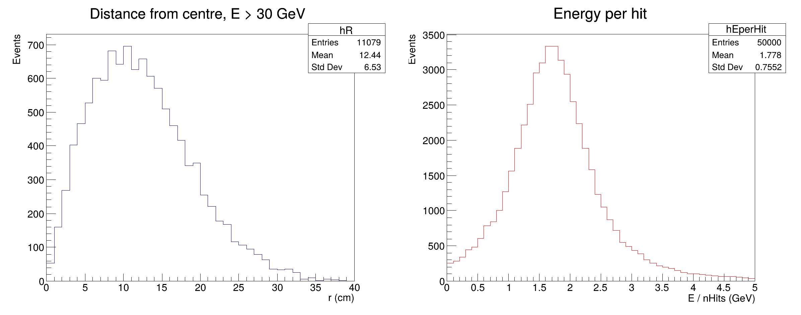

It is the mirror image of writing: you make variables, connect them to the branches
with `SetBranchAddress("name", &variable)`, and `tree->GetEntry(i)` fills them with the
values of event `i`.

> **The variable type must match the branch type exactly.** The branch `energy` was
> written as a `double`. If you connect it to a `float`, you get:
>
> ```text
> Error in <TTree::SetBranchAddress>: The pointer type given "Float_t" (5) does not
> correspond to the type needed "Double_t" (8) by the branch: energy
> ```
>
> and the values you read are garbage. Use `tree->Print()` to check the types.

`Long64_t` is ROOT's name for a 64-bit integer; use it to count entries, because trees can
have more than 2 billion of them.

## 7.6 TTreeReader: a safer loop

`TTreeReader` is the modern way to write the same loop. It checks the types for you and
makes array branches easy:

```cpp
// tree_reader.C -- the modern, safer way to loop over a tree: TTreeReader
// Run with:   root -l tree_reader.C      (run tree_write.C first)

void tree_reader()
{
   TFile *file = TFile::Open("toy_tree.root");
   TTreeReader reader("events", file);

   // The type is checked: a wrong type gives a clear error message
   TTreeReaderValue<double> energy(reader, "energy");
   TTreeReaderValue<int>    nHits(reader, "nHits");
   TTreeReaderArray<double> hitEnergy(reader, "hitEnergy");   // vector branch

   int nEvents = 0, nWithBigHit = 0;
   double sumMaxFraction = 0;

   while (reader.Next()) {               // loops over all events
      nEvents++;
      // *energy gives the value; hitEnergy works like an array
      double maxHit = 0;
      for (double e : hitEnergy) {
         if (e > maxHit) maxHit = e;
      }
      if (maxHit > 10) nWithBigHit++;
      sumMaxFraction += maxHit / *energy;
   }

   std::cout << "Events read                       : " << nEvents << std::endl;
   std::cout << "Events with a hit above 10 GeV    : " << nWithBigHit << std::endl;
   std::cout << "Average (largest hit / total E)   : " << sumMaxFraction / nEvents << std::endl;
}
```

```text
Processing tree_reader.C...
Events read                       : 50000
Events with a hit above 10 GeV    : 2182
Average (largest hit / total E)   : 0.420395
```

- `TTreeReaderValue<double> energy(reader, "energy")` connects to a single-value branch.
  Use `*energy` to get the value.
- `TTreeReaderArray<double> hitEnergy(reader, "hitEnergy")` connects to an array branch.
  You can loop over it, or use `hitEnergy[i]` and `hitEnergy.GetSize()`.
- `while (reader.Next())` loops over all entries.

With the wrong type, `TTreeReader` gives a clear message instead of garbage:

```text
Error in <TTreeReaderValueBase::CreateProxy()>: The branch energy contains data of
type double. It cannot be accessed by a TTreeReaderValue<float>
```

## 7.7 Many files: TChain

Data are usually split into many files with the same tree inside. A `TChain` makes them
look like one big tree:

```cpp
TChain chain("events");          // the name of the tree inside the files
chain.Add("run1.root");
chain.Add("run2.root");
chain.Add("data/run*.root");     // wildcards work too
std::cout << chain.GetEntries() << std::endl;
chain.Draw("energy");            // everything that works for a TTree works here
```

## 7.8 Which method should I use?

| Method | Use it for |
|--------|-----------|
| `TTree::Draw`, `Scan`, `GetEntries(cut)` | quick looks and checks |
| Loop with `TTreeReader` (or `SetBranchAddress`) | full control in C++; old code uses `SetBranchAddress` |
| `RDataFrame` (Chapter 9) | **the recommended way for analyses** — short, fast, and works in Python |

## Key points

- A tree is a table: rows are events (entries), columns are branches.
- Write: `Branch("name", &var)`, set the variables, `Fill()`, then `Write()`.
- Look: `Print()` for the structure, `Scan()` for values, `Draw()` for quick plots.
- `Draw("y:x")` puts y first. `Draw("expr>>h(n,a,b)")` names and bins the histogram.
- In a loop, the variable type must match the branch type exactly. `TTreeReader` checks
  this for you.
- `TChain` treats many files as one tree.

## Exercises

**Exercise 7.1 — Compare selections.** Using `toy_tree.root` and `TTree::Draw` with the
`"goff"` option, make two histograms of `energy`: one for all events, and one for events
with more than 20 hits. Normalise both to unit area and draw them on the same canvas with
a legend. Why does the second one have no events at low energy?

**Exercise 7.2 — Count in a loop.** Write a loop with `SetBranchAddress` that counts the
events with energy above 50 GeV *and* a distance r = √(x² + y²) less than 10 cm. Check
your answer with a single `tree->GetEntries("...")` call.

Solutions are in Appendix A and in `solutions/ch07`.

# 8 PyROOT: ROOT from Python

Everything you have done in C++ can also be done in Python, with exactly the same
classes and methods. This is called **PyROOT**. Python is popular because it is easy to
read and write, and because you can combine ROOT with Python's huge collection of
scientific packages (NumPy, pandas, matplotlib, scikit-learn, ...).

Examples for this chapter are in `macros/ch08_pyroot`. Some of them read
`../ch07_trees/toy_tree.root`, so run `tree_write.C` from Chapter 7 first.

## 8.1 From C++ to Python

You start with `import ROOT`. After that, every ROOT class and function is available as
`ROOT.something`. To translate a C++ macro into Python, follow these rules:

| C++ | Python |
|-----|--------|
| `auto h = new TH1D("h", "t", 10, 0, 1);` | `h = ROOT.TH1D("h", "t", 10, 0, 1)` |
| `h->Fill(x);` | `h.Fill(x)` |
| `h->GetXaxis()->SetTitle("x");` | `h.GetXaxis().SetTitle("x")` |
| `gStyle->SetOptStat(0);` | `ROOT.gStyle.SetOptStat(0)` |
| `TMath::Pi()` | `ROOT.TMath.Pi()` |
| `kRed + 1` | `ROOT.kRed + 1` |
| `true`, `false`, `nullptr` | `True`, `False`, `ROOT.nullptr` |
| `for (int i = 0; i < n; i++) { ... }` | `for i in range(n):` (and indent the block) |
| `std::cout << x << std::endl;` | `print(x)` |
| `// comment` | `# comment` |

In short: no `new`, no semicolons, no types, and `.` instead of `->` and `::`.

## 8.2 Your first PyROOT script

Here is the Gaussian fit of Section 5.2, in Python:

```python
# pyroot_basic.py -- histogram, fit and plot, written in Python
# Run with:   python pyroot_basic.py
#   (or  python -i pyroot_basic.py  to keep the window open)
import ROOT

ROOT.gStyle.SetOptFit(1111)
ROOT.gStyle.SetStatW(0.25)
ROOT.gStyle.SetStatH(0.20)

# Exactly the same classes and methods as in C++
h = ROOT.TH1D("h", "Gaussian fit in Python;Mass (GeV);Events", 50, 0, 10)
rng = ROOT.TRandom3(5)
for i in range(1000):
    h.Fill(rng.Gaus(5.0, 1.5))
h.SetMaximum(1.6 * h.GetMaximum())

c = ROOT.TCanvas("c", "PyROOT", 800, 600)
h.Fit("gaus")
h.SetMarkerStyle(20)
h.Draw("E")
c.SaveAs("pyroot_basic.png")

fit = h.GetFunction("gaus")
print(f"Mean  = {fit.GetParameter(1):.3f} +- {fit.GetParError(1):.3f}")
print(f"Sigma = {fit.GetParameter(2):.3f} +- {fit.GetParError(2):.3f}")
print(f"chi2/ndf = {fit.GetChisquare():.1f} / {fit.GetNDF()}")
```

```bash
python pyroot_basic.py
```

```text
****************************************
Minimizer is Minuit2 / Migrad
Chi2                      =      52.9448
NDf                       =           43
Edm                       =  5.45987e-06
NCalls                    =           53
Constant                  =      49.0973   +/-   1.98969
Mean                      =      5.09064   +/-   0.0511566
Sigma                     =      1.54279   +/-   0.0385196    	 (limited)
Mean  = 5.091 +- 0.051
Sigma = 1.543 +- 0.039
chi2/ndf = 52.9 / 43
```

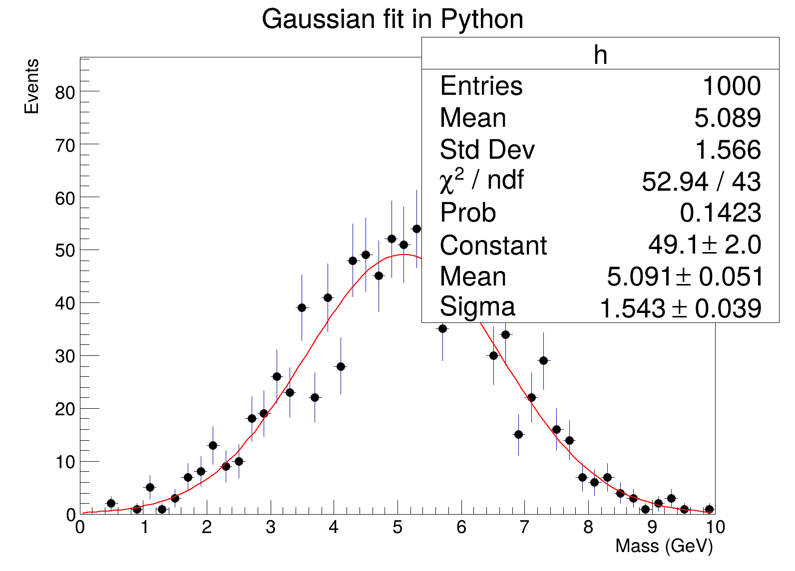

> **The window closes at once?** When a Python script ends, Python quits, and the
> canvas window closes with it. To keep it open, run the script with
> `python -i pyroot_basic.py`. The `-i` means "stay in interactive mode after the
> script"; type `exit()` or press Ctrl+D to quit. The PNG file is saved in any case.

## 8.3 Object lifetimes in Python

In C++ macros we used `new` so that objects stay alive. In Python, an object lives as
long as **some variable refers to it**. Inside a function, local variables disappear when
the function ends — and so does their canvas:

```python
def make_plot():
    c = ROOT.TCanvas("c", "", 800, 600)
    h = ROOT.TH1D("h", "", 10, 0, 1)
    h.Draw()
    # function ends: c and h are deleted, the window disappears

def make_plot_that_stays():
    c = ROOT.TCanvas("c", "", 800, 600)
    h = ROOT.TH1D("h", "", 10, 0, 1)
    h.Draw()
    return c, h          # give them back to the caller, who keeps them

c, h = make_plot_that_stays()
```

Code at the top level of a script (not inside a function), as in our examples, does not
have this problem.

## 8.4 Reading a tree in Python

Branches become attributes of the tree, so a loop over events is very short:

```python
# pyroot_tree.py -- read a TTree in Python
# Run with:   python pyroot_tree.py
#   (needs ../ch07_trees/toy_tree.root: run tree_write.C first)
import ROOT

f = ROOT.TFile.Open("../ch07_trees/toy_tree.root")
tree = f.Get("events")
print("Events in tree:", tree.GetEntries())

# Branches are attributes of the event: event.energy, event.hitEnergy ...
n_high = 0
total_hits = 0
for event in tree:
    total_hits += event.nHits
    if event.energy > 50:
        n_high += 1

print("Events with energy > 50 GeV:", n_high)
print(f"Average number of hits: {total_hits / tree.GetEntries():.2f}")

# Look at the first event in detail
tree.GetEntry(0)
print("Event 0: energy =", round(tree.energy, 2), "GeV, hits:",
      [round(e, 2) for e in tree.hitEnergy])
```

```text
Events in tree: 50000
Events with energy > 50 GeV: 4104
Average number of hits: 11.00
Event 0: energy = 17.49 GeV, hits: [11.06, 6.44]
```

This is easy to write, but **slow**: a Python loop over millions of events can take
minutes where C++ takes seconds. For real analyses in Python, use `RDataFrame`
(Chapter 9), which runs the loop in fast C++ for you.

## 8.5 ROOT and NumPy

PyROOT works together with NumPy arrays:

```python
# pyroot_numpy.py -- moving numbers between NumPy and ROOT
# Run with:   python pyroot_numpy.py
import ROOT
import numpy as np

rng = np.random.default_rng(1)

# NumPy array -> ROOT histogram (Fill accepts a whole array)
x = rng.exponential(2.0, size=100000)
h = ROOT.TH1D("h", "Exponential (filled from NumPy);t (#mus);Events", 40, 0, 10)
h.Fill(x)
print("Entries:", h.GetEntries())

# ROOT histogram -> NumPy array of bin contents
counts = h.values()
print("First five bins:", counts[:5])
print("Type:", type(counts))

# Fit with an exponential: expo = exp([0] + [1]*t), so lifetime = -1/[1]
c = ROOT.TCanvas("c", "NumPy", 800, 600)
c.SetLogy()
h.Fit("expo", "Q")          # Q = quiet
h.Draw("E")
c.SaveAs("pyroot_numpy.png")
slope = h.GetFunction("expo").GetParameter(1)
print(f"Fitted lifetime = {-1/slope:.3f}  (generated 2.0)")
```

```text
Entries: 100000.0
First five bins: [11661. 10420.  9225.  7983.  7214.]
Type: <class 'numpy.ndarray'>
Fitted lifetime = 1.993  (generated 2.0)
```

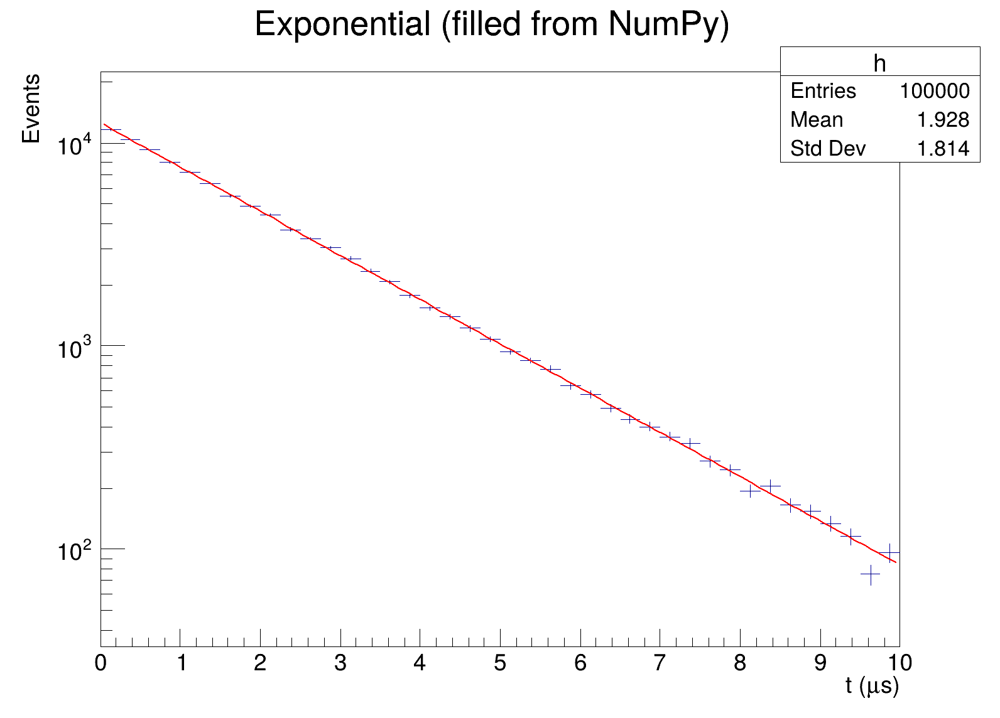

- `h.Fill(array)` fills a whole NumPy array at once (fast).
- `h.values()` gives the bin contents as a NumPy array (without under- and overflow),
  and `h.variances()` gives the squared errors. You can then use them with matplotlib or
  any other Python tool.
- Chapter 9 shows how to get tree columns as NumPy arrays (`AsNumpy`).

## 8.6 Using C++ from Python

You can mix the two languages. `ROOT.gInterpreter.Declare` compiles a piece of C++, and
the result can be called from Python:

```python
import ROOT

ROOT.gInterpreter.Declare("""
double kinetic(double m, double v) { return 0.5 * m * v * v; }
""")
print(ROOT.kinetic(2.0, 3.0))       # prints 9.0

# Load an existing C++ macro and call its function
ROOT.gROOT.ProcessLine(".L ../ch02_first_steps/squares.C")
ROOT.squares(2)
```

This is useful when you have a fast C++ function (or an existing macro) that you want
to use in a Python analysis.

## 8.7 Jupyter notebooks

A Jupyter notebook mixes code, results, plots and text in one document in your web
browser. It is very convenient for exploring data and for sharing an analysis. If you
installed ROOT with conda (Section 1.3), Jupyter is already there. Start it from the
folder with your files:

```bash
conda activate root-tutorial
cd root-tutorial/macros/ch08_pyroot
jupyter lab
```

A browser window opens. Click *Python 3* under *Notebook* to make a new notebook, and
type code into the cells. Press **Shift+Enter** to run a cell.

```python
import ROOT
%jsroot on

h = ROOT.TH1D("h", "Notebook test;x;Entries", 50, -4, 4)
h.FillRandom("gaus", 10000)
c = ROOT.TCanvas()
h.Draw()
c.Draw()        # show the canvas in the notebook
```

- `c.Draw()` at the end of a cell shows the canvas in the notebook.
- `%jsroot on` makes the plots interactive (zoom, move the mouse over bins, right-click
  menus), using ROOT's JavaScript graphics. Without it you get static pictures.
- A cell that starts with `%%cpp` contains C++ instead of Python, so you can mix both.

You can also start a notebook that uses C++ in every cell with `root --notebook`.

## Key points

- `import ROOT`, then use `ROOT.TH1D`, `ROOT.TCanvas`, ... with `.` instead of `->`.
- Run scripts with `python script.py`, or `python -i script.py` to keep windows open.
- Python objects live as long as a variable refers to them — return canvases from functions.
- Python loops over events are slow; use RDataFrame for large data.
- `h.Fill(numpy_array)` and `h.values()` connect ROOT histograms and NumPy.
- In Jupyter: `%jsroot on` for interactive plots, `c.Draw()` to show a canvas.

## Exercises

**Exercise 8.1 — The muon lifetime in Python.** Redo Exercise 5.2 in Python. This time,
generate the 5000 decay times with NumPy
(`numpy.random.default_rng().exponential(2.197, size=5000)`), fill them into the histogram
with a single `Fill` call, and fit with `expo`. Print the lifetime with its error.
If you have Jupyter, try it in a notebook too.

Solutions are in Appendix A and in `solutions/ch08`.

# 9 RDataFrame: modern analysis

`RDataFrame` is ROOT's modern, recommended way to analyse data in trees. Instead of
writing the event loop yourself, you *describe* what you want — which events to keep,
which new quantities to compute, which histograms to fill — and RDataFrame runs the
loop for you, in fast C++, and if you like on all the cores of your computer. The same
code works in Python and C++.

Examples for this chapter are in `macros/ch09_rdataframe`. They read
`../ch07_trees/toy_tree.root`, so run `tree_write.C` from Chapter 7 first.

## 9.1 The idea

An RDataFrame analysis is a chain of steps:

```text
data (tree) ──> Filter ──> Define ──> Filter ──> ... ──> results
                (keep some   (add a new                  (histograms, counts,
                 events)      column)                     means, new files)
```

- **`Filter("cut")`** keeps only the events that pass the cut.
- **`Define("name", "expression")`** adds a new column, computed from other columns.
- **Actions** produce results: `Count()`, `Mean("col")`, `Histo1D(...)`, `Snapshot(...)`.

The expressions are strings of C++ code, like the cuts in `TTree::Draw`. They are
compiled, so they are fast even when you write the analysis in Python.

## 9.2 A first example

```python
# rdf_basic.py -- first steps with RDataFrame
# Run with:   python rdf_basic.py     (needs ../ch07_trees/toy_tree.root)
import ROOT

# A dataframe on top of a tree: RDataFrame("tree name", "file name")
df = ROOT.RDataFrame("events", "../ch07_trees/toy_tree.root")

# Define = make a new column.  Filter = keep only events that pass a cut.
df_sel = (df.Define("r", "sqrt(x*x + y*y)")
            .Filter("energy > 30", "Energy above 30 GeV"))

# Results are LAZY: these lines only "book" the work, nothing runs yet
n_all  = df.Count()
n_sel  = df_sel.Count()
mean_r = df_sel.Mean("r")
h_e = df.Histo1D(("h_e", "All events;Energy (GeV);Events", 50, 0, 100), "energy")
h_r = df_sel.Histo1D(("h_r", "Energy > 30 GeV;r (cm);Events", 40, 0, 40), "r")

# The first time we ask for a value, ONE loop over the data fills everything
print("All events     :", n_all.GetValue())
print("Selected events:", n_sel.GetValue())
print(f"Mean r         : {mean_r.GetValue():.2f} cm")
print("The event loop ran", df.GetNRuns(), "time(s)")

c = ROOT.TCanvas("c", "RDataFrame", 1200, 500)
c.Divide(2, 1)
c.cd(1)
ROOT.gPad.SetLogy()
h_e.Draw()
c.cd(2)
h_r.Draw()
c.SaveAs("rdf_basic.png")

# Print the first rows of some columns
df_sel.Display(["eventNumber", "energy", "nHits", "r"], 5).Print()
```

```text
All events     : 50000
Selected events: 11079
Mean r         : 12.45 cm
The event loop ran 1 time(s)
+-----+-------------+-----------+-------+-----------+
| Row | eventNumber | energy    | nHits | r         |
+-----+-------------+-----------+-------+-----------+
| 5   | 5           | 64.855798 | 30    | 17.316796 |
+-----+-------------+-----------+-------+-----------+
| 18  | 18          | 41.721539 | 25    | 17.523374 |
+-----+-------------+-----------+-------+-----------+
| 22  | 22          | 47.012870 | 33    | 6.428211  |
+-----+-------------+-----------+-------+-----------+
| 43  | 43          | 31.027139 | 14    | 2.162716  |
+-----+-------------+-----------+-------+-----------+
| 44  | 44          | 49.813152 | 25    | 3.889823  |
+-----+-------------+-----------+-------+-----------+
```

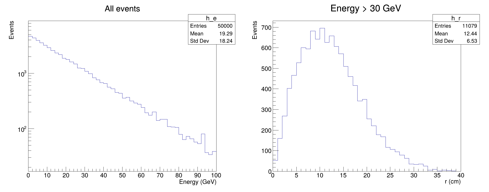

Two things are new here.

**Lazy evaluation.** The lines that book `Count`, `Mean` and `Histo1D` do not read any
data; they just *book* (register) the results. The event loop runs only when you first
ask for a value, with `GetValue()` or by drawing a histogram. Then **all** booked results
are filled together, in **one** pass over the data — as the line
`The event loop ran 1 time(s)` shows. This is why RDataFrame is fast: book everything
first, then use the results.

> **Tip:** Avoid asking for a result in the middle of booking. If you call `GetValue()`
> on the first result before booking the others, RDataFrame has to loop over the data a
> second time for the rest.

**The histogram "model".** `Histo1D(("h_r", "title;x;y", 40, 0, 40), "r")` takes the
same arguments as `TH1D` (name, titles, bins, range) as a tuple, followed by the column
to fill. Without the model, `Histo1D("r")` chooses the binning itself.

`Display(columns, n)` prints the first `n` rows of some columns — handy for checking
that your `Define`s do what you expect.

## 9.3 The same in C++

RDataFrame looks almost the same in C++:

```cpp
// rdf_basic_cpp.C -- the same first RDataFrame analysis, in C++
// Run with:   root -l rdf_basic_cpp.C     (needs ../ch07_trees/toy_tree.root)

void rdf_basic_cpp()
{
   ROOT::RDataFrame df("events", "../ch07_trees/toy_tree.root");

   // A Define can be a string (as in Python) ...
   auto dfSel = df.Define("r", "sqrt(x*x + y*y)")
                  .Filter("energy > 30", "Energy above 30 GeV");

   // ... or a C++ function (here a "lambda") plus the list of input columns
   auto dfPhi = dfSel.Define("phi", [](double x, double y) { return atan2(y, x); },
                             {"x", "y"});

   auto nSel = dfPhi.Count();
   auto hPhi = dfPhi.Histo1D({"hPhi", "Energy > 30 GeV;#phi (rad);Events", 40, -4, 4}, "phi");

   std::cout << "Selected events: " << *nSel << std::endl;   // * gives the value

   auto c = new TCanvas("c", "RDataFrame in C++", 800, 600);
   hPhi->SetMinimum(0);
   // DrawClone: the histogram belongs to the dataframe and is deleted when
   // the macro ends; a clone stays on the canvas.
   hPhi->DrawClone();
   c->SaveAs("rdf_basic_cpp.png");
}
```

```text
Processing rdf_basic_cpp.C...
Selected events: 11079
```

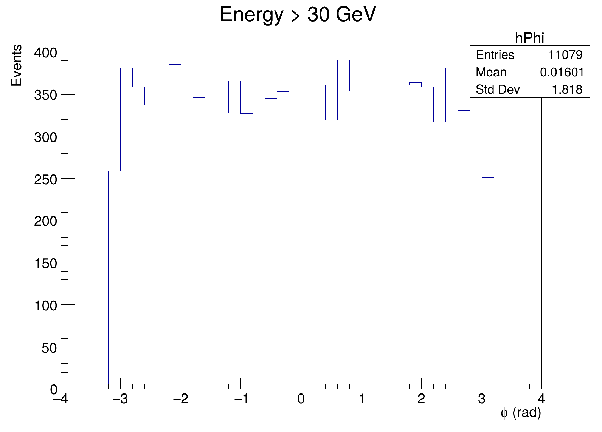

Differences from Python:

- the histogram model is written with braces: `{"hPhi", "title", 40, -4, 4}`;
- a result is used with `*`: `*nSel` is the number, and `hPhi->` calls methods of the
  histogram;
- `Define` can also take a C++ function (here a *lambda*, an unnamed function written
  in place) and the list of columns it needs. This is useful for longer calculations;
- the histograms belong to the dataframe and are deleted when the macro ends, so we draw
  a copy with `DrawClone()`.

## 9.4 Cuts and the cut-flow report

Give each `Filter` a name as its second argument. `Report()` then tells you how many
events passed each cut:

```python
# rdf_cutflow.py -- several named cuts and a cut-flow report
# Run with:   python rdf_cutflow.py     (needs ../ch07_trees/toy_tree.root)
import ROOT

df = ROOT.RDataFrame("events", "../ch07_trees/toy_tree.root")

# Give every Filter a name: the report then tells you what each cut did
sel = (df.Filter("energy > 10", "Energy > 10 GeV")
         .Filter("nHits >= 5", "At least 5 hits")
         .Filter("sqrt(x*x + y*y) < 20", "Inside r < 20 cm")
         .Filter("Max(hitEnergy) < 0.5 * energy", "No dominant hit"))

report = sel.Report()
n_final = sel.Count()

print("Events after all cuts:", n_final.GetValue())
report.Print()
```

```text
Events after all cuts: 24345
Energy > 10 GeV     : pass=30247      all=50000      -- eff=60.49 % cumulative eff=60.49 %
At least 5 hits     : pass=29112      all=30247      -- eff=96.25 % cumulative eff=58.22 %
Inside r < 20 cm    : pass=25236      all=29112      -- eff=86.69 % cumulative eff=50.47 %
No dominant hit     : pass=24345      all=25236      -- eff=96.47 % cumulative eff=48.69 %
```

`eff` is the fraction of events that pass this cut (out of those that passed the
previous ones), and `cumulative eff` is the fraction that pass all cuts so far. A table
like this is part of every physics analysis.

## 9.5 Array columns (RVec)

In RDataFrame, an array branch like `hitEnergy` appears as an **RVec**: an array that
supports calculations on all elements at once, without writing a loop:

```python
# rdf_vectors.py -- working with vector columns (one value per hit)
# Run with:   python rdf_vectors.py     (needs ../ch07_trees/toy_tree.root)
import ROOT

df = ROOT.RDataFrame("events", "../ch07_trees/toy_tree.root")

# hitEnergy is an RVec: an array with different length in each event.
# Operations work on all elements at once, no loop needed:
#   hitEnergy > 2           -> array of true/false
#   Sum(hitEnergy > 2)      -> how many hits above 2 GeV
#   hitEnergy[hitEnergy > 2] -> only the hits above 2 GeV
df2 = (df.Define("nBigHits", "Sum(hitEnergy > 2.0)")
         .Define("bigHits", "hitEnergy[hitEnergy > 2.0]")
         .Define("maxHit", "Max(hitEnergy)")
         .Define("fracBig", "Sum(bigHits) / energy"))

h_n = df2.Histo1D(("h_n", "Hits above 2 GeV;Number of hits;Events", 30, 0, 30), "nBigHits")
# Histogramming a vector column fills one entry per element (per hit)
h_hits = df2.Histo1D(("h_hits", "Energy of every hit;Hit energy (GeV);Hits", 60, 0, 30), "hitEnergy")

df2.Display(["nHits", "nBigHits", "maxHit", "fracBig"], 5).Print()

c = ROOT.TCanvas("c", "Vectors", 1200, 500)
c.Divide(2, 1)
c.cd(1)
h_n.Draw()
c.cd(2)
ROOT.gPad.SetLogy()
h_hits.Draw()
c.SaveAs("rdf_vectors.png")
```

```text
+-----+-------+----------+-----------+----------+
| Row | nHits | nBigHits | maxHit    | fracBig  |
+-----+-------+----------+-----------+----------+
| 0   | 2     | 2        | 11.055867 | 1.000000 |
+-----+-------+----------+-----------+----------+
| 1   | 1     | 0        | 0.019199  | 0.000000 |
+-----+-------+----------+-----------+----------+
| 2   | 11    | 3        | 4.594691  | 0.550628 |
+-----+-------+----------+-----------+----------+
| 3   | 3     | 1        | 2.525240  | 0.568202 |
+-----+-------+----------+-----------+----------+
| 4   | 1     | 1        | 2.900047  | 1.000000 |
+-----+-------+----------+-----------+----------+
```

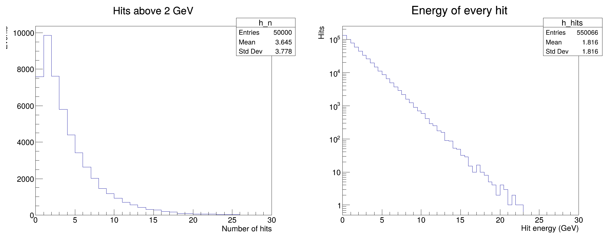

The most useful operations on an RVec `v`:

| Expression | Result |
|------------|--------|
| `v.size()` | number of elements |
| `v > 2.0` | an array of true/false, one per element |
| `v[v > 2.0]` | only the elements above 2.0 |
| `Sum(v)`, `Mean(v)`, `Max(v)`, `Min(v)` | one number per event |
| `Sum(v > 2.0)` | how many elements are above 2.0 |
| `ArgMax(v)` | index of the largest element |
| `Sort(v)`, `Reverse(v)`, `Take(v, n)` | sorted, reversed, first n elements |
| `v[0]` | the first element (check that `v.size() > 0` first!) |
| `InvariantMass(pt, eta, phi, m)` | invariant mass of the particles (Chapter 10) |
| `DeltaR(eta1, eta2, phi1, phi2)` | distance in (η, φ) between particles |

These functions are part of `ROOT::VecOps` and can be used directly in the strings.
`Histo1D` of an RVec column fills one entry per element.

## 9.6 Saving results: Snapshot, NumPy and many cores

```python
# rdf_snapshot.py -- save a selection to a new file, use all CPU cores,
#                    and get columns as NumPy arrays
# Run with:   python rdf_snapshot.py     (needs ../ch07_trees/toy_tree.root)
import ROOT

ROOT.EnableImplicitMT()      # use all CPU cores (call it BEFORE making the dataframe)

df = ROOT.RDataFrame("events", "../ch07_trees/toy_tree.root")
skim = (df.Filter("energy > 50", "High energy")
          .Define("r", "sqrt(x*x + y*y)"))

# Write the selected events, with only some columns, to a new file
skim.Snapshot("events_skim", "skim.root", ["eventNumber", "energy", "nHits", "r"])
print("Wrote skim.root")

# Read it back and get NumPy arrays
df_skim = ROOT.RDataFrame("events_skim", "skim.root")
arrays = df_skim.AsNumpy(["energy", "r"])
energy = arrays["energy"]
print("Events in skim :", len(energy))
print(f"Mean energy    : {energy.mean():.2f} GeV")
print(f"Largest energy : {energy.max():.2f} GeV")
```

```text
Wrote skim.root
Events in skim : 4104
Mean energy    : 70.26 GeV
Largest energy : 229.54 GeV
```

- **`Snapshot("tree", "file.root", [columns])`** writes the events that pass your
  filters, with the columns you choose (including `Define`d ones), to a new file. This
  is called a *skim*: a smaller file with only what you need, which is much faster to
  analyse again and again.
- **`AsNumpy([columns])`** gives the columns as a Python dictionary of NumPy arrays,
  ready for NumPy, pandas or matplotlib.
- **`ROOT.EnableImplicitMT()`** makes RDataFrame use all the cores of your computer. It
  must be called *before* the RDataFrame is created. With more than one thread, the
  order of the events is not guaranteed, so do not rely on it.

> **Note:** `df.Range(n)`, which processes only the first `n` events, does not work
> together with `EnableImplicitMT()`.

## 9.7 Other useful actions

| Action | Result |
|--------|--------|
| `Count()` | number of events |
| `Sum("x")`, `Mean("x")`, `Min("x")`, `Max("x")` | one number |
| `Stats("x")` | mean, RMS, minimum and maximum together |
| `Histo1D(model, "x")`, `Histo2D(model, "x", "y")` | histograms |
| `Profile1D(model, "x", "y")` | mean of y in bins of x |
| `Graph("x", "y")` | a TGraph |
| `Take["double"]("x")` | all values in a list |
| `AsNumpy(["x", "y"])` | NumPy arrays (Python only) |
| `Snapshot("tree", "file.root", ["x"])` | write a new file |
| `Report()`, `Display(["x"], n)` | cut flow, first rows |

A dataframe can read many files at once, with wildcards or a list:
`ROOT.RDataFrame("events", "data/run*.root")`. It can even read files over the network,
as you will see in Chapter 10.

## Key points

- `ROOT.RDataFrame("tree", "file.root")` opens the data; `Filter` keeps events;
  `Define` adds columns; actions (`Count`, `Histo1D`, ...) give results.
- Results are lazy: book everything first; the loop runs once, when a value is first used.
- Name your filters and use `Report()` for the cut flow.
- Array columns are RVecs: `Sum(v > 2)`, `v[v > 2]`, `Max(v)` work without loops.
- `Snapshot` writes a skim; `AsNumpy` gives NumPy arrays; `EnableImplicitMT()` uses all cores.

## Exercises

**Exercise 9.1 — A small analysis.** With RDataFrame and `toy_tree.root`:

1. Define the distance `r = sqrt(x*x + y*y)`.
2. Select events with energy above 30 GeV, and then with at least 10 hits, using two
   *named* filters.
3. Make a histogram of `r` for the selected events and save it as a PNG.
4. Print the mean of `r` for the selected events and the cut-flow report.
5. Write the selected events, with only the columns `energy` and `r`, to a file
   `selected.root`. Check the new file with `rootls -t selected.root`.

Solutions are in Appendix A and in `solutions/ch09`.

# 10 Mini-project: find the hidden particle

Time to put everything together. You get a dataset of collision events with muons. Some
of the events contain an unknown particle that decays into a muon and an antimuon. Your
job: **find the particle, measure its mass, and identify it.** This is exactly how many
particles were discovered.

Work in teams of two or three. The files are in `macros/ch10_project`.

## 10.1 The data

First create the dataset (it takes a few seconds):

```bash
cd root-tutorial/macros/ch10_project
root -l -q make_dimuon_toy.C
```

This writes `dimuon_toy.root` with a tree called `Events`. Each entry is one collision
event with one or more muons. The branches are:

| Branch | Type | Meaning |
|--------|------|---------|
| `nMuon` | integer | number of muons in the event |
| `Muon_pt` | array of float | transverse momentum $p_\mathrm{T}$ of each muon (GeV) |
| `Muon_eta` | array of float | pseudorapidity η of each muon |
| `Muon_phi` | array of float | azimuthal angle φ of each muon (radians) |
| `Muon_mass` | array of float | muon mass (0.1057 GeV) |
| `Muon_charge` | array of int | charge of each muon, +1 or −1 |

So `Muon_pt[0]` is the transverse momentum of the first muon in the event, and
`Muon_charge[1]` is the charge of the second one.

> **The coordinates of particle physics.** The beams travel along the z axis.
> **$p_\mathrm{T}$** is the momentum perpendicular to the beam. **φ** is the angle around the beam
> (from −π to π). **η** (pseudorapidity) describes the angle θ to the beam:
> η = −ln tan(θ/2). A particle at 90° to the beam has η = 0; large |η| means close to
> the beam. Together, ($p_\mathrm{T}$, η, φ, m) fully describe a particle's four-momentum.

## 10.2 The physics: invariant mass

When a particle X decays into two muons, X → μ⁺μ⁻, energy and momentum are conserved.
So the **invariant mass** of the two muons,

$$m_{\mu\mu}^2 = (E_1 + E_2)^2 - |\vec p_1 + \vec p_2|^2 ,$$

is equal to the mass of X, whatever direction or speed X had. If you compute $m_{\mu\mu}$ for
many events and fill a histogram:

- muon pairs that come from X all give the **same** mass: they form a **peak** at the
  mass of X (as wide as the detector resolution);
- muon pairs that do not come from a decay (random pairs, other processes) give a
  **smooth background**.

You do not need to code the formula yourself: RDataFrame has a function
`ROOT::VecOps::InvariantMass(pt, eta, phi, mass)` that computes the invariant mass of all
particles in the arrays.

## 10.3 Your tasks

Use RDataFrame, in Python or C++, as you prefer. Start a new file, e.g.
`my_analysis.py`, and build it up step by step, checking the output at each step.

**Step 1 — Look at the data.** How many events are there? Use `rootls -t dimuon_toy.root`
and `df.Display([...], 5).Print()` to look at a few events. Make histograms of `nMuon`
and of `Muon_pt`. (*Hint:* `Histo1D` of an array column fills every element.)

**Step 2 — Select muon pairs.** Keep only events with **exactly two muons**, and then
only those where the two muons have **opposite charge**. Use named filters, and print
the cut-flow report at the end.

**Step 3 — Compute the invariant mass** with `Define` and `InvariantMass`.

**Step 4 — Look for a peak.** Make a histogram of the mass from 0 to 10 GeV with 40 MeV
bins (how many bins is that?). Can you see a peak? Where? Is there more than one?

**Step 5 — Fit the peak.** Make a second histogram that zooms into the region around the
biggest peak, with finer bins. Fit it with a Gaussian plus a background function
(`"gaus(0) + expo(3)"` or `"gaus(0) + pol2(3)"`), with sensible starting values and the
`"R"` option. Find:

- the **mass** of the particle (the mean of the Gaussian), with its error;
- the **width** (sigma) — this is the detector resolution, not the true width of the particle;
- the **number of signal events** (area of the Gaussian divided by the bin width).

**Step 6 — Identify the particle.** Compare your mass with the list of particles of the
Particle Data Group (<https://pdg.lbl.gov>, *Summary Tables*). Which known particle has
this mass and decays into two muons?

**Step 7 — Make a final plot** good enough for a talk:

- data with error bars, the fit curve, and the background part of the fit drawn separately;
- axis titles with units, e.g. `m_{#mu#mu} (GeV)` and `Events / 10 MeV`;
- a legend, and your results (mass, width, signal) written on the plot with `TLatex`;
- saved as **PDF** and PNG.

**Step 8 — Save your work** — histograms and fit function — in a ROOT file.

> **Hints.** Each step uses something from earlier chapters:
>
> - Filters: `df.Filter("nMuon == 2", "Exactly two muons")` (Chapter 9)
> - Charges: `"Muon_charge[0] != Muon_charge[1]"`
> - Mass: `df.Define("Dimuon_mass", "ROOT::VecOps::InvariantMass(Muon_pt, Muon_eta, Muon_phi, Muon_mass)")`
> - Fitting a histogram from RDataFrame: get the real histogram first with
>   `h = result.GetValue()`, then `h.Fit(...)` (Chapter 5)
> - Number of bins and bin width: `h.GetNbinsX()`, `h.GetBinWidth(1)`
> - Peak position for a starting value: `h.GetBinCenter(h.GetMaximumBin())`

## 10.4 Extra tasks for fast teams

**A. Same-charge pairs.** Make the mass histogram also for pairs with the **same** charge
(++ or −−), and draw it on top of the opposite-charge one. A real particle decays to
μ⁺μ⁻, never to μ⁺μ⁺. So what do the same-charge pairs tell you? Subtract the same-charge
histogram from the opposite-charge one and look at the result. (This *like-sign
subtraction* is a standard technique, for example in heavy-ion experiments.)

**B. A second particle.** Is there a second, smaller peak? Fit both peaks together with
`"gaus(0) + gaus(3) + expo(6)"`. What is the second particle? What is the ratio of the
number of events in the two peaks?

**C. Optimise the cuts.** Muons from the particle tend to have a higher $p_\mathrm{T}$ than the
random background muons. Add a cut that requires both muons to have $p_\mathrm{T}$ above 1.5, 2,
2.5 GeV. For each cut, fit again and compute the signal S and background B within ±3σ
of the peak, the ratio S/B, and the *significance* S/√(S+B). Which cut gives the
cleanest peak? Which gives the most significant one? Are these the same?

**D. Real data!** The branch names in our toy data are the same as in a real dataset
published by the CMS experiment at CERN: 61 million events from 2012. Run your analysis
on it — only the file name changes! The script `cms_open_data.py` shows how. It needs an
internet connection and reads the first 2 million events in about two minutes:

```bash
python cms_open_data.py
```

Look at the result: how many particles can you recognise?

## 10.5 Presenting your result

At the end of Day 2 each team shows its final plot and says in two minutes:

1. what selection you used and how many events passed;
2. the mass, width and number of signal events from your fit, with errors;
3. which particle you think it is, and why;
4. one thing that surprised you or that you would do better with more time.

A good physics plot has: axis titles with units, a legend, readable text sizes, no
unnecessary decoration, and the important numbers on it.

> **Spoiler warning.** A complete worked solution, the results, and the plot from the
> real CMS data are in Appendix A, Section A.10. Try the project yourself first!

## Key points

- An invariant-mass peak reveals a particle; its position is the mass.
- A typical analysis: select events → compute a quantity → histogram → fit → compare
  with known values → make a clear plot.
- Everything you learned in this tutorial was needed for this project — well done!

# 11 Common mistakes and how to fix them

Everybody makes these mistakes when starting with ROOT. The messages below are copied
from real ROOT sessions, so you can recognise them when they appear on your screen.

## 11.1 How to read an error message

- **Read the first error, not the last.** One mistake often causes many messages; the
  first one is usually the real problem.
- **Look for the file name and line number.** `semicolon.C:3:13: error: ...` means: file
  `semicolon.C`, line 3, column 13.
- **A crash prints a long list** starting with `*** Break *** segmentation violation`,
  followed by many lines of computer addresses (the *stack trace*). You can usually
  ignore the list itself. Look at the messages printed *just before* the crash, and think
  about which pointer could be `nullptr`.

## 11.2 Macros

**The macro does nothing.**

```text
Processing myplot.C...
warning: Failed to call `myplot()` to execute the macro.
Add this function or rename the macro. Falling back to `.L`.
```

The file `myplot.C` contains a function with a different name (here `plot()`). The
function name must be the same as the file name. Rename one of them.

**A missing semicolon.**

```text
semicolon.C:3:13: error: expected ';' at end of declaration
   int n = 5
            ^
            ;
```

The compiler even shows you where the semicolon should go.

**Wrong numbers from a division.** `int a = 7, b = 2; double r = a / b;` gives
`r = 3`, not 3.5, because `a / b` is computed with integers before it is stored. Write
`double(a) / b` or use `double` variables. This mistake gives **no error message** —
you just get wrong results, so it is worth remembering.

**Running a macro twice in the same session.**

```text
Warning in <TROOT::Append>: Replacing existing TH1: h (Potential memory leak).
```

You created a second histogram called `h` while the first still exists. This is only a
warning and is harmless in small macros. If you want to avoid it, quit and restart ROOT,
or give your histograms different names.

## 11.3 Plots

**My plot disappears when the macro ends.** You created the object without `new`
(`TH1D h(...)` or `TCanvas c(...)`), so it was deleted at the end of the macro. Use
`auto h = new TH1D(...)` (Section 2.6). In Python, keep a variable that refers to it
(Section 8.3).

**The second histogram is cut off at the top.** The first histogram drawn decides the y
range. Call `SetMaximum` on the first histogram (Section 3.6).

**My graph does not appear.** The first graph on a pad needs the `A` option to draw the
axes: `g->Draw("AP")`, not `g->Draw("P")`.

**My histogram is empty, but I filled it.** Your values are outside the range
`xmin`–`xmax`, so they all went into the underflow or overflow bins. Compare
`h->GetEntries()` (counts everything) with `h->Integral()` (counts only the visible
bins), and fix the range.

**Everything is drawn on top of each other.** You forgot to make a new canvas (or to
`cd()` to a different pad) before drawing the next thing. Without `"SAME"`, `Draw`
replaces the content of the *current* pad.

**Python: the window closes immediately.** Run the script with `python -i script.py`
(Section 8.2).

## 11.4 Files

**The file does not exist.**

```text
Error in <TFile::TFile>: file /home/me/root-tutorial/macros/ch06_files/my_resluts.root does not exist

 *** Break *** segmentation violation
```

The file name is wrong (here: `resluts`), or you are running the macro from a different
folder. ROOT tells you the full path where it looked. The crash afterwards happens
because the macro then uses the `nullptr` file. Check the pointer:

```cpp
TFile *f = TFile::Open("my_results.root");
if (!f || f->IsZombie()) { std::cout << "Cannot open file" << std::endl; return; }
```

**The object is not in the file.**

```text
h = 0x0

 *** Break *** segmentation violation
```

`f->Get<TH1D>("hEnergyy")` found no object with that name and returned `nullptr`
(printed as `0x0`). Check the names with `f->ls()` or `rootls -l file.root`, and remember
the folder: `"calibration/hGain"`.

**My histogram vanished after I closed the file.** The file owned it and deleted it.
Use `h->SetDirectory(nullptr)` before closing (Section 6.4).

## 11.5 Trees

**Wrong variable type.**

```text
Error in <TTree::SetBranchAddress>: The pointer type given "Float_t" (5) does not
correspond to the type needed "Double_t" (8) by the branch: energy
```

The variable must have exactly the type of the branch. Check with `tree->Print()`.
With `TTreeReader`:

```text
Error in <TTreeReaderValueBase::CreateProxy()>: The branch energy contains data of
type double. It cannot be accessed by a TTreeReaderValue<float>
```

**`Scan` shows fewer rows than expected.** The last argument of `Scan` is the number of
entries to look at, not the number of rows to print (Section 7.3).

## 11.6 RDataFrame and Python

**A misspelled column name.**

```text
cppyy.gbl.std.runtime_error: Template method resolution failed:
  ...
    runtime_error: Unknown column: "enrgy"
```

In Python, the message is long, but the last line tells you what is wrong. Check the
column names with `df.GetColumnNames()`.

**ROOT and Python versions do not match.**

```text
ImportError:
ROOT was built for Python 3.14.7, but you are running Python 3.9.6.
Python major.minor versions must match. Use a matching Python or ROOT build.
```

Use the Python that ROOT was built with (Sections 1.3 and 1.5). With conda, make sure
the environment is activated.

**A Filter that is not a cut.**

```text
runtime_error: Filter: the following expression does not evaluate to bool:
1
```

A `Filter` must be a true/false condition. To keep all events, write `"true"`.

## 11.7 Fits

**The fit curve is far away from the data**, or the printout contains `FAILED`,
`NOT POSDEF` or `CALL LIMIT`. Go through the checklist in Section 5.8: starting values,
fit range, parameter limits, fitting in steps.

**The fit looks fine but χ²/ndf is huge.** Either the function does not describe the
data (look for a structure that the function misses), or the errors are too small. With
weighted histograms, make sure you called `Sumw2()`.

**The fit is wrong when there are few entries.** Use the likelihood option `"L"`
(Section 5.7).

## 11.8 Everything is slow

- **Python loops over events are slow.** Use RDataFrame, which runs the loop in C++.
- **Interpreted C++ loops** can be made faster by compiling the macro: `.x macro.C+`.
- **Use all your cores** with `ROOT.EnableImplicitMT()` in RDataFrame.
- **Read only what you need.** RDataFrame and `TTree::Draw` read only the branches you
  use. In your own loops, use `TTreeReader`, which does the same.
- **Make a skim** of the events and columns you need with `Snapshot` (Section 9.6), and
  run your analysis on the smaller file.

# 12 Where to go next

Congratulations — in two days you have learned the core of ROOT: histograms, graphs,
functions, fits, files, trees, PyROOT and RDataFrame, and you have used them for a real
analysis. Here is where to continue.

## 12.1 Documentation

| What | Where |
|------|-------|
| ROOT manual (explanations by topic) | <https://root.cern/manual/> |
| Reference guide (every class and method) | <https://root.cern/doc/master/> |
| ROOT tutorials (hundreds of small examples) | <https://root.cern/doc/master/group__Tutorials.html> |
| ROOT forum (ask questions; search first!) | <https://root-forum.cern.ch> |
| Install instructions and release notes | <https://root.cern/install/> |

> **How to ask a good question on the forum:** say which ROOT version and operating
> system you use, give a *short* macro that shows the problem (and the input file if
> needed), and copy the exact error message. Questions like this get answered quickly.

## 12.2 Topics we did not cover

- **RooFit** — a powerful library for advanced fits: unbinned likelihood fits, fits of
  several datasets together, complex signal and background models. Used in almost every
  precision measurement.
- **`TEfficiency`** — efficiencies with correct error bars.
- **`THStack`** — stacked histograms, e.g. several background sources on top of each other.
- **Styles** — `gStyle` settings and the style templates of experiments, to give all
  your plots the same look.
- **`TGraph2D`, `TF2`, `TH3`** — functions and data in more dimensions.
- **RNTuple** — the new data format that follows TTree. It is faster and smaller, and
  RDataFrame reads it with the same code.
- **Machine learning** — ROOT works with Python ML libraries (scikit-learn, PyTorch,
  XGBoost) through NumPy arrays, and has its own tools (TMVA, SOFIE).
- **Distributed analysis** — RDataFrame can run on many computers at once (with Dask or
  Spark).

## 12.3 The Python ecosystem around ROOT

The **Scikit-HEP** project (<https://scikit-hep.org>) has many Python packages for
particle physics. Some of them work with ROOT files without ROOT itself:

- **uproot** — reads and writes ROOT files with pure Python and NumPy;
- **awkward-array** — arrays with different lengths per event, like our `hitEnergy`;
- **hist** and **mplhep** — histograms and physics-style plots with matplotlib.

## 12.4 More training and data

- **HEP Software Foundation training** (<https://hsf-training.org>) — free courses on
  ROOT, Python, git, C++, and more.
- **CERN Open Data** (<https://opendata.cern.ch>) — real data from the LHC experiments,
  including ALICE and CMS, with examples. You already used one dataset in Chapter 10.
- **Your experiment's software** — the analysis frameworks of most experiments are built
  on ROOT, so everything in this manual will help you there.

Good luck with your analyses!

# Appendix A: Solutions to the exercises

Try the exercises yourself before you look here! There is always more than one correct
solution; these are just examples. All files are in the folder `solutions`, one
sub-folder per chapter, and they have been run to make the outputs shown here.

## A.2 First steps

**Exercise 2.1 — A table.**

```cpp
// Solution to Exercise 2.1 -- a table of square roots and logarithms
void table()
{
   printf("%4s %10s %10s\n", "x", "sqrt(x)", "log(x)");
   for (int x = 1; x <= 10; x++) {
      printf("%4d %10.4f %10.4f\n", x, sqrt(x), log(x));   // log = natural log
   }
}
```

```text
Processing table.C...
   x    sqrt(x)     log(x)
   1     1.0000     0.0000
   2     1.4142     0.6931
   3     1.7321     1.0986
   4     2.0000     1.3863
   5     2.2361     1.6094
   6     2.4495     1.7918
   7     2.6458     1.9459
   8     2.8284     2.0794
   9     3.0000     2.1972
  10     3.1623     2.3026
```

**Exercise 2.2 — Your own function plot.**

```cpp
// Solution to Exercise 2.2 -- draw exp(-x/3)*cos(x) and save it as PNG and PDF
void damped()
{
   auto c = new TCanvas("c", "Damped oscillation", 800, 600);
   auto f = new TF1("f", "exp(-x/3)*cos(x)", 0, 15);
   f->SetTitle("Damped oscillation;Time t (s);Amplitude");
   f->SetLineColor(kRed);
   f->SetLineWidth(3);
   f->SetNpx(300);
   f->Draw();
   c->SaveAs("damped.png");
   c->SaveAs("damped.pdf");
}
```

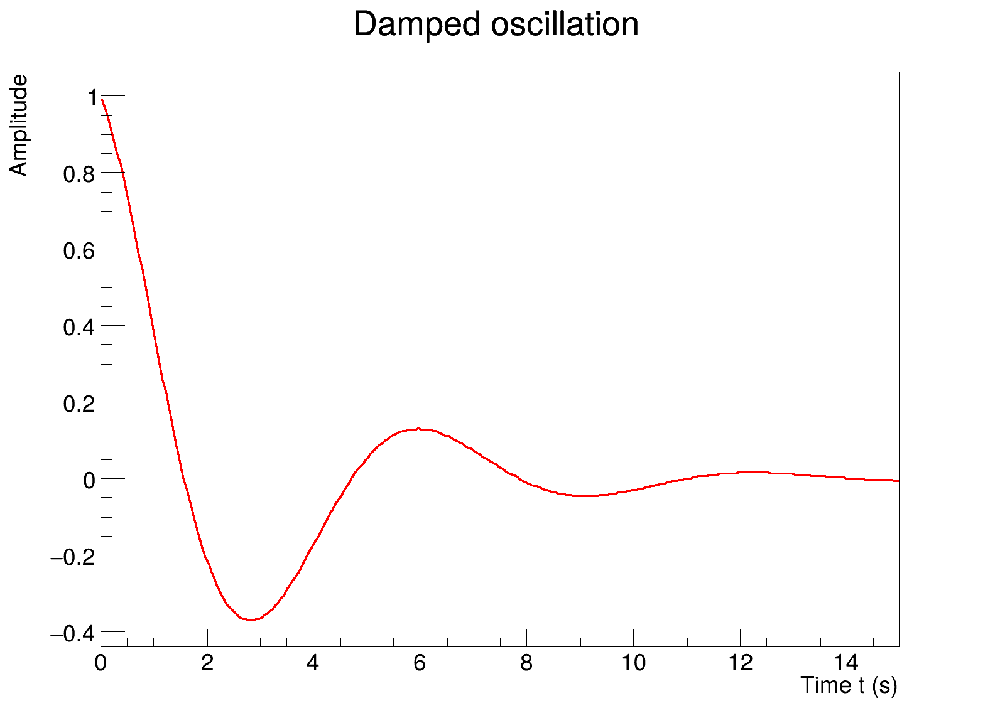

`SetNpx(300)` makes the curve smoother: with the default of 100 points over 15 units, the
peaks look slightly angular. Zoom into `damped.pdf` and `damped.png`: the PDF stays sharp,
the PNG becomes blocky.

## A.3 Histograms

**Exercise 3.1 — The central limit theorem.**

```cpp
// Solution to Exercise 3.1 -- the central limit theorem
// The sum of N uniform random numbers looks more and more Gaussian as N grows.
void clt()
{
   int nValues[4] = {1, 2, 3, 12};
   TRandom3 rng(1);
   auto c = new TCanvas("c", "Central limit theorem", 1000, 800);
   c->Divide(2, 2);

   for (int k = 0; k < 4; k++) {
      int N = nValues[k];
      auto h = new TH1D(Form("hSum%d", N), Form("Sum of %d uniform numbers;sum;Entries", N),
                        60, 0, N);
      for (int i = 0; i < 100000; i++) {
         double sum = 0;
         for (int j = 0; j < N; j++) sum += rng.Uniform(0, 1);
         h->Fill(sum);
      }
      c->cd(k + 1);
      h->SetFillColor(kAzure - 9);
      h->SetMinimum(0);
      h->Draw();
      if (N > 1) h->Fit("gaus", "Q");   // compare with a Gaussian
   }
   c->SaveAs("clt.png");
}
```

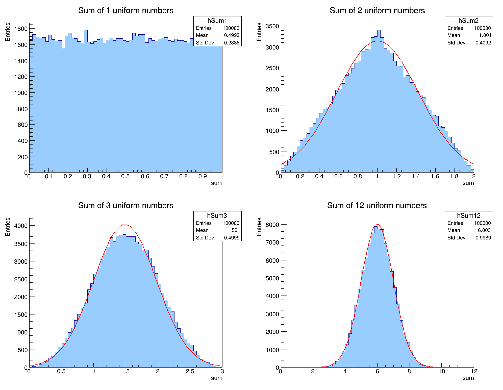

One uniform number gives a flat distribution, the sum of two gives a triangle, the sum
of three is already round, and the sum of twelve is almost exactly a Gaussian with mean
6 and standard deviation 1. This is the *central limit theorem*: sums of many random
numbers are Gaussian, whatever the distribution of the individual numbers. It is why
Gaussians appear everywhere in physics. `Form(...)` creates a text from a pattern, like
`printf`, which is handy for making names like `hSum12`.

**Exercise 3.2 — Calculating π.**

```cpp
// Solution to Exercise 3.2 -- estimate pi with random points
// Points uniform in the square [-1,1] x [-1,1]. The fraction inside the
// circle x^2 + y^2 < 1 is (area of circle) / (area of square) = pi / 4.
void pi_mc()
{
   TRandom3 rng(3);
   auto hR2 = new TH1D("hR2", "x^{2} + y^{2} of the random points;x^{2} + y^{2};Points", 40, 0, 2);
   auto gIn  = new TGraph();       // for the picture: points inside ...
   auto gOut = new TGraph();       // ... and outside the circle

   int nTotal = 1000000, nInside = 0;
   for (int i = 0; i < nTotal; i++) {
      double x = rng.Uniform(-1, 1);
      double y = rng.Uniform(-1, 1);
      double r2 = x * x + y * y;
      hR2->Fill(r2);
      bool inside = (r2 < 1);
      if (inside) nInside++;
      if (i < 5000) {              // only draw the first 5000 points
         if (inside) gIn->AddPoint(x, y);
         else        gOut->AddPoint(x, y);
      }
   }
   double piEstimate = 4.0 * nInside / nTotal;
   double piError = 4.0 * sqrt(nInside * (1.0 - double(nInside) / nTotal)) / nTotal;
   printf("pi = %.4f +- %.4f   (true value %.4f)\n", piEstimate, piError, TMath::Pi());

   auto c = new TCanvas("c", "pi", 1200, 600);
   c->Divide(2, 1);
   c->cd(1);
   gIn->SetTitle("First 5000 points;x;y");
   gIn->SetMarkerStyle(7);
   gIn->SetMarkerColor(kBlue);
   gOut->SetMarkerStyle(7);
   gOut->SetMarkerColor(kRed);
   gIn->GetXaxis()->SetLimits(-1, 1);
   gIn->SetMinimum(-1);
   gIn->SetMaximum(1);
   gIn->Draw("AP");
   gOut->Draw("P");
   c->cd(2);
   hR2->SetMinimum(0);
   hR2->Draw();            // flat below 1 (inside the circle), falling above
   c->SaveAs("pi_mc.png");
}
```

```text
Processing pi_mc.C...
pi = 3.1414 +- 0.0016   (true value 3.1416)
```

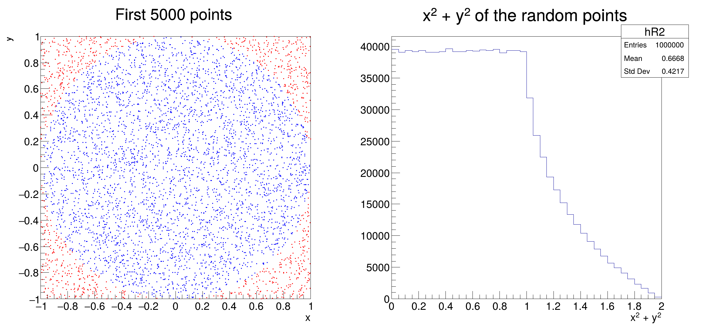

The histogram of x² + y² is flat up to 1: inside the circle, equal steps in r² cover
equal areas. Above 1, only the corners of the square are left, which get smaller and
smaller until x² + y² = 2. The error on π gets 10 times smaller when you use 100 times
more points.

## A.4 Graphs and functions

**Exercise 4.1 — Trigonometry.**

```cpp
// Solution to Exercise 4.1 -- three functions with a legend, and an integral
void trig()
{
   double twoPi = 2 * TMath::Pi();
   auto f1 = new TF1("f1", "sin(x)", 0, twoPi);
   auto f2 = new TF1("f2", "cos(x)", 0, twoPi);
   auto f3 = new TF1("f3", "sin(x)*cos(x)", 0, twoPi);
   f1->SetLineColor(kBlue);
   f2->SetLineColor(kRed);
   f3->SetLineColor(kGreen + 2);
   f3->SetLineStyle(2);

   auto c = new TCanvas("c", "Trig", 800, 600);
   c->SetGrid();
   f1->SetTitle("Trigonometric functions;x (rad);f(x)");
   f1->SetMinimum(-1.2);
   f1->SetMaximum(1.6);
   f1->Draw();
   f2->Draw("SAME");
   f3->Draw("SAME");

   auto leg = new TLegend(0.65, 0.75, 0.88, 0.88);
   leg->AddEntry(f1, "sin(x)", "l");
   leg->AddEntry(f2, "cos(x)", "l");
   leg->AddEntry(f3, "sin(x) cos(x)", "l");
   leg->Draw();
   c->SaveAs("trig.png");

   auto f4 = new TF1("f4", "sin(x)^2", 0, TMath::Pi());
   std::cout << "Integral of sin^2 from 0 to pi = " << f4->Integral(0, TMath::Pi())
             << "  (pi/2 = " << TMath::Pi() / 2 << ")" << std::endl;
}
```

```text
Processing trig.C...
Integral of sin^2 from 0 to pi = 1.5708  (pi/2 = 1.5708)
```

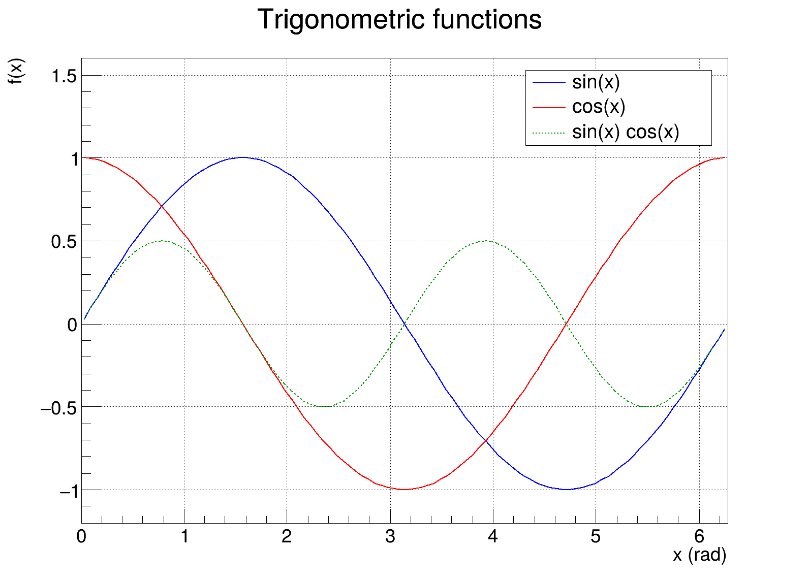

**Exercise 4.2 — Ohm's law.**

```cpp
// Solution to Exercise 4.2 -- plot Ohm's-law measurements with error bars
void ohm()
{
   auto g = new TGraphErrors("ohm.txt");
   g->SetTitle("Ohm's law;Current I (mA);Voltage V (V)");
   g->SetMarkerStyle(20);
   g->SetMarkerColor(kBlue + 1);

   auto c = new TCanvas("c", "Ohm", 800, 600);
   c->SetGrid();
   g->Draw("AP");
   c->SaveAs("ohm.png");
}
```

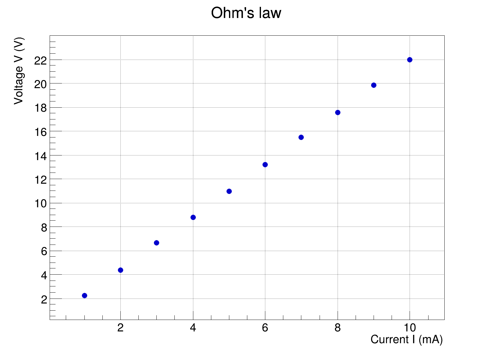

## A.5 Fitting

**Exercise 5.1 — The resistance.**

```cpp
// Solution to Exercise 5.1 -- fit a straight line and get the resistance
void ohm_fit()
{
   gStyle->SetOptFit(111);
   gStyle->SetStatX(0.88);     // statistics box in the empty lower-right corner
   gStyle->SetStatY(0.35);
   auto g = new TGraphErrors("ohm.txt");
   g->SetTitle("Ohm's law;Current I (mA);Voltage V (V)");
   g->SetMarkerStyle(20);

   auto c = new TCanvas("c", "Ohm fit", 800, 600);
   c->SetGrid();
   g->Fit("pol1");
   g->Draw("AP");
   c->SaveAs("ohm_fit.png");

   TF1 *line = g->GetFunction("pol1");
   // V in volts, I in mA, so the slope is in V/mA = kOhm
   printf("R = %.3f +- %.3f kOhm\n", line->GetParameter(1), line->GetParError(1));
}
```

```text
Processing ohm_fit.C...
****************************************
Minimizer is Minuit2 / Migrad
Chi2                      =      1.09209
NDf                       =            8
Edm                       =  2.65996e-11
NCalls                    =           72
p0                        =    0.0289339   +/-   0.0824023
p1                        =      2.19547   +/-   0.0132804
R = 2.195 +- 0.013 kOhm
```

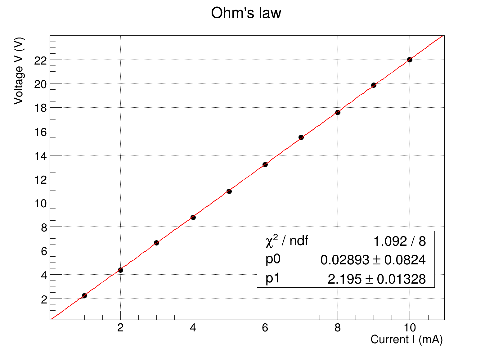

The resistance is R = 2.195 ± 0.013 kΩ, and the intercept is compatible with zero, as it
should be for a resistor. χ²/ndf = 1.09/8 is small, which suggests that the errors of
0.05 V in the file are a bit larger than the real scatter of the points.

**Exercise 5.2 — The muon lifetime.**

```cpp
// Solution to Exercise 5.2 -- measure the muon lifetime with an exponential fit
void muon_lifetime()
{
   gStyle->SetOptFit(111);
   auto h = new TH1D("h", "Muon decay times;t (#mus);Decays / 0.25 #mus", 40, 0, 10);
   TRandom3 rng(3);
   for (int i = 0; i < 5000; i++) h->Fill(rng.Exp(2.197));   // true lifetime 2.197 us

   auto c = new TCanvas("c", "Muon lifetime", 800, 600);
   c->SetLogy();
   h->Fit("expo", "L");          // expo = exp([0] + [1]*t); likelihood fit
   h->SetMarkerStyle(20);
   h->Draw("E");
   c->SaveAs("muon_lifetime.png");

   TF1 *f = h->GetFunction("expo");
   double slope = f->GetParameter(1), slopeErr = f->GetParError(1);
   double tau = -1.0 / slope;
   double tauErr = tau * slopeErr / std::abs(slope);
   printf("Lifetime = %.3f +- %.3f us   (true value 2.197 us)\n", tau, tauErr);
}
```

```text
Processing muon_lifetime.C...
****************************************
Minimizer is Minuit2 / Migrad
MinFCN                    =      15.7982
Chi2                      =      31.5964
NDf                       =           38
Edm                       =  1.01899e-06
NCalls                    =           44
Constant                  =      6.34435   +/-   0.020924
Slope                     =    -0.454031   +/-   0.00732798
Lifetime = 2.202 +- 0.036 us   (true value 2.197 us)
```

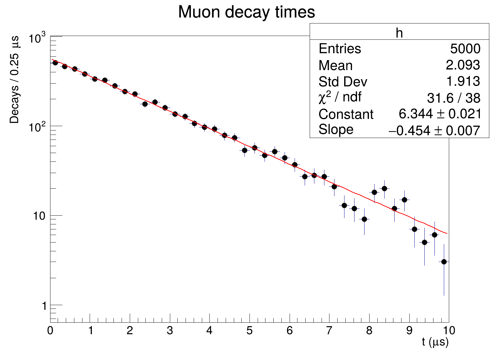

The result, 2.202 ± 0.036 μs, agrees with 2.197 μs. If you use a different random seed,
you get a slightly different value each time; about two times out of three it is within
one error (0.036 μs) of the true value. On a logarithmic y axis an exponential is a
straight line, which makes it easy to see whether the data follow an exponential.

## A.6 ROOT files

**Exercise 6.1 — Save and read back.**

```cpp
// Solution to Exercise 6.1 -- write histograms into a folder of a file, read one back
void clt_write_read()
{
   // ---- write ----
   TFile *out = TFile::Open("clt.root", "RECREATE");
   TDirectory *dir = out->mkdir("sums");
   dir->cd();
   TRandom3 rng(1);
   int nValues[4] = {1, 2, 3, 12};
   for (int N : nValues) {
      auto h = new TH1D(Form("hSum%d", N), Form("Sum of %d uniform numbers;sum;Entries", N),
                        60, 0, N);
      for (int i = 0; i < 100000; i++) {
         double sum = 0;
         for (int j = 0; j < N; j++) sum += rng.Uniform();
         h->Fill(sum);
      }
   }
   out->Write();
   out->Close();

   // ---- read back ----
   TFile *in = TFile::Open("clt.root");
   in->ls();
   auto h12 = in->Get<TH1D>("sums/hSum12");
   if (!h12) { std::cout << "hSum12 not found!" << std::endl; return; }
   std::cout << "hSum12: mean = " << h12->GetMean() << " (expected 6), std dev = "
             << h12->GetStdDev() << " (expected 1)" << std::endl;
   auto c = new TCanvas("c", "Read back", 800, 600);
   h12->Draw();
   c->SaveAs("clt_read.png");
}
```

```text
Processing clt_write_read.C...
TFile**		clt.root
 TFile*		clt.root
  KEY: TDirectoryFile	sums;1	sums
hSum12: mean = 6.00301 (expected 6), std dev = 0.998899 (expected 1)
```


Note that the folder `sums` is shown by `ls()`, but not its contents. Use
`rootls -l clt.root:sums` to look inside it.

## A.7 Trees

**Exercise 7.1 — Compare selections.**

```cpp
// Solution to Exercise 7.1 -- compare two selections from a tree, normalised
void tree_compare()
{
   gStyle->SetOptStat(0);
   TFile *file = TFile::Open("../../macros/ch07_trees/toy_tree.root");
   auto tree = file->Get<TTree>("events");

   // "goff" = graphics off: fill the histograms without drawing them
   tree->Draw("energy>>hAll(50,0,100)", "", "goff");
   tree->Draw("energy>>hMany(50,0,100)", "nHits > 20", "goff");
   auto hAll  = (TH1F *)gDirectory->Get("hAll");
   auto hMany = (TH1F *)gDirectory->Get("hMany");

   hAll->Scale(1.0 / hAll->Integral());
   hMany->Scale(1.0 / hMany->Integral());
   hAll->SetTitle("Energy, normalised to unit area;Energy (GeV);Fraction of events");
   hAll->SetLineColor(kBlue);
   hMany->SetLineColor(kRed);
   hAll->SetLineWidth(2);
   hMany->SetLineWidth(2);
   hAll->SetMaximum(1.2 * std::max(hAll->GetMaximum(), hMany->GetMaximum()));

   auto c = new TCanvas("c", "Compare", 800, 600);
   hAll->Draw("HIST");
   hMany->Draw("HIST SAME");
   auto leg = new TLegend(0.55, 0.76, 0.88, 0.88);
   leg->AddEntry(hAll, "All events", "l");
   leg->AddEntry(hMany, "nHits > 20", "l");
   leg->Draw();
   c->SaveAs("tree_compare.png");
}
```

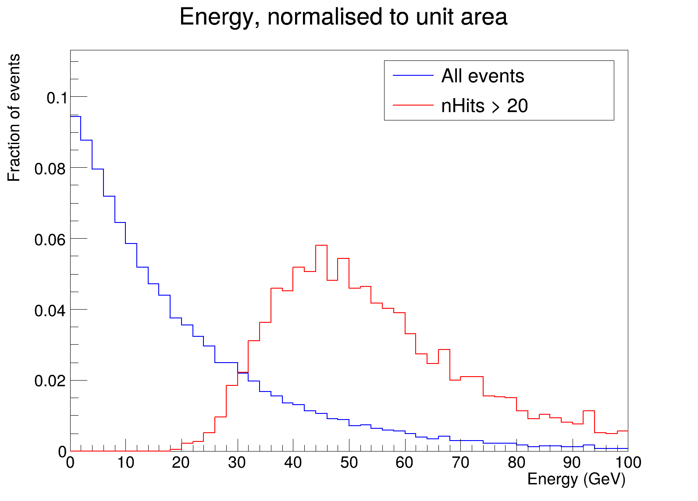

The number of hits grows with the energy (on average one hit per 2 GeV). To have more
than 20 hits, an event needs an energy of roughly 20 GeV or more, so the selected events
have no low energies. A cut on one variable changes the distribution of other, correlated
variables — something to keep in mind in every analysis.

**Exercise 7.2 — Count in a loop.**

```cpp
// Solution to Exercise 7.2 -- count events in a loop, then check with a one-liner
void tree_count()
{
   TFile *file = TFile::Open("../../macros/ch07_trees/toy_tree.root");
   auto tree = file->Get<TTree>("events");

   double energy, x, y;
   tree->SetBranchAddress("energy", &energy);
   tree->SetBranchAddress("x", &x);
   tree->SetBranchAddress("y", &y);

   int count = 0;
   for (Long64_t i = 0; i < tree->GetEntries(); i++) {
      tree->GetEntry(i);
      if (energy > 50 && sqrt(x * x + y * y) < 10) count++;
   }
   std::cout << "Loop count     : " << count << std::endl;
   std::cout << "GetEntries(cut): "
             << tree->GetEntries("energy > 50 && sqrt(x*x + y*y) < 10") << std::endl;
}
```

```text
Processing tree_count.C...
Loop count     : 1616
GetEntries(cut): 1616
```

Both methods agree. The one-line `GetEntries` is perfect for checks like this.

## A.8 PyROOT

**Exercise 8.1 — The muon lifetime in Python.**

```python
# Solution to Exercise 8.1 -- the muon lifetime fit in Python, data made with NumPy
import ROOT
import numpy as np

ROOT.gStyle.SetOptFit(111)
times = np.random.default_rng(4).exponential(2.197, size=5000)   # microseconds

h = ROOT.TH1D("h", "Muon decay times (Python);t (#mus);Decays / 0.25 #mus", 40, 0, 10)
h.Fill(times)

c = ROOT.TCanvas("c", "Muon lifetime", 800, 600)
c.SetLogy()
h.Fit("expo", "L")
h.SetMarkerStyle(20)
h.Draw("E")
c.SaveAs("muon_lifetime_py.png")

f = h.GetFunction("expo")
tau = -1 / f.GetParameter(1)
tau_err = tau * f.GetParError(1) / abs(f.GetParameter(1))
print(f"Lifetime = {tau:.3f} +- {tau_err:.3f} us   (true value 2.197 us)")
```

```text
****************************************
Minimizer is Minuit2 / Migrad
MinFCN                    =      16.9551
Chi2                      =      33.9103
NDf                       =           38
Edm                       =  1.67688e-07
NCalls                    =           38
Constant                  =      6.34915   +/-   0.0209179
Slope                     =    -0.456617   +/-   0.00735609
Lifetime = 2.190 +- 0.035 us   (true value 2.197 us)
```

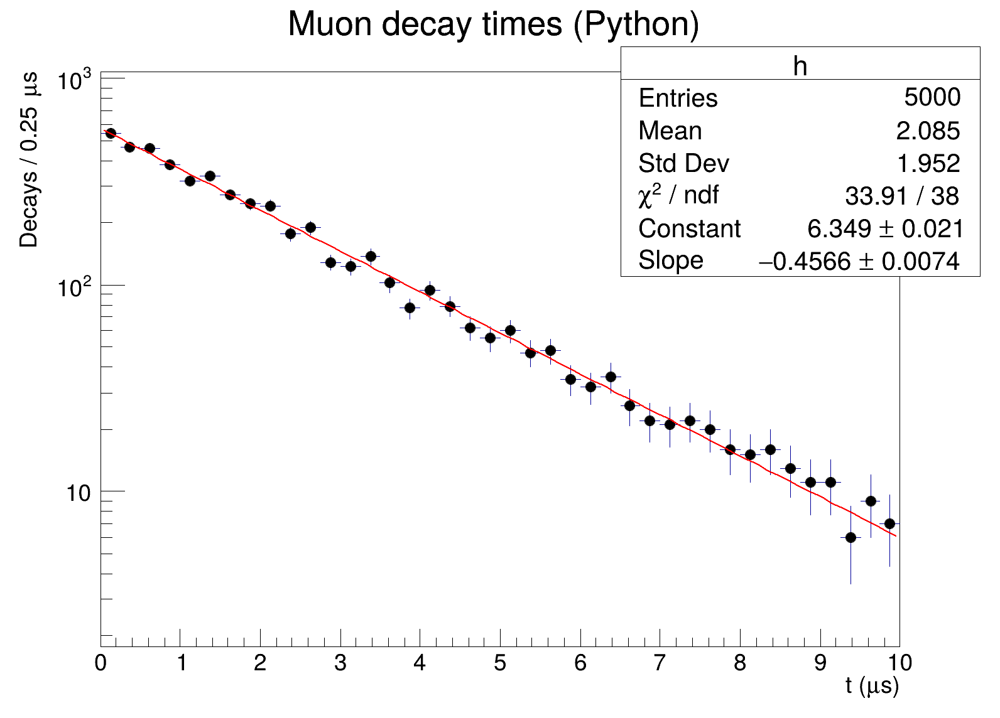

## A.9 RDataFrame

**Exercise 9.1 — A small analysis.**

```python
# Solution to Exercise 9.1 -- a small RDataFrame analysis
import ROOT

df = ROOT.RDataFrame("events", "../../macros/ch07_trees/toy_tree.root")
sel = (df.Define("r", "sqrt(x*x + y*y)")
         .Filter("energy > 30", "Energy > 30 GeV")
         .Filter("nHits >= 10", "At least 10 hits"))

h = sel.Histo1D(("h_r", "Selected events;r (cm);Events", 40, 0, 40), "r")
mean_r = sel.Mean("r")
report = df.Report()

c = ROOT.TCanvas("c", "RDF exercise", 800, 600)
h.Draw()
c.SaveAs("rdf_exercise.png")

print(f"Mean r of selected events: {mean_r.GetValue():.2f} cm")
report.Print()

sel.Snapshot("selected", "selected.root", ["energy", "r"])
print("Wrote selected.root")
```

```text
Mean r of selected events: 12.45 cm
Energy > 30 GeV     : pass=11079      all=50000      -- eff=22.16 % cumulative eff=22.16 %
At least 10 hits    : pass=11026      all=11079      -- eff=99.52 % cumulative eff=22.05 %
Wrote selected.root
```

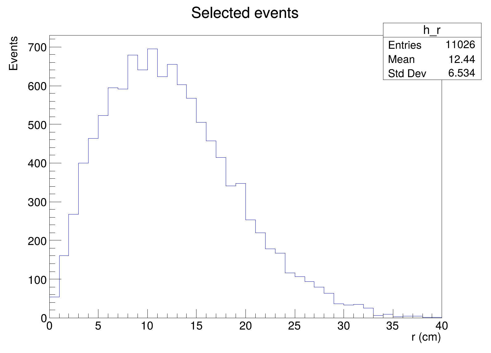

Almost every event above 30 GeV also has 10 or more hits, so the second cut removes
very few events (99.5% pass). The report calls this the efficiency of the cut.

## A.10 Mini-project: worked solution (spoiler!)

### The analysis

Here is one complete solution of Steps 2–8, in Python. It is also in
`macros/ch10_project/dimuon_analysis.py`.

```python
# dimuon_analysis.py -- mini-project solution: find the hidden particle
# Run with:   python dimuon_analysis.py     (run make_dimuon_toy.C first)
#
# Steps: select events with two muons of opposite charge, compute their
# invariant mass, histogram it, fit the peak, report mass / width / yield,
# and make a clean final plot.
import ROOT

ROOT.gStyle.SetOptStat(0)

# ---------------------------------------------------------------- 1. Data
df = ROOT.RDataFrame("Events", "dimuon_toy.root")

# ---------------------------------------------------------------- 2. Selection
df_2mu = df.Filter("nMuon == 2", "Exactly two muons")
df_os = df_2mu.Filter("Muon_charge[0] != Muon_charge[1]", "Opposite charge")

# Invariant mass of the two muons (a ready-made RVec helper function)
df_mass = df_os.Define("Dimuon_mass",
                       "ROOT::VecOps::InvariantMass(Muon_pt, Muon_eta, Muon_phi, Muon_mass)")

# ---------------------------------------------------------------- 3. Histograms
h_full = df_mass.Histo1D(("h_full", "Opposite-charge muon pairs;m_{#mu#mu} (GeV);Events / 40 MeV",
                          250, 0.0, 10.0), "Dimuon_mass")
h_zoom = df_mass.Histo1D(("h_zoom", ";m_{#mu#mu} (GeV);Events / 10 MeV",
                          100, 2.6, 3.6), "Dimuon_mass")
report = df.Report()

# Overview plot: where is the peak?
c1 = ROOT.TCanvas("c1", "Overview", 800, 600)
h_full.SetLineColor(ROOT.kBlue + 1)
h_full.Draw("HIST")
c1.SaveAs("dimuon_overview.png")

# ---------------------------------------------------------------- 4. Fit
h = h_zoom.GetValue()            # the real TH1D behind the booked result
peak_guess = h.GetBinCenter(h.GetMaximumBin())

model = ROOT.TF1("model", "gaus(0) + expo(3)", 2.6, 3.6)
model.SetParNames("Height", "Mass", "Width", "BkgConst", "BkgSlope")
model.SetParameters(h.GetMaximum(), peak_guess, 0.03, 6.0, -0.5)
model.SetNpx(500)
model.SetLineColor(ROOT.kRed)
model.SetLineWidth(3)
result = h.Fit(model, "S R 0")   # S = keep result, R = function range, 0 = draw later

mass, mass_err = model.GetParameter(1), model.GetParError(1)
width, width_err = abs(model.GetParameter(2)), model.GetParError(2)

# Signal and background parts of the model
sig = ROOT.TF1("sig", "gaus", 2.6, 3.6)
sig.SetParameters(model.GetParameter(0), mass, width)
bkg = ROOT.TF1("bkg", "expo", 2.6, 3.6)
bkg.SetParameters(model.GetParameter(3), model.GetParameter(4))
bkg.SetLineColor(ROOT.kGreen + 2)
bkg.SetLineStyle(2)
bkg.SetLineWidth(3)

# Counting: events within +- 3 sigma of the peak
bw = h.GetBinWidth(1)
lo, hi = mass - 3 * width, mass + 3 * width
S = sig.Integral(lo, hi) / bw
B = bkg.Integral(lo, hi) / bw
n_signal = sig.Integral(2.6, 3.6) / bw
significance = S / (S + B) ** 0.5

# ---------------------------------------------------------------- 5. Results
print("\n================ RESULTS ================")
print(f"Mass        = {1000*mass:.1f} +- {1000*mass_err:.1f} MeV")
print(f"Width       = {1000*width:.1f} +- {1000*width_err:.1f} MeV (detector resolution)")
print(f"Signal      = {n_signal:.0f} events")
print(f"In +-3 sigma: S = {S:.0f}, B = {B:.0f}, S/B = {S/B:.2f}")
print(f"Significance S/sqrt(S+B) = {significance:.1f}")
print(f"chi2/ndf    = {result.Chi2():.1f} / {result.Ndf()}")
print("PDG: J/psi mass = 3096.9 MeV")
print("=========================================\n")
report.Print()

# ---------------------------------------------------------------- 6. Final plot
c2 = ROOT.TCanvas("c2", "Final plot", 800, 600)
h.SetMarkerStyle(20)
h.SetMarkerSize(0.8)
h.SetMaximum(1.35 * h.GetMaximum())
h.Draw("E")
bkg.Draw("SAME")
model.Draw("SAME")

leg = ROOT.TLegend(0.60, 0.70, 0.88, 0.86)
leg.SetBorderSize(0)
leg.AddEntry(h, "Toy data", "pe")
leg.AddEntry(model, "Gaussian + exponential fit", "l")
leg.AddEntry(bkg, "Background part", "l")
leg.Draw()

text = ROOT.TLatex()
text.SetNDC()
text.SetTextFont(42)
text.SetTextSize(0.037)
text.DrawLatex(0.15, 0.84, "#bf{ROOT tutorial} mini-project")
text.DrawLatex(0.15, 0.78, f"m = {1000*mass:.1f} #pm {1000*mass_err:.1f} MeV")
text.DrawLatex(0.15, 0.73, f"#sigma = {1000*width:.1f} #pm {1000*width_err:.1f} MeV")
text.DrawLatex(0.15, 0.68, f"N_{{signal}} = {n_signal:.0f}")
c2.SaveAs("dimuon_fit.png")

# ---------------------------------------------------------------- 7. Save
out = ROOT.TFile("dimuon_results.root", "RECREATE")
h_full.Write()
h.Write()
model.Write()
out.Close()
print("Saved dimuon_overview.png, dimuon_fit.png and dimuon_results.root")
```

```text
****************************************
Minimizer is Minuit2 / Migrad
Chi2                      =      108.948
NDf                       =           95
Edm                       =  4.47215e-08
NCalls                    =          149
Height                    =      471.171   +/-   11.9814
Mass                      =      3.09609   +/-   0.00082117
Width                     =    0.0334608   +/-   0.000776435
BkgConst                  =      6.10536   +/-   0.081913
BkgSlope                  =    -0.308468   +/-   0.0265361

================ RESULTS ================
Mass        = 3096.1 +- 0.8 MeV
Width       = 33.5 +- 0.8 MeV (detector resolution)
Signal      = 3952 events
In +-3 sigma: S = 3941, B = 3463, S/B = 1.14
Significance S/sqrt(S+B) = 45.8
chi2/ndf    = 108.9 / 95
PDG: J/psi mass = 3096.9 MeV
=========================================

Exactly two muons   : pass=147669     all=279657     -- eff=52.80 % cumulative eff=52.80 %
Opposite charge     : pass=104822     all=147669     -- eff=70.98 % cumulative eff=37.48 %
Saved dimuon_overview.png, dimuon_fit.png and dimuon_results.root
```

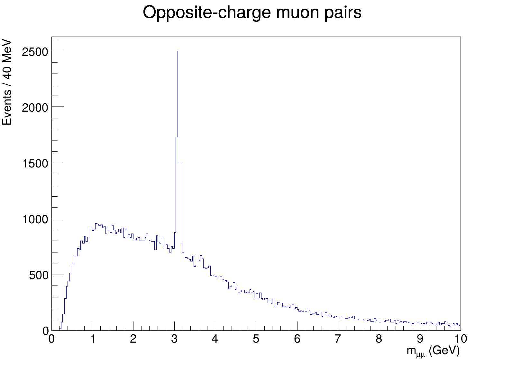

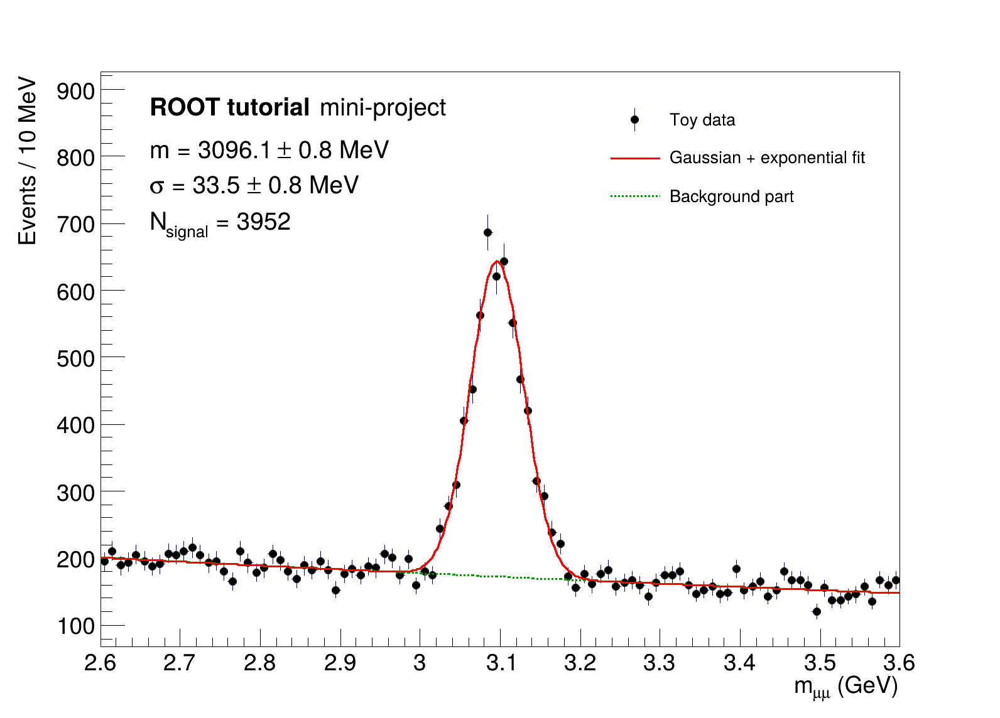

**The answer.** The peak is at 3096.1 ± 0.8 MeV. The Particle Data Group lists the
**J/ψ meson** (a bound state of a charm quark and its antiquark) at 3096.9 MeV, and it
does decay to μ⁺μ⁻. Our result agrees within one error. The J/ψ was discovered in 1974,
in two experiments at the same time, in exactly this kind of plot — the discovery is
known as the *November Revolution* of particle physics.

The width of 33.5 MeV is not the natural width of the J/ψ (which is only 0.09 MeV): it
is the resolution of our (toy) detector, which measures the muon momenta with an
uncertainty of 1.5%.

### Extra task A: same-charge pairs

```python
# dimuon_like_sign.py -- extra task: compare opposite-charge and same-charge pairs
# Run with:   python dimuon_like_sign.py     (run make_dimuon_toy.C first)
#
# A real particle decays to mu+ mu- (opposite charge). Random pairs of
# unrelated muons can have any charges. So same-charge pairs show what the
# random background looks like, and the difference shows the real pairs.
import ROOT

ROOT.gStyle.SetOptStat(0)

df = ROOT.RDataFrame("Events", "dimuon_toy.root")
df_2mu = (df.Filter("nMuon == 2")
            .Define("Dimuon_mass",
                    "ROOT::VecOps::InvariantMass(Muon_pt, Muon_eta, Muon_phi, Muon_mass)"))

bins = ("", ";m_{#mu#mu} (GeV);Pairs / 40 MeV", 150, 0.0, 6.0)
h_os = df_2mu.Filter("Muon_charge[0] != Muon_charge[1]").Histo1D(("h_os",) + bins[1:], "Dimuon_mass")
h_ss = df_2mu.Filter("Muon_charge[0] == Muon_charge[1]").Histo1D(("h_ss",) + bins[1:], "Dimuon_mass")

h_diff = h_os.Clone("h_diff")
h_diff.Add(h_ss.GetPtr(), -1)        # opposite-charge minus same-charge

c = ROOT.TCanvas("c", "Like-sign", 1200, 500)
c.Divide(2, 1)

c.cd(1)
h_os.SetLineColor(ROOT.kBlue + 1)
h_ss.SetLineColor(ROOT.kRed)
h_ss.SetFillColorAlpha(ROOT.kRed, 0.25)
h_os.SetTitle("All muon pairs")
h_os.Draw("HIST")
h_ss.Draw("HIST SAME")
leg = ROOT.TLegend(0.55, 0.72, 0.88, 0.86)
leg.SetBorderSize(0)
leg.AddEntry(h_os.GetPtr(), "Opposite charge (+ -)", "l")
leg.AddEntry(h_ss.GetPtr(), "Same charge (+ + or - -)", "f")
leg.Draw()

c.cd(2)
h_diff.SetTitle("Opposite minus same charge")
h_diff.SetLineColor(ROOT.kBlack)
h_diff.Draw("HIST")

c.SaveAs("dimuon_like_sign.png")
print("Opposite-charge pairs:", int(h_os.GetEntries()))
print("Same-charge pairs    :", int(h_ss.GetEntries()))
```

```text
Opposite-charge pairs: 104822
Same-charge pairs    : 42847
```

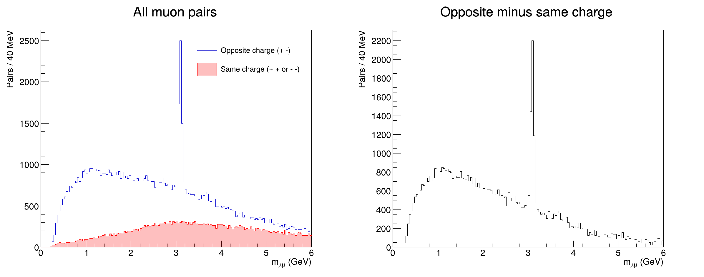

The same-charge pairs have no peak: they come only from random combinations of
unrelated muons. Subtracting them removes this *combinatorial* background. What is left
is the J/ψ peak plus a smooth spectrum of opposite-charge pairs from other processes
(in our toy data: a "continuum" of correlated pairs).

### Extra task B: the second particle

```python
# Extra task (chapter 10) -- fit BOTH peaks: two Gaussians + exponential background
import ROOT

ROOT.gStyle.SetOptStat(0)
df = ROOT.RDataFrame("Events", "../../macros/ch10_project/dimuon_toy.root")
df_mass = (df.Filter("nMuon == 2")
             .Filter("Muon_charge[0] != Muon_charge[1]")
             .Define("m", "ROOT::VecOps::InvariantMass(Muon_pt, Muon_eta, Muon_phi, Muon_mass)"))
h = df_mass.Histo1D(("h", ";m_{#mu#mu} (GeV);Events / 20 MeV", 75, 2.6, 4.1), "m").GetValue()

model = ROOT.TF1("model", "gaus(0) + gaus(3) + expo(6)", 2.6, 4.1)
model.SetParNames("H1", "M1", "S1", "H2", "M2", "S2", "B0", "B1")
model.SetParameters(1000, 3.10, 0.03, 50, 3.69, 0.04, 6.5, -0.3)
model.SetNpx(600)

c = ROOT.TCanvas("c", "Two peaks", 800, 600)
h.Fit(model, "R")

bw = h.GetBinWidth(1)
root2pi = (2 * ROOT.TMath.Pi()) ** 0.5
n1 = model.GetParameter(0) * abs(model.GetParameter(2)) * root2pi / bw
n2 = model.GetParameter(3) * abs(model.GetParameter(5)) * root2pi / bw
print(f"Peak 1: m = {1000*model.GetParameter(1):.1f} MeV, N = {n1:.0f}")
print(f"Peak 2: m = {1000*model.GetParameter(4):.1f} MeV, N = {n2:.0f}")
print(f"Ratio N2/N1 = {n2/n1:.3f}")

h.SetMarkerStyle(20)
h.SetMarkerSize(0.7)
h.Draw("E")
c.SaveAs("psi2s_fit.png")
```

```text
****************************************
Minimizer is Minuit2 / Migrad
Chi2                      =      71.2498
NDf                       =           67
Edm                       =  2.70687e-06
NCalls                    =          241
H1                        =      935.473   +/-   22.7726
M1                        =       3.0963   +/-   0.000843254
S1                        =    0.0340091   +/-   0.000778247
H2                        =      46.8051   +/-   9.1654
M2                        =       3.6611   +/-   0.0123503
S2                        =    0.0535435   +/-   0.0131744
B0                        =      6.91592   +/-   0.0534264
B1                        =    -0.347698   +/-   0.0163379
Peak 1: m = 3096.3 MeV, N = 3987
Peak 2: m = 3661.1 MeV, N = 314
Ratio N2/N1 = 0.079
```

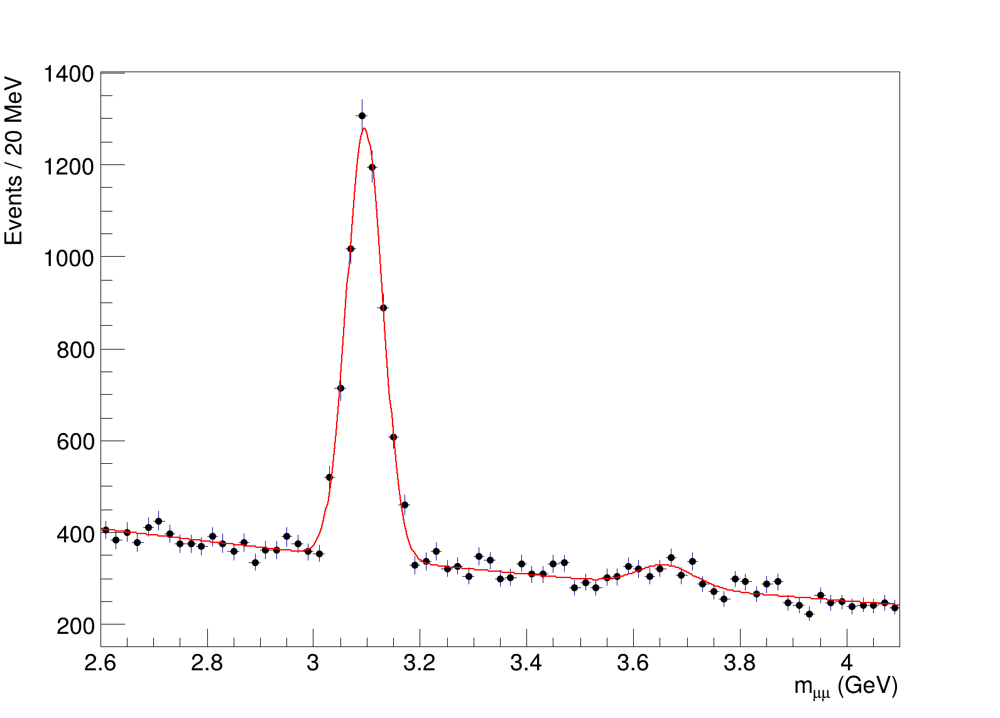

The second peak, at 3661 ± 12 MeV, is the **ψ(2S)** (also called ψ′), an excited state of
the J/ψ, at 3686.1 MeV in the PDG tables. With only about 300 signal events on a large
background, our measurement is much less precise, and it is two errors away from the
true value — this happens about one time in twenty. The ratio of the two peaks has a
large uncertainty (about 30%) for the same reason.

### What is inside the toy data

The generator `make_dimuon_toy.C` hides two particles in the data: the J/ψ (3.0969 GeV,
in 3% of the events) and the ψ(2S) (3.6861 GeV, in 0.15% of the events). They are
produced with a realistic spread of momenta and decay into two muons. The rest of the
events contain either a pair of muons with a smoothly falling mass distribution, or two
unrelated muons. The detector only sees muons with $p_\mathrm{T}$ > 1 GeV and |η| < 2.4, and
measures $p_\mathrm{T}$ with 1.5% resolution.

```cpp
// make_dimuon_toy.C -- make the toy dataset for the mini-project
// Run with:   root -l make_dimuon_toy.C        (takes a few seconds)
//
// Writes dimuon_toy.root with a tree "Events". Each event has a few muons.
// The branch names are the same as in the CMS Open Data dimuon sample, so
// the same analysis code works on real data (see the bonus section).
//
// Hidden inside: some events contain a particle that decays to mu+ mu-.
// Your job in the mini-project is to find it and measure its mass.
// (Organisers: please don't tell the participants what is inside!)

void make_dimuon_toy(int nEvents = 300000)
{
   const double muMass = 0.105658;           // GeV
   TRandom3 rng(2026);

   TFile *file = TFile::Open("dimuon_toy.root", "RECREATE");
   auto tree = new TTree("Events", "Toy dimuon events");

   UInt_t nMuon;
   std::vector<float> Muon_pt, Muon_eta, Muon_phi, Muon_mass;
   std::vector<int>   Muon_charge;
   tree->Branch("nMuon", &nMuon);
   tree->Branch("Muon_pt", &Muon_pt);
   tree->Branch("Muon_eta", &Muon_eta);
   tree->Branch("Muon_phi", &Muon_phi);
   tree->Branch("Muon_mass", &Muon_mass);
   tree->Branch("Muon_charge", &Muon_charge);

   // Detector: muons are seen if pT > 1 GeV and |eta| < 2.4;
   // the pT is measured with 1.5% resolution.
   auto addMuon = [&](const TLorentzVector &p, int charge) {
      if (p.Pt() < 1.0 || std::abs(p.Eta()) > 2.4) return;
      Muon_pt.push_back(p.Pt() * (1.0 + rng.Gaus(0, 0.015)));
      Muon_eta.push_back(p.Eta());
      Muon_phi.push_back(p.Phi());
      Muon_mass.push_back(muMass);
      Muon_charge.push_back(charge);
   };

   // A particle of mass m with random pT and rapidity, decaying to mu+ mu-
   TGenPhaseSpace decay;
   double daughterMasses[2] = {muMass, muMass};
   auto makePair = [&](double m) {
      double pt  = rng.Exp(2.0) + rng.Exp(2.0);
      double y   = rng.Uniform(-2.5, 2.5);
      double phi = rng.Uniform(-TMath::Pi(), TMath::Pi());
      double mT  = sqrt(m * m + pt * pt);
      TLorentzVector parent(pt * cos(phi), pt * sin(phi), mT * sinh(y), mT * cosh(y));
      decay.SetDecay(parent, 2, daughterMasses);
      decay.Generate();
      addMuon(*decay.GetDecay(0), +1);
      addMuon(*decay.GetDecay(1), -1);
   };

   // A single unrelated muon
   auto randomMuon = [&]() {
      TLorentzVector p;
      p.SetPtEtaPhiM(0.8 + rng.Exp(1.2), rng.Uniform(-2.6, 2.6),
                     rng.Uniform(-TMath::Pi(), TMath::Pi()), muMass);
      addMuon(p, rng.Uniform() < 0.5 ? +1 : -1);
   };

   for (int i = 0; i < nEvents; i++) {
      Muon_pt.clear(); Muon_eta.clear(); Muon_phi.clear();
      Muon_mass.clear(); Muon_charge.clear();

      double u = rng.Uniform();
      if (u < 0.030)       makePair(3.0969);             // the hidden particle
      else if (u < 0.0315) makePair(3.6861);             // a smaller one
      else if (u < 0.55)   makePair(0.25 + rng.Exp(0.9) + rng.Exp(0.9)); // smooth continuum
      else { randomMuon(); randomMuon(); }               // unrelated pair

      int nExtra = rng.Poisson(0.15);                    // extra random muons
      for (int k = 0; k < nExtra; k++) randomMuon();

      nMuon = Muon_pt.size();
      if (nMuon > 0) tree->Fill();
   }

   tree->Write();
   std::cout << "Wrote " << tree->GetEntries() << " events to dimuon_toy.root" << std::endl;
   file->Close();
}
```

### Extra task D: real CMS data

```python
# cms_open_data.py -- BONUS: the same analysis on REAL data from the CMS experiment
# Run with:   python cms_open_data.py
#
# Needs an internet connection. The file (2.2 GB, 61.5 million events) is read
# over the network from CERN's open-data server; only the parts we use are
# downloaded. Reading the first 2 million events takes about a minute or two.
# Set N_EVENTS = 0 to use all 61.5 million events (much longer!).
import ROOT

N_EVENTS = 2_000_000
URL = ("root://eospublic.cern.ch//eos/opendata/cms/derived-data/"
       "AOD2NanoAODOutreachTool/Run2012BC_DoubleMuParked_Muons.root")

df = ROOT.RDataFrame("Events", URL)
if N_EVENTS > 0:
    df = df.Range(N_EVENTS)          # only the first N events
else:
    ROOT.EnableImplicitMT()          # (Range cannot be used with multi-threading)
    df = ROOT.RDataFrame("Events", URL)

# Exactly the same selection as for the toy data
df_mass = (df.Filter("nMuon == 2", "Exactly two muons")
             .Filter("Muon_charge[0] != Muon_charge[1]", "Opposite charge")
             .Define("Dimuon_mass",
                     "ROOT::VecOps::InvariantMass(Muon_pt, Muon_eta, Muon_phi, Muon_mass)"))

# Logarithmic bins, so that both low and high masses look good on a log axis
import numpy as np
edges = np.logspace(np.log10(0.25), np.log10(300), 1001)
h = df_mass.Histo1D(ROOT.RDF.TH1DModel("h", ";m_{#mu#mu} (GeV);Events / bin",
                                       len(edges) - 1, edges), "Dimuon_mass")
report = df_mass.Report()

ROOT.gStyle.SetOptStat(0)
c = ROOT.TCanvas("c", "CMS open data", 900, 650)
c.SetLogx()
c.SetLogy()
h.SetLineColor(ROOT.kBlue + 1)
h.SetMaximum(5 * h.GetMaximum())       # room for the labels
h.Draw("HIST")

# Name the peaks. Coordinates are (mass in GeV, height in events).
label = ROOT.TLatex()
label.SetTextFont(42)
label.SetTextSize(0.04)
label.SetTextAlign(21)                     # centred, above the point
peak_names = [(0.55, "#eta"), (0.78, "#rho,#omega"), (1.02, "#phi"), (3.10, "J/#psi"),
              (3.69, "#psi'"), (9.9, "#Upsilon"), (91.2, "Z")]
for mass, name in peak_names:
    # highest bin within +-5% of the mass
    height = max(h.GetBinContent(b) for b in range(h.FindBin(0.95 * mass), h.FindBin(1.05 * mass) + 1))
    label.DrawLatex(mass, 1.4 * height, name)

title = ROOT.TLatex()
title.SetNDC()
title.SetTextFont(42)
title.SetTextSize(0.035)
title.DrawLatex(0.12, 0.92, "#bf{CMS Open Data} 2012, #sqrt{s} = 8 TeV, "
                + (f"first {N_EVENTS/1e6:.0f} million events" if N_EVENTS else "all events"))
c.SaveAs("cms_dimuon_spectrum.png")

print("Muon pairs in the plot:", int(h.GetEntries()))
report.Print()
```

```text
Muon pairs in the plot: 746358
Exactly two muons   : pass=982287     all=2000000    -- eff=49.11 % cumulative eff=49.11 %
Opposite charge     : pass=746358     all=982287     -- eff=75.98 % cumulative eff=37.32 %
```

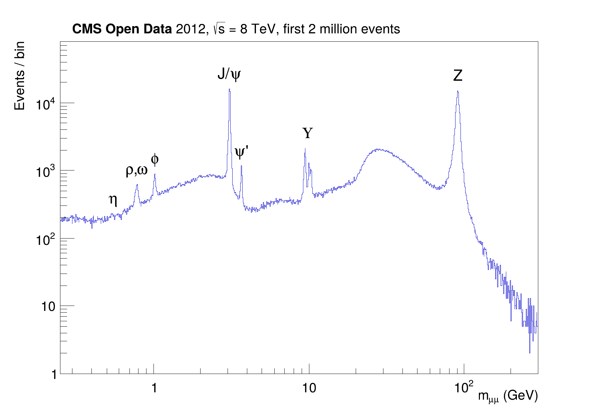

With the same selection as for the toy data, the real data show a whole century of
particle physics in one plot: the η (548 MeV), the ρ and ω (775 and 783 MeV), the φ
(1019 MeV), the J/ψ and ψ(2S), the three Υ states (9.46, 10.02 and 10.36 GeV; they
contain a bottom quark and antiquark), and the Z boson (91.2 GeV). The broad bump around
30 GeV is *not* a particle: it is caused by the way CMS selected (triggered) these events.

Logarithmic bins are used (`numpy.logspace`), so that every peak gets enough bins on the
logarithmic x axis.

# Appendix B: Quick reference

A summary of the commands used in this manual. C++ is shown; for Python, see the
translation table at the end.

## Starting ROOT

| Command | Meaning |
|---------|---------|
| `root -l` | start ROOT without the banner |
| `root -l macro.C` | start ROOT and run `macro.C` |
| `root -l -b -q 'macro.C(5)'` | run with an argument, no graphics, then quit |
| `root -l file.root` | start ROOT and open a file (as `_file0`) |
| `.x macro.C` / `.x macro.C+` | run a macro / compile and run it |
| `.L macro.C` | load a macro, then call its functions |
| `.ls` / `.q` | list objects / quit |
| `rootls -l file.root`, `rootbrowse file.root` | look inside a file |
| `hadd out.root in1.root in2.root` | merge files |

## Histograms

```cpp
auto h = new TH1D("h", "title;x title;y title", 100, 0., 10.);
h->Fill(x);                      h->Fill(x, weight);
h->Draw();     h->Draw("E");     h->Draw("HIST SAME");
h->GetEntries();  h->GetMean();  h->GetStdDev();  h->Integral();
h->GetBinContent(i);  h->FindBin(x);  h->GetBinCenter(i);
h->Scale(1. / h->Integral());    h->Sumw2();   h->Rebin(2);
h->Add(h2);   h->Divide(h1, h2, 1, 1, "B");    auto h3 = (TH1D*)h->Clone("h3");
h->SetLineColor(kRed);  h->SetFillColor(kAzure-9);  h->SetMarkerStyle(20);
h->SetMinimum(0);  h->SetMaximum(100);  h->GetXaxis()->SetRangeUser(2, 5);
auto h2 = new TH2D("h2", "t;x;y", 50, 0, 10, 50, 0, 10);  h2->Fill(x, y);  h2->Draw("COLZ");
```

## Functions and graphs

```cpp
auto f = new TF1("f", "[0]*exp(-x/[1])", 0, 10);   // also "gaus", "expo", "pol2"
f->SetParameters(1, 3);  f->Eval(2.);  f->Integral(0, 5);  f->Draw();
auto g = new TGraph(n, xArray, yArray);       g->Draw("APL");
auto ge = new TGraphErrors("data.txt");       ge->Draw("AP");   // x y ex ey
auto mg = new TMultiGraph();  mg->Add(g, "PL");  mg->Draw("A");
```

## Fitting

```cpp
h->Fit("gaus");                                  // built-in function
h->Fit("gaus", "", "", 3., 7.);                  // only between 3 and 7
auto f = new TF1("f", "gaus(0) + expo(3)", 0, 10);
f->SetParameters(100, 4, 0.5, 5, -0.3);          // starting values!
TFitResultPtr r = h->Fit(f, "S R");              // S: result, R: function range
f->GetParameter(1);  f->GetParError(1);  f->GetChisquare();  f->GetNDF();
gStyle->SetOptFit(1111);                         // fit results in the stats box
```

Options: `Q` quiet, `L` likelihood, `R` range, `S` result, `0` no drawing, `+` keep old fits.

## Canvas, style and text

```cpp
auto c = new TCanvas("c", "title", 800, 600);
c->Divide(2, 2);  c->cd(1);  gPad->SetLogy();  gPad->SetGrid();
c->SaveAs("plot.pdf");  c->SaveAs("plot.png");
gStyle->SetOptStat(0);                           // no statistics boxes
auto leg = new TLegend(0.6, 0.7, 0.88, 0.88);
leg->AddEntry(h, "Data", "pe");  leg->AddEntry(f, "Fit", "l");  leg->Draw();
auto t = new TLatex();  t->SetNDC();  t->SetTextFont(42);  t->DrawLatex(0.2, 0.8, "#sigma = 1");
```

LaTeX in ROOT text: `#alpha #beta #mu #sigma #pi #Upsilon`, `x^{2}`, `p_{T}`,
`#sqrt{s}`, `#pm`, `#rightarrow`, `#bf{bold}`, `#it{italic}`.

## Files

```cpp
TFile *f = TFile::Open("out.root", "RECREATE");   // or "READ", "UPDATE"
h->Write();   g->Write("gName");   f->Write();   f->Close();
TFile *in = TFile::Open("out.root");
auto h = in->Get<TH1D>("h");   if (!h) { /* not found! */ }
auto h2 = in->Get<TH1D>("folder/h2");
h->SetDirectory(nullptr);                          // keep h after in->Close()
```

## Trees

```cpp
// Write
auto t = new TTree("events", "title");
double e;  std::vector<double> v;
t->Branch("e", &e);  t->Branch("v", &v);
/* in the loop: */  e = ...;  v.clear(); v.push_back(...);  t->Fill();
t->Write();

// Look
t->Print();  t->Scan("e:nHits", "e > 10", "", 20);  t->GetEntries("e > 10");
t->Draw("e>>h(100,0,100)", "nHits > 5");  t->Draw("y:x", "", "COLZ");

// Loop
TTreeReader reader("events", file);
TTreeReaderValue<double> e(reader, "e");  TTreeReaderArray<double> v(reader, "v");
while (reader.Next()) { double val = *e;  for (double x : v) { /* ... */ } }

TChain chain("events");  chain.Add("run*.root");  // many files as one tree
```

## RDataFrame (Python)

```python
ROOT.EnableImplicitMT()                              # optional: all cores
df = ROOT.RDataFrame("events", "file.root")
sel = (df.Filter("energy > 30", "High energy")
         .Define("r", "sqrt(x*x + y*y)"))
n = sel.Count()                                      # lazy: booked, not run yet
h = sel.Histo1D(("h", "title;r;Events", 40, 0, 40), "r")
m = sel.Mean("r")
print(n.GetValue(), m.GetValue())                    # one loop fills everything
h.Draw()
df.Report().Print()                                  # cut flow
sel.Display(["energy", "r"], 5).Print()
sel.Snapshot("tree", "skim.root", ["energy", "r"])
arrays = sel.AsNumpy(["energy", "r"])
```

RVec in strings: `Sum(v)`, `Max(v)`, `v[v > 2]`, `Sum(v > 2)`, `v.size()`,
`ROOT::VecOps::InvariantMass(pt, eta, phi, m)`.

## C++ → Python

| C++ | Python |
|-----|--------|
| `auto h = new TH1D(...);` | `h = ROOT.TH1D(...)` |
| `h->Draw();` | `h.Draw()` |
| `gStyle->SetOptStat(0);` | `ROOT.gStyle.SetOptStat(0)` |
| `TMath::Pi()`, `kRed` | `ROOT.TMath.Pi()`, `ROOT.kRed` |
| `nullptr`, `true` | `ROOT.nullptr`, `True` |
| `*result` (RDataFrame) | `result.GetValue()` |
| `{"h", "t", 10, 0, 1}` (histogram model) | `("h", "t", 10, 0, 1)` |
